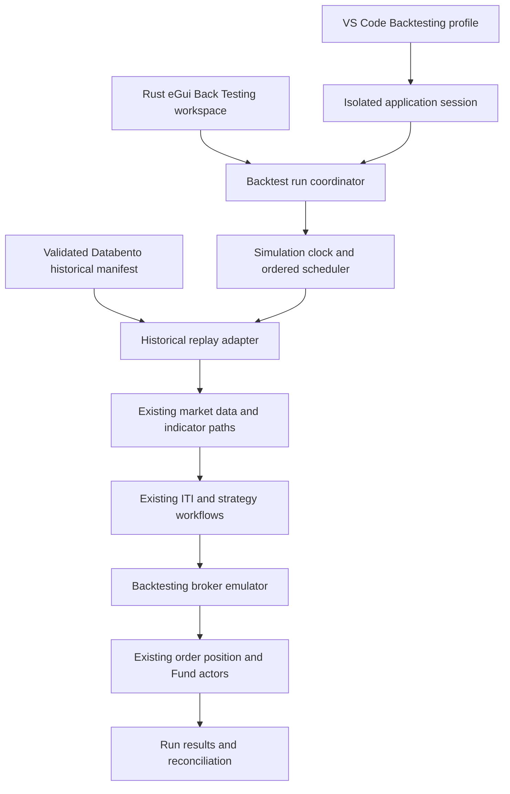

# Application Backtesting System Draft Design

**Revision:** 0.3  
**Status:** Agreed functional direction; source inventories and implementation plan created; runtime feasibility proof pending  
**Date:** 2026-11-09  
**Scope:** The existing API Server, Rust Market Data Host, Rust eGui, scheduler, PostgreSQL and ScyllaDB

## 1. Purpose and consolidated direction

Run the trading application over a historical date range using isolated backtesting storage, historical inputs and a controlled application clock. Exercise the normal strategy, order, broker, position and Fund workflows, preserving their decisions and financial accounting.

This is the single working design for the application backtesting system. It consolidates the launcher and UI, actor-based backtesting, and historical archive designs. Section 15 records the user's accepted decisions and later refinements. Section 17 records the source-based feasibility assessment and the gate before implementation planning. The accompanying [functional specification](Application-Backtesting-System-Specification-v0.1.md) defines requirements; it does not authorize application changes.

The primary initial use is functional qualification: prove that trading workflows operate correctly over historical time with no unexplained errors, no indeterminate order state and reconciled financial state. Profitability, commissions, points, drawdown and other agreed outputs remain included. Richer financial research and metrics are later work, and profitability is not an initial acceptance threshold.

The basic first version has one active run, a VS Code Backtesting launch profile, separate PostgreSQL and ScyllaDB namespaces, validated historical inputs, an application simulation clock, and a persistent Back Testing workspace in Rust eGui. Advanced experiments and archive automation remain later capabilities.

## 2. Basic first version

| Area | Proposed behavior |
| --- | --- |
| VS Code | A dedicated Backtesting profile launches a separately configured application session with full source-level debugging. |
| PostgreSQL | Backtesting databases hold application schemas, aggregate events, snapshots, projections, configuration and results. |
| ScyllaDB | Separate backtesting keyspaces hold raw historical tick data only. |
| Historical inputs | Resolve or acquire the complete required Databento dataset, including initialization history before the requested trading range. |
| Application clock | Trading code observes a server-owned historical instant that advances under replay control. |
| Normal workflows | Replay drives the existing indicators, ITI signals, strategy stages, broker emulator and financial actors. |
| Rust eGui | Add **Backtesting** immediately after **System** in the menu bar. Open a center-pane workspace with From, To, Start and Stop. |
| Run evidence | Retain the input/configuration manifest, workflow decisions, orders, fills, Fund settlement and results. |

The first version runs Development or Backtesting one at a time. It does not require parameter optimization, a new strategy algorithm, live or IBKR Paper connectivity, or an Aspire migration. It does not change current trading restrictions to generate more trades.

## 3. Existing foundations and changes needed

The repository already has an ITI replay harness and `scripts/Backtest/New-BacktestPostgres.ps1`. The latter creates a schema-only isolated PostgreSQL database and verifies its table inventory; it is not a complete application bootstrap. The existing ITI scripts are useful reference implementations, not evidence that full strategy-to-settlement replay already works.

The API actor composition root currently registers `TimeProvider.System`; the Rust Host also has a system-clock registration. The scheduler contains direct wall-clock reads. The injected `FuturesValueDateProvider` refreshes its operational date on each read and deliberately prevents date rollback. Therefore, a different DI registration alone is insufficient: clock use, timers, native code and retained state need an explicit replay boundary.

Rust eGui already supports center-pane workspaces and loaded trade tabs. The Back Testing workspace should use the same presentation conventions rather than a transient modal dialog.

## 4. Application architecture



These are logical responsibilities, not a requirement to create a new project or actor for every box.

| Responsibility | Proposed owner |
| --- | --- |
| Create, start, stop and finish a run | Event-sourced command actor owning one RunId. |
| Provision storage, prepare inputs and initialize state | Bounded orchestration Functions with durable outcomes and progress. |
| Own historical time and event advancement | One run-scoped simulation clock/controller. |
| Decode and deliver historical market inputs | Replay adapter in the Rust Market Data Host using existing normalization and publication contracts. |
| Evaluate strategies and account for trading | Existing domain actors with backtesting environment adapters. |
| Report run state and results | Query actors reading projected read models. |

Command actors own authoritative state. Query handlers use projected read models and reply through the current query actor conventions. Accepted commands and terminal outcomes are durable and idempotent. Repeated Start or Stop requests cannot allocate another run or duplicate financial activity.

## 5. Isolation and storage

### 5.1 Proposed names and ownership

Use explicit names such as `ifm_application_backtest_<run>` for PostgreSQL and `ifm_ticks_backtest_<run>` for ScyllaDB. Create fresh mutable namespaces per run. Before a newly accepted Start begins importing data, remove all prior run-owned mutable namespaces and verify that they are no longer accessible through the backtesting application. A new namespace alone does not satisfy the cleanup requirement if old mutable run stores remain available.

ScyllaDB uses keyspaces rather than PostgreSQL-style databases. It continues to store ticks only. Application events, financial state, snapshots, configuration and projections remain in PostgreSQL.

Initial deployment uses separate databases/keyspaces on the existing servers, with restricted credentials and resource limits preventing access to Development. A verified immutable historical archive and immutable configuration packages may survive a reset; mutable imports, snapshots, projections, account state and caches may not. Dedicated servers/containers are not a V1 prerequisite.

The launcher and application validate effective connections, database/keyspace names, broker mode, run ownership and messaging scope before admitting work. There is no implicit fallback to Development. A failure to resolve a backtesting setting stops startup with a specific error.

Isolation also covers:

- NATS subjects, JetStream streams/consumers, durable subscriptions and outboxes. A different API port alone is insufficient.
- Sequence/ID allocation, scheduler leases, caches and static singletons.
- API and Host ports, process ownership, logs, output directories and recovery files.
- Broker emulator storage and identifiers. Live and Paper broker endpoints are unavailable to a backtest session.

Use an E: working root, for example `E:\IFM\Backtesting`, subject to capacity validation. Retain the current separation between Docker data placement and application artifacts; this design does not relocate Docker volumes automatically.

### 5.2 Initialization baseline

1. Validate ownership, stop prior run workers, fence old messages, clear all prior run-owned mutable state, verify cleanup, and create/migrate fresh schemas/keyspaces with recorded versions.
2. Load an explicit configuration baseline: strategy definitions, parameter sets, policies, calendars, instruments, Portfolio/Fund mandates and initial capital.
3. Import historical market/reference inputs with provenance and coverage evidence.
4. Initialize aggregates through owning commands or an explicit audited bootstrap mechanism, preserving event/rebuild consistency.
5. Seed indicators, verify projected results, then admit strategy execution at the requested start boundary.

Do not clone current Development orders, positions, recovery incidents, outboxes or balances into a historical run. Starting positions, if supported later, require a separate declared baseline.

Every accepted Start executes this full path, including a new import of the requested range and calculated warm-up range into fresh working stores. It is never Resume or Continue. Import can read verified local Databento files instead of downloading them again; it cannot reuse prior mutable database rows. Reset also covers messaging/outboxes, sequence state, leases, emulator ledgers, replay offsets, timers, caches, runtime/static state and UI Output. Prefer fresh run worker processes to attempting to empty every static cache in place. A small current reset-operation journal can survive worker teardown to recover an interrupted reset; it contains control receipts, not prior trading results.

Current run results remain inspectable after Stop/Complete/Fail until the next accepted Start. That Start clears them and the previous Output. There is no V1 prior-run history browser. A manually exported read-only report, if explicitly requested, is outside working state and is never used to seed another run. Development stores, source files and unrelated Docker data are outside the reset allowlist. Cleanup failure blocks the new run rather than falling back to old state.

Aggregate repositories load the latest eligible creation event when it recreates current state. Where creation occurs only once, use a verified full-state snapshot event and replay its tail. A read-model row alone is not a substitute for an aggregate's event history.

## 6. Historical data and archive

### 6.1 Data required for the chosen strategy

Preparing a run resolves the dependency set for its configured strategies and horizons, not only the primary ES trade stream.

| Input | Purpose |
| --- | --- |
| Futures definitions, trades, quotes, status and statistics | Contract identity, prices, liquidity, bars and ITI. |
| Historical ES contract/roll coverage | Preserve the configured continuous-series policy and tradable contract mapping at each historical instant. |
| VX front/back definitions and market inputs | Current Regime Discovery and Market Condition volatility dependencies; this application uses VX, not VIX futures. |
| Option definitions, quotes, trades, volume and open interest | Historical chain discovery, leg selection, pricing, execution and positions when options strategies are enabled. |
| Daily and intraday bar history | Seed all active indicators and their dependencies. |
| Rates, economic events and market calendars | Existing pricing and trading restrictions. These require a separate historical source or declared baseline where Databento does not provide them. |
| Contract multipliers, ticks, expirations and settlement rules | Correct orders, positions, commissions and P&L. |

The previous archive design proposes ES futures `mbp-1` with definitions/status/statistics, and options `bbo-1s` plus trades and metadata. Retain these as starting candidates, then validate that their granularity satisfies the chosen indicators and execution model. Do not silently treat sampled quotes as complete intra-second order-book history. VX dataset/schema coverage needs its own explicit selection.

Inputs must be available as of the simulated decision time. Historical chain membership cannot expose contracts listed later. Rate/calendar revisions need availability timestamps or an explicitly disclosed approximation; current values cannot silently stand in for historical knowledge.

### 6.2 Preparation and cost

Resolve verified local Databento history first. For missing partitions, calculate coverage, estimated acquisition cost and required disk space before downloading. Paid acquisition requires explicit approval within the agreed budget; pressing Start does not authorize an unspecified data charge. Report unsupported dates, missing sources and warm-up gaps before replay starts.

Canonical provider history remains immutable versioned `DBN.zst` with manifests, request identities, checksums and coverage checks. ScyllaDB is a bounded historical working store populated from that source, not the permanent canonical warehouse. PostgreSQL stores import/control metadata and derived application state. Derived database images and analytical files retain their source manifest identity.

Validation includes decoding, schema/contract mapping, expected trading-session coverage, original timestamps/sequences, duplicates, gaps, completeness and provenance. Loading is restartable and idempotent; a partial download/import cannot become Ready. Required data cannot be silently filled from unrelated live captures or present-day feeds.

### 6.3 Warm-up and date boundaries

The user selects inclusive **trading value dates**. The server resolves them to exact UTC session boundaries through the exchange calendar, including Sunday opens, overnight sessions, holidays, early closes and daylight-saving changes. Internally use a half-open replay interval and display its resolved boundaries.

Separate `WarmupFromUtc`, `TradeFromUtc` and `TradeToUtcExclusive`. Required prehistory is derived from the longest active dependency chain. Daily EMA20/50/200 use Daily baselines; intraday indicators require their own complete windows. EMA200 needs sufficient completed trading observations before the first scored decision, not simply 200 calendar days. Longer statistical baselines may require additional history.

Warm-up updates indicator and reference state without enabling new strategy orders. Missing warm-up history blocks the run or produces an explicitly unqualified result according to the agreed policy; it does not justify lowering thresholds. At the trading boundary, all required configured indicator dependencies must qualify.

## 7. Simulation time

### 7.1 One authoritative historical clock

Expose a server-owned simulation clock through the existing .NET `TimeProvider` abstraction. Rust replay and time-sensitive pricing/worker components need an equivalent injected clock interface or an explicit synchronized clock protocol. Rust eGui displays server simulation time and does not control it by setting its local system clock.

Clock control messages carry RunId, generation, monotonic advancement sequence and UTC instant. Participants acknowledge the same advancement before the next dependent operation. Only the run coordinator advances time. A run never moves backward; running an earlier date range creates a fresh run/session and fresh retained state.

`IValueDateProvider` remains a server singleton within that run. It derives dates from simulation time on each read. Its completed-EOD advancement remains the last successful Market Close step, and Market Open obtains the date from the server provider. No historical date is smuggled through a client Start Feed command.

### 7.2 Clock usage audit

Audit and classify `DateTime.Now/UtcNow`, `DateTimeOffset.UtcNow`, `TimeProvider.System`, static value-date fallbacks, Rust `SystemTime`, timers, delays and scheduled jobs.

| Time concern | Clock |
| --- | --- |
| Trading date, market sessions, indicator freshness, quote age, order expiry, strategy decisions and scheduled trading actions | Simulation time. |
| Transport cancellation, process startup/shutdown limits, database/socket timeouts, replay-stall watchdogs and debugger wait safety | Real monotonic elapsed time. |
| Diagnostic logs | Retain both wall timestamp and simulation timestamp with RunId. |

Do not globally replace every timer with a simulated timer. Infrastructure still needs to detect a hung run while simulated time is frozen. Conversely, trading timers must not remain tied to the workstation clock.

### 7.3 Advancement and deterministic scheduling

Begin with a deterministic, event-driven replay that advances to the next eligible market record, broker response or scheduled trading action. Real-time/paced replay can be an optional later mode.

An implementation must not publish an entire day's ticks, immediately advance the clock to the end of that day, and leave asynchronous actors processing earlier prices. That would make otherwise fresh inputs expire and can change decisions.

For each logical advancement:

1. Select the next item using a documented total ordering that preserves source/publisher sequence and stable file order for ties.
2. Apply the historical instant and deliver the eligible input or due scheduled action.
3. Allow work due at the current instant—indicators, workflow steps, commands, durable projections and due broker responses—to reach a defined completion barrier.
4. Advance again only when downstream consumers and required reads agree on the processed watermark.

The barrier must cover outstanding causal work, not just empty local mailboxes. Registered future timers and future broker responses remain in the ordered scheduler; the barrier must not wait for them before advancing to their due time. Work awaiting such a future event must yield explicitly, preventing a frozen-clock deadlock. Cross-source ordering, same-timestamp timer priority and modeled processing/broker latency must be versioned in the run manifest. Exact rules are still open design decisions.

Trading deadlines and NoTrade restrictions remain effective in simulation time. Persistence/transport duration is measured separately. Do not hide an overload by extending quote validity or marking stale data fresh. Replay speed is an output of safe advancement, not permission to drop records. A real-time watchdog reports an error if the completion barrier stalls.

### 7.4 Stable message origin timestamps

All application messages need an explicit origin timestamp supplied by the authoritative injected clock when they are created. This includes commands, queries, events, replies, status notifications and errors participating in the run. An origin property must not calculate a new `DateTime.UtcNow` value every time it is read.

Stamp once at the owning producer/factory boundary; preserve the timestamp through serialization, NATS, outbox retries, persistence, replay and projection. Carry RunId, generation and causal identity so prior-run messages cannot enter the new run. Business messages in Backtesting use the run's simulation clock. Outside a run, administrative control messages use an explicitly identified control-plane TimeProvider; live trading retains its system-clock-backed provider. DTOs do not resolve DI services or consult a mutable global clock.

Keep origin time, original provider event/receive time, logical receipt/processing time and wall-clock diagnostic time distinct. Databento timestamps and business expiry dates must not be overwritten with replay creation time. Existing `OriginatedOn`, `ReceivedOn`, `CreatedOn` and related properties need a semantic and wire-contract audit before any mass conversion. Additive contract changes must retain existing MessagePack slots, stored event readability, hashes and idempotency. Older messages lacking an origin remain explicitly legacy/unknown rather than being assigned today's time on every read.

This is a shared clock/message migration, not just a new backtest screen. Classify every direct clock read before changing it; native resource deadlines and physical transport waits must not be redirected blindly to virtual time.

## 8. Trading workflows and broker execution

Historical inputs use a dedicated **backtesting `IMarketDataApi` emulator**, with its backend selected only by the Backtesting profile. It reads Databento DBN files and presents historical data through the same application contracts as live feeds. Reuse the Rust decoder/normalization components behind that boundary; do not add a second trading algorithm or switch the native live backend into an undocumented synthetic mode.

The emulator implements the capabilities actually used by the trading system: historical contract resolution, subscriptions/leases, current prices, point-in-time option-chain discovery and snapshots, seed history, source-aware health, Start/Stop and recovery/reconciliation. Its observable state contains only records available at the simulation watermark. Replay EOF, market closure, a quiet subscription and an actual fault are different states. A quiet options feed does not wait for a tick to prove subscription readiness, while quote freshness still follows the original observation time. Historical seed requests cannot expose records beyond the simulation instant. Unsupported required API capabilities fail qualification explicitly, never fall back to the live provider.

These publications update the normal indicators, ITI actors and strategy workflows. Each Daily, Weekly and Monthly workflow uses its own configured dependencies; unrelated horizons do not form a global readiness gate.

Reuse Regime Discovery, Market Condition, Trade Selection, Order Composition, Risk Management, order execution, position monitoring and exit flows. Record NoTrade and error outcomes with their original reasons. Keep inactive optional metrics inactive unless a separate algorithm is approved.

Use the Development broker emulator as the initial adapter candidate, extending or replacing only environment-facing behavior needed for historical execution. Reuse the existing Portfolio, Fund, order and position aggregates; do not create a second authoritative financial ledger merely because an older design suggested one.

The emulator requires simulation-clock-aware order expiry, acknowledgement/fill timing, commissions, multipliers, Place/Change Limit/Cancel pending states, reconciliation, partial fills and late fills. Only broker execution events change filled quantities and realized positions. Financial state must reconcile across broker, order, position and Fund projections.

Freeze the execution model before a run: combo versus independent-leg behavior, executable-price rules, slippage, latency, partial fills and costs. A displayed Net Mid or indicative price does not prove a historical fill. A midpoint-only model must be labeled diagnostic. Positions crossing expiration require supported exercise/assignment/settlement rules or a declared boundary that prevents unsupported scenarios.

## 9. VS Code Backtesting startup

Proposed additions:

- A `Backtesting` application configuration/profile.
- A repository script such as `.vscode/Start-IFMBacktesting.ps1`.
- VS Code prepare/build/start/stop tasks and a named **API + eGui Rust UI + Rust MarketData Backtesting** launch configuration.
- Separate process/session ownership and stop handling that cannot terminate Development accidentally.

The launch script validates configuration and storage, starts the isolated API, replay-enabled Rust Host and Rust eGui, and opens Back Testing. Starting the application does not start trading the selected range; the UI Start command creates/prepares the run.

Normal wall-clock Market Open/Close jobs, live dataset reconnections, browser/live-feed recovery and broker connectivity are disabled or replaced in this profile. Simulation scheduling invokes supported trading actions at historical session times through normal command boundaries. Backup/import jobs do not execute merely because virtual time crosses their ordinary schedule.

The application must visibly identify the session as **Backtesting**. No live profile switch is available inside an active run. V1 allows Development or Backtesting, one at a time, and still isolates all connections and storage. The launcher refuses to take over an active Development session silently.

## 10. Rust eGui Back Testing workspace

Add only a **Backtesting** menu item immediately after **System**. Selecting it adds or focuses a **Backtesting tab in the existing center-pane tab host**, exactly as loading a trade adds a trade tab. Preserve the current UI layout exactly: do not move Strategy/Operations/Actors tabs, existing trade tabs, splitters, graphs, left-pane views, right-pane views or other controls. Do not introduce a new tab strip to regroup current views. The new tab joins the center-pane host that already exists. Input and Output are contained entirely inside this new tab. It is not a separate window, modal dialog or full-screen replacement. Switching away does not stop the run; repeated menu clicks focus the existing Backtesting tab rather than creating duplicates.

Mockups show only the menu addition and the new center-pane tab content. Surrounding panes are deliberately omitted from the preview so it cannot imply a redesign or relocation of the existing application UI.

The workspace has two explicit sections: **Input** for every user-configurable run setting, and **Output** for all progress, results and errors. Initial capital, date range, configuration baseline, execution costs and latency are required per-run inputs, not hard-coded defaults. Infrastructure-derived values appear read-only under Input without exposing credentials.

Minimum layout:

```text
Back Testing                                      Environment: Backtesting

INPUT
From: [calendar date]       To: [calendar date]
Initial capital: [...]     Currency: [...]
Configuration baseline: [versioned selection]
Strategy/horizons: [...]   Historical manifest: [...]
Execution profile: [...]   Costs/slippage/latency: [...]
Reset: Always clear prior mutable run data and import fresh

                         [ Start ] [ Stop ]

OUTPUT
Run: ...                   Status: ...
Simulation time: ...       Current value date: ...
Progress: ...              Last error / readiness detail: ...
Summary | Trades and Fills | Decisions | Data and Performance | Settlement | Run Details
Daily / monthly / whole-run values, separately for Long and Short
```

Follow existing calendar, typography and label-alignment conventions, including the 20 px label-to-control spacing. Date defaults should use the existing previous-month/current-month convention as a proposed starting point, but the UI must show unavailable history and unresolved data costs rather than implying that the whole default interval is runnable.

| State | UI behavior |
| --- | --- |
| Idle | Dates editable; Start enabled when the range is valid; Stop disabled. |
| Preparing / Initializing | Dates locked; stage and coverage visible; Stop cancels preparation safely. |
| Running | Simulation time and progress update; Start disabled; Stop enabled. |
| Stopping / Draining | Both buttons disabled; show outstanding work and cleanup outcome. |
| Completed / Stopped / Failed | Retain current results and reason until the next accepted Start, which clears prior mutable state and Output and imports afresh. |

Show errors once with their reason retained inline; repeated polling must not repeatedly open the same dialog. Reconnection queries the durable current run rather than starting another. Closing the workspace while active should be prevented or explicitly require stopping first; a tab-close action must not silently abandon a running coordinator.

Pause, speed selection, stepping, experiment comparison and richer charts are later additions, not minimum controls.

## 11. Run lifecycle, stopping and results

Proposed lifecycle:

`Created -> Validating -> DataPreparing -> Initializing -> Ready -> Running -> Draining -> Completed`

An operator Stop moves active work through `Stopping` to `Stopped`; an unrecoverable failure records `Failed`. The coordinator owns one terminal outcome and keeps all preparation/failure evidence. Repeated commands return the existing outcome.

Stop prevents further replay admission, freezes advancement at a consistent watermark, and completes or records the outcome of work already admitted. It cancels downloads/reads cooperatively and uses real-time bounds for cleanup. Do not erase open orders, pretend a submitted operation failed, or synthesize fills to make shutdown look clean.

Operator Stop preserves the current run's open positions and records a partial result. Normal range end marks remaining positions using qualified bid/ask evidence and reports unrealized P&L separately, without forced liquidation or pretending every Fund is settled. Missing marks remain unavailable with a reason. Neither path admits market records beyond the approved range simply to improve the result. The next accepted Start clears that run's mutable state.

V1 restarts failed runs from the beginning with the same fresh reset/import path. Whole-run Resume is deferred. Individual aggregate snapshots remain essential within the current run, but no previous-run snapshot can initialize a new run.

Minimum retained results include:

- RunId, configuration/code/calendar versions, ordering/execution model and dataset hashes.
- Requested range, initialization range, simulation progress, wall duration and final status.
- ITI/workflow counts and complete stage decisions, including NoTrade, rejected orders and data-quality failures.
- Orders, changes/cancels, fills, positions, commissions, realized/unrealized P&L and Fund reconciliation.
- Daily and monthly summaries split by **long and short**; combined net results do not replace that view.
- Missing/stale intervals, replay throughput, queue pressure and processing/barrier timings.

## 12. Archive operations and later capabilities

The previous archive design remains the basis for immutable daily DBN objects grouped into versioned monthly manifests, staged download validation, local publication, optional verified AWS copies, restore drills and retention gates. Run preparation can consume a validated selected interval without waiting for a new monthly archival job.

Separate archive health and operational Scylla retention from active run state. Do not expire canonical history or active backtesting tick data using an unreviewed live rolling-retention policy. A reusable working-set cleanup requires explicit ownership and active-run checks.

Hardware layouts, RAID capacity, S3 tiers, upload schedules, operational backup retention and monthly cost limits need environment-specific confirmation. The older hardware topology is not assumed installed. Redis/Blackboard backup references are obsolete for the current application. Aspire remains deferred. Current actor-based scheduled-task conventions take precedence over introducing a parallel Windows Task Scheduler ownership model.

Future capabilities retained from the earlier backtesting design include scenario overlays with original/transformed evidence, counterfactual comparison, parameter experiments, out-of-sample partitions, deterministic regression datasets, stress execution profiles, multiple independent runs, hedge-specific metrics, replay checkpoints, and research/analytical caches. Generated specification tooling may be considered later. None may silently promote parameters to Development or production, and no LLM belongs in the trading decision loop.

## 13. Validation before implementation acceptance

| Test group | Required coverage |
| --- | --- |
| Isolation | Wrong database/keyspace, shared NATS scope, Development credentials or real broker mode rejected before mutations; Development unchanged. |
| Initialization | Schema creation, approved configuration baseline, aggregate rebuild and latest full-state snapshot plus tail, import retries and partial imports. |
| Historical data | Range/session/DST boundaries, warm-up coverage, point-in-time definitions and availability, hashes, duplicates, gaps and source corrections. |
| Clock | Frozen time, ordered advances, value-date rollover, no rewind, timer cancellation, same-timestamp ordering, real-time watchdog and debugger pause. |
| End-to-end replay | Real isolated PostgreSQL and ScyllaDB, isolated NATS, Rust replay and .NET actors, all active indicators and all three strategy horizons. |
| Trading | Valid NoTrade reasons, stale quotes, pending Place/Change/Cancel, rejected/partial/late fills, reconciliation, positions, commissions and Fund settlement. |
| Stop and recovery | Stop during download/warm-up/replay/draining, duplicate commands, UI disconnect/reconnect, consistent partial outcome and no duplicate orders/fills. |
| Repeatability | Same input/configuration/ordering yields the same business decisions and financial outcome; compare normalized business evidence, not random IDs or wall-clock log stamps. |
| UI | Menu ordering, one persistent center tab, date controls, Start/Stop states, reconnect, progress and single error notification. |

Include unit, BDD and integration tests. A small fixed replay dataset should prove the clock and complete workflow before expanding the date range. Record wall duration, simulated duration, throughput, allocations/GC where relevant, queue pressure and storage size; optimize only after correctness and deterministic ordering qualify.

## 14. Proposed delivery order

This is a conceptual dependency order, not an implementation plan. Feasibility and live-trading impact must be reviewed before creating that plan.

1. Review the section 17 feasibility findings and approve the boundaries before preparing implementation work.
2. Build the isolated Backtesting launch/profile, storage bootstrap and visible environment identity.
3. Implement the clock boundary, Rust synchronization, scheduler replacement and replay completion barrier with a small fixture.
4. Add manifest-driven historical preparation, initialization coverage and indicator qualification.
5. Run the normal trading flows with the clock-aware broker emulator and reconcile financial state.
6. Add the center-pane UI and verify Start/Stop/reconnect against the real coordinator.
7. Qualify a short historical interval, then expand to longer ranges and add reporting/experiments as agreed.

This stage produces a reviewed design; implementation follows a separate specification.

## 15. Accepted decisions and per-run settings

| Decision | Accepted direction |
| --- | --- |
| Initial instruments and strategies | Existing Intrinsic Time workflows for Daily, Weekly and Monthly; ES, VX and required ES options. Defer MES/additional strategies unless required. |
| Trading date interpretation | Inclusive exchange value dates resolved to UTC sessions, with separate non-trading warm-up. Range configurable in Input. |
| Storage deployment | Existing servers with restricted, fresh per-run PostgreSQL databases and ScyllaDB tick keyspaces. Delete all previous run-owned mutable state before importing anew. |
| Development concurrency | Development or Backtesting, one at a time in V1; retain strict isolation in either case. |
| Historical baseline | Explicit versioned configuration and initial Portfolio/Fund capital selected in Input; start with no orders or positions. |
| Missing non-Databento history | Versioned historical required sources or explicitly labeled, selected approximations; no silent present-day substitutions. |
| Data coverage and cost | Start with affordable verified local history. Import fresh for every accepted Start; approve paid acquisition separately. |
| Replay clock and ordering | One event-driven simulation clock with source order and causal completion barriers; real elapsed time for infrastructure watchdogs. |
| Broker fill model | Reuse emulator lifecycle; deterministic executable bid/ask limits, atomic combo fills and explicit per-run costs/slippage/latency. Midpoint-only runs remain diagnostic. |
| Stop / range end | Stop is partial. Range end marks open positions without forced liquidation; unrealized results remain separate. |
| Failure and resume | Fresh reset/import/replay after failure. No whole-run resume in V1. |
| Archive infrastructure | E: source/artifact working root subject to capacity; existing Docker placement; new RAID/AWS automation deferred. |
| Result views | All agreed profitability, points, costs, drawdown, exposure and reconciliation values remain in Output, with Long/Short and daily/monthly/whole-run views. Advanced financial analytics later. |

Additional agreed requirements are a dedicated file-backed `IMarketDataApi` emulator, stable TimeProvider-derived message origins, explicit Input/Output sections, and functional trading correctness as the initial acceptance goal. Numerical values and exact baseline versions remain configurable on each run. Feasibility conclusions below require review before implementation planning.

## 16. Design provenance and implementation anchors

The following documents are retained as source references. This consolidated draft is the discussion entry point; their conflicting assumptions are addressed above rather than copied as simultaneous requirements.

- [Earlier actor-based backtesting design](Actor-Based-Spread-Strategy-Backtesting-System-Specification-v0.1.md).
- [Earlier historical archive design](Historical_Market_Data_Backtesting_Archive_Specification_v1.0.md) — the filename says v1.0; its header identifies version 1.1.
- [Current actor implementation conventions](Actor-Implementation-Conventions.md).
- [Current event-modeling conventions](Actor-Event-Modeling-Conventions.md).

Relevant existing implementation areas:

- `.vscode/launch.json`, `.vscode/tasks.json` and the Development launcher scripts.
- `scripts/Backtest/New-BacktestPostgres.ps1` and `scripts/Backtest/Run-ItiBacktest.ps1`.
- `TomasAI.IFM.Application.Api.Server.Core/DependencyInjection/Actors/RegisterActorGenericTypes.cs`.
- `TomasAI.IFM.Application.Contracts.MarketData/FuturesValueDateProvider.cs`.
- `TomasAI.IFM.Application.MarketData.Rust/host/Hosting/NativeBackendServices.cs` and native replay/clock-sensitive code.
- `TomasAI.IFM.Application.ServerManager.SchedulerHost`.
- `TomasAI.IFM.UI.Rust.eGui/src/main.rs` and its center-pane workspace controls.

## 17. Feasibility and impact on actual trading

### 17.1 Assessment

**Feasible with isolated adapters and a controlled shared clock/timestamp refactor; not configuration-only and not yet proven low-risk.** The trading rules and financial aggregates can remain shared. The environment boundary can be isolated. Fully reliable accelerated historical replay, however, cannot be promised without addressing shared message origins, native time-dependent state and asynchronous completion ordering.

This assessment comes from reading current source, not a completed replay prototype. No application behavior has been changed and no live-trading safety claim is inferred from database isolation alone.

| Area | Current evidence | Feasibility / live-trading exposure |
| --- | --- | --- |
| Market-data seam | `IMarketDataApi` already separates provider-specific identifiers; `MarketDataApiClient` forwards backend operations. | Good place for the dedicated emulator. Domain consumers should retain the same contracts. The completed 76-member capability matrix confirms this is broader than tick publication; discovery, reference data, seeds, pricing, subscriptions and recovery all need replay behavior. |
| DBN decoding | Rust `src/historical/file.rs` already streams compressed DBN with bounded backpressure/cancellation. | Reuse decoding; file-fed subscriptions, point-in-time discovery and coherent snapshots still need an adapter. Do not replace the live decoder. |
| Live Host registration | `NativeBackendServices` explicitly accepts `DatabentoLive` and rejects synthetic/emulator providers. | Introduce a separate Backtesting composition root. Weakening that live-only guard would increase live risk unnecessarily. |
| Broker clock | Emulator already accepts `IEmulatorClock`; production registration selects `SystemEmulatorClock`. | Supply a simulation-clock adapter in Backtesting. Retain live registration and order-state semantics. Fill behavior still needs qualification against historical quotes. |
| .NET clocks | Actor DI registers `TimeProvider.System`; the Host also registers it. `FuturesValueDateProvider` has an injected clock but retains forward-only date state. | Both DI containers/processes must select the same clock domain. Fresh run workers avoid rewinding retained singleton state. Shared call sites need regression coverage. |
| Message origins | Workflow commands contain `OriginatedOn => DateTime.UtcNow`; `NatsEventProducer.PrepareEvent` fills a missing `ReceivedOn` with `DateTime.UtcNow`. | Highest shared compatibility risk: clocks leak through constructors, computed properties and transport defaults. The completed syntax inventory identifies 158 non-test computed OriginatedOn declarations, plus 60 other system-time timestamp properties in non-test paths (including a client sample). Transport, context and durable outbox metadata must change as well as actual business consumers. |
| Native time | Rust already exposes an explicit controlled business clock and managed UpdateLiveClock. Required-output availability (30 seconds), network waits and resource recovery use physical monotonic time. | Separate market freshness/leases from transport/resource deadlines. Replacing all monotonic time with virtual time would break runtime safety. |
| Replay ordering | Current NATS/actor processing is asynchronous; the live pipeline does not require a global simulated-time advancement barrier. | A run-scoped causal watermark/barrier is new work. Tests must prove no deadlock, dropped inputs, look-ahead or stale-time artifacts. Queue depth alone cannot prove completion. |
| Clean reset | Existing PostgreSQL script creates schema-only isolated storage; there is no demonstrated whole-application fresh-reset protocol. | A separate launcher/control boundary can own reset and new workers. Fencing producers/outboxes before deleting storage is mandatory. |
| UI and output | eGui already has menu and center-pane workspace patterns. | Low shared risk if new Input/Output state is confined to Backtesting mode. No real-run result is fabricated by the mockup. |

### 17.2 Change boundaries

Keep new launcher/profile, reset orchestration, file-fed `IMarketDataApi`, run coordinator, replay scheduler and Input/Output workspace Backtesting-specific. Reuse the existing strategies, validation, order transitions, Portfolio/Fund accounting and storage conventions.

Shared changes should be restricted to explicit clock seams, stable origin metadata and the minimum interfaces required for completion evidence. Production defaults must continue to use the system-backed TimeProvider, existing live backend and current broker selection. A process-global mode flag or a globally replaceable clock is not an acceptable shortcut.

The message audit may require a broad mechanical change across shared contracts. If so, it must be treated as a separately reviewable compatibility migration, with fixtures for persisted events, request fingerprints and NATS/outbox transport. An adapter alone cannot fix code that directly reads wall time inside a business decision.

### 17.3 Implementation proof and migration gates

The [implementation plan](Application-Backtesting-System-Implementation-Plan-v0.1.md) uses the [completed market-data API, clock/timer and message timestamp inventories and shared change boundaries](Application-Backtesting-Shared-Code-Inventories-2026-11-09.md). Their declared source/search scope, per-site uncertainties and exact shared seams are recorded explicitly. Reset ownership and causal completion responsibilities still require qualification against the isolated proof. Source inventories alone do not prove live-trading safety or historical-data sufficiency.

After approval of that boundary, the first implementation milestone should be a disposable isolated proof, not a broad conversion: one short real Databento replay through the normal bar/indicator/ITI and strategy path, one broker lifecycle through settlement, and a second fresh Start proving no first-run state leaks. Include Daily/Weekly/Monthly evidence on fixtures that contain real qualifying triggers.

Required proof criteria include unchanged live defaults, live startup/feed registration tests, existing broker rejection/partial/late-fill/reconciliation tests, clock and message serialization compatibility, reset isolation, determinism, and a qualified live Development smoke test after shared changes. There must be no unexplained error, unknown financial outcome or duplicate execution in the proof. A legitimate NoTrade, preserved input-quality restriction or declared stopped partial result is not an application defect.

If the proof requires rewriting core trading rules, bypassing freshness/risk restrictions, replacing broad actor infrastructure or altering live feed recovery to accommodate replay, stop and revise the architecture. Source inspection alone cannot guarantee that the complete feature needs no major shared changes; these proof results determine whether the chosen scope remains acceptable.

### 17.4 Completed inventory findings (2026-11-09)

The [inventory report](Application-Backtesting-Shared-Code-Inventories-2026-11-09.md) contains all 76 API members, 1,626 message-family declarations, per-property timestamp evidence, 7,464 C# clock/timer sites (including tests), native/launcher/database time candidates, and the existing controlled Rust clock seam. Counts are source scope, not required-edit counts.

The recommended shared boundary is an injected market TimeProvider plus independent physical watchdogs, immutable origin metadata persisted through transport/outbox/event storage, corrected business consumers of computed origins, and explicit replay backend ownership. Keep live registrations, financial rules, quiet-feed readiness, freshness/NoTrade checks, MessagePack keys, stream versions and order/reconciliation semantics intact. No application code, runtime tests, restarts or implementation plan were produced by this review.
