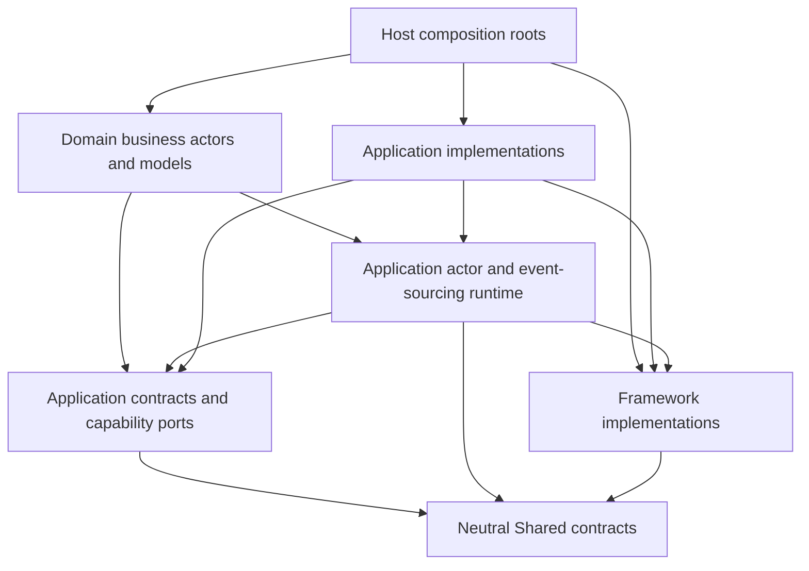

# Domain → Application → Framework: Dependency Separation Design

**Status:** Proposed; inventory and design only
**Inventory date:** 2026-10-25
**Scope:** C# project boundaries, actor runtime, event sourcing, contracts, adapters, and composition roots
**Requested direction:** Domain → Application → Framework; neutral Shared contracts available to all layers

## 1. Recommendation

This is feasible. Establish separate Application actor/event-sourcing libraries, extract the neutral contracts that Framework implementations need, and then remove the remaining upward references and transport/storage leaks. A namespace rename alone cannot establish this architecture.

The first migration should move generic infrastructure ownership while preserving actor behavior, message subjects, persisted event identities, and wire payloads. Follow with a separate cleanup of business contracts and service boundaries. Do not combine the move with changes to trading algorithms, recovery rules, delivery guarantees, database schemas, or process layout.

The main findings are:

- `Shared.EventModelActor` and `Shared.EventSourcing` are folders/namespaces in `TomasAI.IFM.Shared`, not independently movable projects. Together they contain **249 evaluated Compile items**.
- Framework messaging implements interfaces from these folders. Those interfaces cannot all move into an Application assembly that also depends on Framework messaging.
- Domain has **four explicit Framework project references**, but source also reaches Framework and NATS through transitive references. Removing four csproj entries would leave substantial coupling.
- **11 Application projects declare 50 references into Domain projects**. Most targets are `Domain.*.Shared` contracts; composition also references business implementations.
- **Eight Framework projects declare nine upward references** into Domain or Application. These need removal, neutral contracts, or relocation of the specialized adapter.
- Persisted event metadata contains assembly-qualified CLR names. Moving or renaming event contracts without compatibility handling can prevent replay.

No runtime implementation or project reference was changed for this investigation.

## 2. Meaning of the requested boundary

This proposal retains the earlier requirement that a small, neutral Shared contract layer is available to every layer. “Domain depends only on Application” means that Application is Domain's only lower **functional** layer, with this Shared exception.

| Area | Allowed dependencies at the completed boundary |
| --- | --- |
| Domain implementations | Application contracts, Application runtime base classes and service ports; neutral Shared contracts; standard platform APIs |
| Application contracts | Neutral Shared contracts and approved contract annotations; no Domain implementations, Framework implementation types, or concrete storage clients |
| Application implementations | Application contracts/runtime libraries, Framework implementations, neutral Shared contracts; no Domain assemblies |
| Framework | Other Framework libraries and neutral Shared contracts; no Application or Domain assemblies |
| Shared contracts | Other neutral Shared contracts and approved serialization annotations; no Application, Framework, Domain, transport clients, or database clients |
| Composition roots | Domain + Application + Framework as needed to register and run the system; explicitly classified as hosts, not reusable Application services |

Business code also needs a source/API boundary: calling a Framework class through a transitive reference is still a Domain dependency on Framework. Package names and project-reference counts alone do not enforce the requirement.

If the intended rule is literally **no Shared types in Domain at all**, it requires additional Application-owned facade types and mapping to neutral transport contracts. Hiding Shared behind a transitive csproj reference would not satisfy that stricter rule. That extra facade layer is not recommended under the previously agreed Shared exception.

## 3. Inventory and verification method

Companion inventories:

- [Project references](Domain-Application-Framework-Layering-Project-Inventory.csv): all **359 declared reference entries** in the **86 non-test root IFM projects** in scope.
- [Source relocation candidates](Domain-Application-Framework-Layering-Source-Inventory.csv): **284 source files**, including the 249 actor/event-sourcing files and adjacent event-sourcing, decorator, producer, and event-service code.

The project inventory was generated from current csproj XML. Tests, benchmarks, named qualification/probe utilities, vendor projects, and Rust crates are outside that project count. These are repository projects, not a claim that every project is loaded by the current API.

MSBuild `-getItem:Compile` confirmed the Shared folder counts. Current declared references were traversed for cycles: **none were found in the inventoried graph**. This is a static check of that scope, not a new full build or a proof about the future implementation.

Source usage was searched across tracked/non-ignored C# files in those projects. Counts below are **files containing a namespace/type-family text reference**, including imports and occasional metadata/comments. They are upper-bound review counts, not Roslyn-bound symbol counts; unused imports can be removed without rewriting behavior.

### 3.1 Actor and event-sourcing scope

| Current owner | Source files | Finding |
| --- | ---: | --- |
| `Shared/EventModelActor` | 184 | Runtime, supervision, scheduling, state/repository interfaces, message carriers, contracts, diagnostics, and transport helpers mixed together |
| `Shared/EventSourcing` | 65 | Event/result envelopes, handler abstractions, runtime contexts/factories, codecs, and read models with behavior mixed together |
| `Domain.EventSourcing` | 6 | Generic repository/audit infrastructure plus specialized market-data/trade projection behavior and assembly metadata |
| `Shared.Domain` | 15 | Validation/exception/logging decorators; also references Framework.Storage and Domain shared contracts |
| `Shared.EventProducers` | 6 | Typed producers and console history/transport support; references Framework messaging and Domain payload assemblies |
| `Shared.EventService` | 8 | Event services that need contract and orchestration ownership review |

The actor folder includes **52 files under Contracts** and **24 files mentioning NATS.Client**. Being under `Contracts` does not prove a type is transport-neutral.

The broader contract ownership change covers **11 Domain.*.Shared projects and 3,157 source files** in the scanned tree:

| Current contract project | Source files |
| --- | ---: |
| Domain.Application.Shared | 29 |
| Domain.BrokerAccount.Shared | 24 |
| Domain.MarketData.Analytics.Shared | 429 |
| Domain.MarketData.Feed.Shared | 315 |
| Domain.MarketData.Shared | 304 |
| Domain.Portfolio.Shared | 344 |
| Domain.Reference.Shared | 237 |
| Domain.Strategy.Contracts.Shared | 41 |
| Domain.Supervisor.Shared | 103 |
| Domain.SystemAdmin.Shared | 305 |
| Domain.Trade.Shared | 1,026 |

These are project-level review totals, not 3,157 proven DTO moves. They include API implementations, behavior, assembly metadata, and unused imports as well as messages and read models. Their current project references are recorded in the project CSV; the 284-file source CSV focuses on generic infrastructure relocation candidates.

In the Domain projects, actor and event-sourcing namespace families appear in **3,241** and **2,907** files respectively; the sets overlap. This is a wide source migration even though the generic infrastructure itself is 249 files.

Sibling directories named `TomasAI.IFM.Shared.EventModelActor`, `.Contracts`, and `.Templates` also exist, but have no own csproj and are not the evaluated Shared folder above. Do not mistake those directories for the active assembly or delete them as part of an unverified move. Check project links and any generator/template consumers before deciding their ownership.

### 3.2 Domain project inventory

There are **23 Domain-prefixed projects**: business implementations, shared contract projects, and the event-sourcing helper. The table lists direct references outside the Domain prefix. Full intra-Domain references are in the project CSV.

`Framework` and `NATS` columns count source files with text references, including transitive usage and unused imports.

| Domain project | Current direct references outside Domain | Framework files | NATS files |
| --- | --- | ---: | ---: |
| Domain.Application | `Application.BlackBoard`, `Application.EventProjector`, `Application.Storage`, `Shared`, `Shared.Domain` | 0 | 8 |
| Domain.Application.Shared | `Shared` | 0 | 0 |
| Domain.BrokerAccount | `Application.EventProjector`, `Application.Storage`, `Application.TradeBroker`, `Shared`, `Shared.Domain` | 3 | 0 |
| Domain.BrokerAccount.Shared | `Application.TradeBroker`, `Shared` | 0 | 0 |
| Domain.EventSourcing | `Application.Storage` | 2 | 0 |
| Domain.MarketData | `Application.EventProjector`, `Application.MarketData`, `Application.Storage`, `Shared`, `Shared.Domain` | 7 | 7 |
| Domain.MarketData.Analytics | `Application.EventProjector`, `Application.MarketData`, `Application.Storage`, `Shared`, `Shared.Domain` | 17 | 98 |
| Domain.MarketData.Analytics.Shared | `Shared` | 0 | 0 |
| Domain.MarketData.Feed | `Application.EventProjector`, `Application.MarketData`, `Application.Storage`, `Framework.OptionPricer`, `Shared`, `Shared.Domain` | 21 | 17 |
| Domain.MarketData.Feed.Shared | `Shared` | 0 | 0 |
| Domain.MarketData.Securities | `Application.EventProjector`, `Application.Storage`, `Shared`, `Shared.Domain` | 0 | 6 |
| Domain.MarketData.Shared | `Shared` | 0 | 0 |
| Domain.Portfolio | `Application.EventProjector`, `Application.Storage`, `Framework.SequenceId`, `Shared.Domain` | 6 | 0 |
| Domain.Portfolio.Shared | `Shared` | 0 | 0 |
| Domain.Reference | `Application.EventProjector`, `Application.Storage`, `Shared`, `Shared.Domain` | 4 | 3 |
| Domain.Reference.Shared | `Framework.MarketData`, `Shared` | 3 | 0 |
| Domain.Strategy.Contracts.Shared | `Shared` | 0 | 0 |
| Domain.Supervisor | `Application.BlackBoard`, `Application.EventProjector`, `Application.Storage`, `Shared`, `Shared.Domain` | 0 | 0 |
| Domain.Supervisor.Shared | `Shared` | 0 | 0 |
| Domain.SystemAdmin | `Application.EventProjector`, `Application.Storage`, `Shared`, `Shared.Domain` | 1 | 0 |
| Domain.SystemAdmin.Shared | `Shared` | 0 | 0 |
| Domain.Trade | `Application.BlackBoard`, `Application.EventProjector`, `Application.MarketData`, `Application.Storage`, `Application.TradeBroker`, `Shared`, `Shared.Domain` | 30 | 0 |
| Domain.Trade.Shared | `Framework.Serialization`, `Shared` | 11 | 0 |

Across these projects, **105 files mention Framework**, **139 mention NATS.Client**, **633 mention Application.Storage**, and **two mention Npgsql**. These counts overlap and require semantic review. The Application.Storage count itself is not a layering violation; many of its interfaces currently expose implementation details that need inspection.

### 3.3 Explicit Domain → Framework references

| Source | Current target | Required direction |
| --- | --- | --- |
| Domain.MarketData.Feed | Framework.OptionPricer | Application pricing port/adapter; preserve the existing pricing implementation |
| Domain.Portfolio | Framework.SequenceId | Application sequence capability or a neutral ID contract; allocate through an Application implementation |
| Domain.Reference.Shared | Framework.MarketData | Move the required API DTOs to Application contracts or neutral Shared contracts |
| Domain.Trade.Shared | Framework.Serialization | Route operational serialization through an Application port or relocate the payload codec out of contract/domain code |

Domain.Trade also directly references the **Domain.Portfolio and Domain.BrokerAccount implementation assemblies**. For the strongest project rule, replace those implementation references with Application-owned capability interfaces/contracts. The other Domain-to-Domain references are principally shared payload projects and the generic event-sourcing helper.

### 3.4 Existing reverse references

Application projects with direct Domain targets: `Actor.Client`, `Api.Nats.Client`, `Api.Server.Core`, `BlackBoard`, `DatabaseBackup`, `DatabaseBackup.Console`, `EventProjector`, `MarketData`, `ServerManager`, `Storage`, and `Strategy`.

Framework upward references:

| Framework project | Current upward targets |
| --- | --- |
| MarketData | Domain.MarketData.Feed.Shared; Domain.MarketData.Shared |
| MarketData.DataBento | Domain.MarketData.Feed.Shared |
| MarketData.FinancialModelingPrep | Domain.MarketData.Shared |
| OptionPricer | Domain.Trade.Shared |
| Storage | Domain.Trade.Shared |
| Storage.Azure | Domain.SystemAdmin.Shared |
| Storage.DatabaseBackup.LocalWorkstation | Application.DatabaseBackup |
| Storage.DatabaseBackup.AwsCloud | Application.DatabaseBackup |

Some references may be removable without an adapter. For example, no Domain-qualified source text was found in the scanned Framework.Storage and Framework.Storage.Azure files despite their declared references. Verify removal by an isolated build and bound-symbol/API inspection; do not infer that from text search alone.

## 4. Concrete circular-reference and boundary risks

### 4.1 Moving all actor interfaces upward creates a transport cycle

[Framework.Messaging.Nats](../../TomasAI.IFM.Framework.Messaging.Nats/TomasAI.IFM.Framework.Messaging.Nats.csproj) currently references Shared and implements its actor producer/consumer abstractions.

If those abstractions move wholesale into Application.EventModelActor while that project references Framework messaging, the result is:

```text
Application.EventModelActor → Framework.Messaging.Nats → Application.EventModelActor
```

Leaving Shared code dependent on the moved runtime creates a second possible cycle:

```text
Shared → Application.EventModelActor → Framework.Messaging.Nats → Shared
```

Neutral envelopes and the interfaces implemented by Framework must therefore remain below both implementations. Shared must not gain a dependency on the new Application runtime.

### 4.2 Several actor abstractions still expose NATS

Examples:

- [IActorMessage.GetMessage()](../../TomasAI.IFM.Shared/EventModelActor/Contracts/IActorMessage.cs) returns `NatsMsg<byte[]>`.
- [ActorMessageInfo](../../TomasAI.IFM.Shared/EventModelActor/ActorMessageInfo.cs) exposes and constructs raw NATS message carriers.
- [BaseQueryActor](../../TomasAI.IFM.Shared/EventModelActor/BaseQueryActor.cs), transport helper extensions, and legacy carriers need separation of typed runtime behavior from transport compatibility.

Move the raw NATS carrier and conversion/reply adapters into Framework messaging. Retain a neutral typed `IActorMessage` contract; migrate remaining callers of `GetMessage()` before removing it. Many current query actors already use the neutral parse/receive maps, so an import count must not be treated as a required full rewrite of every actor.

### 4.3 Application interfaces can still leak Framework implementation types

[IMarketDataApi](../../TomasAI.IFM.Application.MarketData/Contracts/IMarketDataApi.cs) is the correct application entry point, but its partial interface family currently imports Framework last-price/ticker contracts and Domain payloads. Move the exposed DTOs/owner identifiers to the proper contract assembly and map them inside the implementation.

[IEventSourceActorDbContext](../../TomasAI.IFM.Application.Storage/EventSourceDb/IEventSourceActorDbContext.cs) inherits `IObjectRepository<EventSourceActorDbContext>`, exposing both a Framework abstraction and a concrete storage class. Introduce an application-facing event-store capability independent of that generic concrete context; preserve transactions and expected-version behavior behind it.

### 4.4 Application support projects depend on Domain shared payloads

Moving only generic runtime code would leave Application.Storage, MarketData, Blackboard and typed producers dependent on Domain.*.Shared. To enforce a single layer direction by project identity, move API/message/read-model contracts into appropriately scoped **Application.Contracts** assemblies. Keep Domain decisions, financial calculations, state transitions, and invariants in Domain.

Where Framework also needs a payload, either:

1. extract a genuinely neutral shape into Shared.Contracts and map business payloads in Application; or
2. move the business-specific adapter from Framework into Application.

Framework must not acquire a dependency on Application.Contracts to continue compiling unchanged.

`Domain.*.Shared` is not automatically a DTO-only inventory. For example, Domain.Trade.Shared contains the actual [forward-price calculation](../../TomasAI.IFM.Domain.Trade.Shared/Futures/Option/Position/IronCondor/ForwardPrice/IronCondorForwardPriceCalculation.cs). Classify behavior separately before relocating contract projects wholesale.

### 4.5 Composition roots cannot obey the same rule as reusable libraries

API.Server.Core registers Domain actors and their Application/Framework dependencies. That composition code must reference all three layers. ServerManager and executable hosts also assemble processes and integrations.

Classify these as **Host/Composition** projects. For a strict namespace-based architecture rule, relocate/rename composition roots under a Host prefix in a later phase; for an initial project-based rule, use an explicit small allowlist. Reusable Application libraries must not use that exception. This is a library/namespace classification, not a requirement for additional operating-system processes.

### 4.6 Runtime contains business-specific policy by string identity

[RealtimeActorResetPolicy](../../TomasAI.IFM.Shared/EventModelActor/RealtimeActorResetPolicy.cs) hard-codes Domain namespaces and exact Iron Condor actor names. Moving that class to Application removes its Shared ownership issue but does not make the policy generic.

Have the composition root register explicit disposable/recoverable actor capabilities. Preserve the current safety distinction between disposable quote work and durable financial operations; do not broaden reset eligibility as a side effect of this move.

## 5. Proposed project ownership

The names below are proposed new boundaries, not claims that these projects already exist.

| Proposed owner | Responsibility |
| --- | --- |
| Shared.Contracts | Neutral identities, envelopes, transport-independent message ports, minimal shared value types, serialization contract metadata |
| Application.EventModelActor | Actor base classes, supervisor/runtime orchestration, scheduling/mailboxes, runtime factories, lifecycle/recovery coordination |
| Application.EventSourcing | Generic bounded contexts/state/repositories, command audit/deduplication coordination, event type resolution and replay orchestration |
| Application.Contracts.* | Application-facing business commands/queries/events/read DTOs and market-data/pricing/portfolio/storage capabilities |
| Application.Storage | Storage adapters and transaction implementation; typed mapping uses Application contracts |
| Application.EventProjector | Projection orchestration and specialized projection mappings; no Domain assembly dependency after contract extraction |
| Application.Messaging / Application.EventServices | Typed producers and application event orchestration, referencing Application contracts and Framework transport |
| Framework.Messaging.Nats | NATS connections, serialization/transport adapters and concrete message carriers implementing neutral Shared ports |
| Other Framework libraries | Provider/database/cache/serialization/native-pricing mechanisms with neutral inputs and outputs |
| Domain.* | Business actor specializations, decisions, guards, calculation models and authoritative state transitions |
| Host composition roots | Registration, assembly discovery, process startup/shutdown, transport implementation selection |

Do not repurpose `Application.Actor.Client` just because its output assembly is named `TomasAI.IFM.Application.Actor`. Its current source includes test/demo actor implementations and a Domain.MarketData.Shared dependency. New runtime ownership must be explicit.

### Allowed reference shape



Arrows mean compile-time dependency. There is no Framework → Application, Application → Domain, or Shared → higher layer edge. Individual libraries should take only the references they use; the diagram is an allowed shape, not a mandate that every runtime project reference Framework.

Keep generic replay/repository code independent of specialized projector implementations. If it needs a projection callback, define the port in the lower contracts/runtime library and register the implementation in composition. Otherwise moving typed projection helpers into Application.EventProjector could introduce an Application.EventSourcing ↔ Application.EventProjector cycle.

## 6. Required work by area

| Area | Required changes and constraints |
| --- | --- |
| Shared.EventModelActor | Move runtime implementations into Application.EventModelActor. Keep neutral IDs/ports below Framework; split transport-shaped contracts and extensions. Extract business reset policy registration. |
| Shared.EventSourcing | Keep event/result/value envelopes in neutral contracts. Move contexts/factories/replay orchestration and application-specific codecs upward. Separate DTO methods that currently invoke codecs. |
| Event-log read models | `EventStreamReadModel.ToDomainEvent()` currently couples a DTO to the codec. Move that behavior to an Application extension/service while preserving the stored shape. |
| Domain.EventSourcing | Move generic repository, audit and duplicate coordination into Application.EventSourcing. Separate AcceptedMarketSignalProjection and ExitWorkflowProjectionBaseline into appropriate projection/migration adapters. Preserve transactional projection ordering and snapshot behavior. |
| Shared.Domain | Move decorator pipelines into Application runtime/pipeline ownership; inject Domain-specific validators/error converters through interfaces. Remove Framework.Storage and Domain contract references from neutral Shared. |
| Application.Storage | Split capability ports from concrete contexts, SQL/driver types and implementations; replace Domain.Shared contracts. Domain's existing storage calls may remain through Application-owned ports after these changes. |
| MarketData/Blackboard/TradeBroker | Keep the existing application boundaries; move exposed contract types and remove reverse Domain dependencies. Preserve backend-controlled ValueDate and the ability to substitute backends. |
| Domain models using Framework | Use Application pricing, serialization, sequence and provider capabilities. Keep pure Domain computations in Domain. Some import-only coupling may simply be removed. |
| Domain actors using transport types | Remove unused imports; replace actual NATS message/reply dependencies with the neutral message API and Application runtime helpers. |
| Framework business mappings | Remove unused project refs where proven; otherwise move specialized mapping upward or introduce neutral inputs. Invert backup provider dependencies on Application.DatabaseBackup. |
| Composition and DI | Register new assemblies and adapters explicitly; update discovery, container verification, factories and assembly markers. Keep the same deployed actor responsibilities and process topology. |
| Documentation/generators/clients | Update conventions, source-path architecture checks, generator templates, schema catalogs, managed clients and Rust contract fixtures where ownership changes affect them. |

The source CSV records a **candidate** destination for each of its 284 files. Interface signature closure and actual symbol ownership must be checked during implementation before treating those placements as final.

## 7. Compatibility rules

### Persisted events and snapshots

[EnlistedEventTransaction](../../TomasAI.IFM.Application.Storage/EventSourceDb/EnlistedEventTransaction.cs) and event-store extensions persist `AssemblyQualifiedName`. The first compatibility step now routes event readers through an explicit registry with legacy CLR fallback and registered stable/historical aliases. Snapshot/range metadata selection uses the same type resolution. Writes remain unchanged; no event classes have moved. See [Event type identity compatibility implementation](Event-Type-Identity-Compatibility-Implementation-v0.1.md) for scope, qualification and remaining deployment gates. Existing Portfolio payload compatibility remains required.

Before moving public event types:

1. inventory persisted event/command/snapshot type names and stored payload formats;
2. establish an explicit old-name → current-type registry and test historical reads;
3. preserve namespaces/full names where possible during assembly extraction;
4. use type forwarding only when the full type name is unchanged and the resulting project references remain acyclic;
5. handle namespace renames through resolver aliases or an explicitly qualified data migration—type forwarding alone does not rename a CLR type.

A permanent Shared facade forwarding runtime types into Application would recreate the forbidden upward dependency. Any transition facade must have a bounded retirement plan and must not be referenced by Framework.

### Transport and client contracts

- Preserve NATS subjects, verbs, IDs, enum values and MessagePack numeric keys.
- Preserve native ABI layouts used by pricing and market-data interop.
- Test the current hybrid UI and standalone Rust UI against unchanged public backend behavior.
- Regenerate compiled Rust metadata/fixtures only with a contract compatibility review. A C# namespace/assembly move can affect type lookup even if MessagePack bytes are unchanged.
- Preserve runtime lifecycle fences, command idempotency, projector completion semantics, deadlines, and current snapshot-only loading behavior.

## 8. Recommended implementation sequence

### Phase 1 — Freeze the boundary and add enforcement

Record the existing graph and compatibility fixtures. Classify reusable Application projects versus composition roots. Add project-reference and **bound symbol/public API** architecture checks; report current violations while the migration is incomplete. Do not suppress violations merely by removing direct references that remain available transitively.

### Phase 2 — Extract neutral contracts and transport adapters

Create the lean Shared contract boundary and compute its complete type/signature dependency closure. Move raw NATS message carriers and helpers into Framework adapters. Update Framework consumers so they no longer need the monolithic Shared runtime.

This is the prerequisite for physically moving runtime implementations: Framework must not continue consuming the old Shared assembly if that assembly would forward back into Application.

### Phase 3 — Move generic actor/event-sourcing infrastructure

Create Application.EventModelActor and Application.EventSourcing. Move runtime/base types, generic repositories and audit/deduplication behavior. Move decorator pipelines. Update Domain base-class references and DI/discovery in small compilable batches. Separate specialized projections instead of moving the entire Domain.EventSourcing project unchanged.

Public contract identity remains stable during this phase. Retire old runtime ownership only after all dependent code uses the replacement assemblies.

### Phase 4 — Correct contract and adapter ownership

Extract Application business/API contract assemblies from Domain.*.Shared, leaving pure Domain behavior in Domain. Move provider-neutral shapes needed by Framework into Shared contracts and map them in Application. Remove the nine Framework upward reference edges and Application support-library reverse Domain references.

Resolve backup provider inversion and composition-root classification explicitly. The existing acyclic graph does not mean these edges satisfy the intended layer direction.

### Phase 5 — Finish Domain isolation

Remove the four explicit Domain → Framework edges, remaining bound uses through transitive references, raw driver types, and Domain implementation-to-implementation references. Ensure Application ports expose no concrete Framework/storage/transport type.

If the chosen final rule covers all Domain-prefixed projects, retire or reclassify the old Domain.Shared and Domain.EventSourcing projects once their contracts/runtime responsibilities have moved. Do not leave them as hidden reverse-reference shims.

### Phase 6 — Qualify compatibility and remove transitional ownership

Run the gates below. Remove obsolete wrappers, aliases, registrations and unused references only when old persisted data and both supported UIs still pass qualification. Update the actor conventions and architecture allowlists to their final state.

Each phase should build independently. Do not deploy a mixture of incompatible event-contract assemblies, serializers and generated client metadata.

## 9. Acceptance criteria

| Gate | Required evidence |
| --- | --- |
| Project graph | Zero cycles; zero Domain → Framework edges; zero reusable Application → Domain edges; zero Framework → Application/Domain edges; zero Shared → higher-layer edges |
| Semantic boundary | Domain code and its consumed Application API signatures contain no Framework, NATS, database or provider implementation types, including via transitive references |
| Contract closure | Neutral Shared contracts can compile independently of Application and Framework implementations |
| Domain project rule | Domain implementation projects reference Application libraries and the agreed neutral Shared contracts; calls into another business area use Application capabilities/contracts |
| Build and DI | All supported hosts, Domain libraries, managed clients and tests build; container verification and actor discovery succeed from the new assemblies |
| Persistence | Historical event, command audit and snapshot fixtures load; expected-version concurrency, deduplication, projection completion and last-snapshot loading remain equivalent |
| Messaging | Golden MessagePack payloads, subjects, retry identities, cancellation/reply behavior and reconnect delivery pass |
| Runtime behavior | Startup, market closed/open, graceful shutdown, two-minute recovery success/failure/UI notification and configured API restart behavior remain qualified |
| Domain behavior | ITI/EMA/Bollinger processing, Iron Condor valuation/forward metrics, risk, portfolio postings and trade plan generation remain unchanged |
| Client compatibility | Hybrid and standalone UIs load trades, consume updates, query health and catch up console history; no automatic UI cutover |

Use reflection/Roslyn or equivalent compiled-symbol analysis for semantic gates. A regex import ban is useful as a fast check but misses fully qualified/transitive dependencies and can flag unused imports incorrectly.

## 10. Findings, certainty, and next decision

**Verified now:** current declared project graph in scope, specific reverse references, Shared evaluated source ownership/counts, concrete transport/storage API leaks, and persisted CLR-name coupling.

**Not claimed:** that every import is a live dependency, that every candidate file can move unchanged, or that a future edited solution has already compiled. No live services were restarted or application behavior changed for this design.

**Recommendation:** approve a staged dependency migration beginning with neutral contract extraction and generic runtime ownership. Treat complete Domain isolation as a broader follow-up within the same design, rather than declaring the work complete after moving two namespaces. Existing actors can keep their business responsibilities; new business actors and new processes are not required by this layering change.
