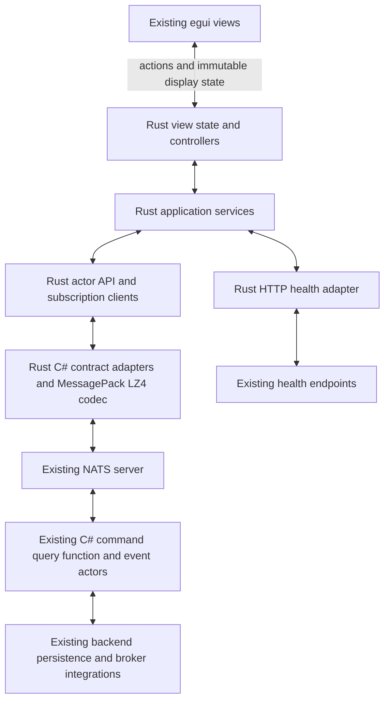

# IFM Standalone Rust UI Migration Plan

Date: 2026-10-18  
Status: Implementation design  
Scope: Desktop views, view models, client models, services, subscriptions, configuration, and packaging

The target is a standalone Rust desktop application that communicates with the existing C# backend through its actor command, query, function, and event contracts over NATS. The desktop release must run without hostfxr, managed bridge assemblies, or an installed .NET runtime. C# remains the authority for trading, portfolio decisions, valuation, persistence, and recovery.

Existing C# data structures, MessagePack keys, serializer settings, compression, actor subjects, and business semantics remain unchanged. Rust implements the compatibility adapters. This is a client migration; moving the backend to Rust is outside scope.

The implementation reuses the current Rust views and ports the behavior presently supplied by managed view models, services, API clients, event consumers, and bridge sessions. Existing user-approved Rust layout and styling remain the presentation baseline. Where a screen is still absent, the WinForms version supplies the behavior and control inventory.

## 1 Decisions and completion criteria

| Decision | Implementation consequence |
| --- | --- |
| Preserve C# contracts | Rust mirrors their wire representation; no field renaming, key renumbering, new envelopes, enum changes, or backend model redesign |
| Preserve existing compression | Implement MessagePack-CSharp Lz4BlockArray compatibility in Rust, including uncompressed messages |
| Preserve backend actor ownership | Rust client actors own UI state and request lifetimes; they do not reproduce the server actor runtime, durable audit reservations, or event-sourced aggregates |
| Reuse the Rust views | Replace their data and action provider incrementally; do not rebuild completed controls unnecessarily |
| Move all managed client behavior | Include services, direct API calls in bridge sessions, local journals, and client calculation helpers |
| Preserve existing user behavior | Preserve menus, dialogs, actions, keyboard behavior, selection, dimensions, colors, loading order, and error handling |
| Keep virtual grids virtual end to end | Fetch requested server pages and render visible rows; never preload all history to emulate paging |
| Separate design from qualification | A Rust screen is complete only when contract, behavior, lifecycle, and desktop checks pass |

Completion requires every reachable frontend feature to have a Rust owner and a tested backend interaction. Every relevant source-inventory row must be classified as ported, reused, merged into another implementation, or intentionally outside the desktop target with a reason. A screen that renders fixtures but still needs managed orchestration is incomplete.

The existing health endpoints are an explicit transport exception: actor health and market-data operations health currently use HTTP/JSON. The baseline preserves those endpoints through Rust HTTP adapters while all existing actor interactions remain NATS/MessagePack. A strict NATS-only requirement for these health features would require additional backend routes; it is not achieved merely by porting the client. Section 10 specifies this boundary.

## 2 Current source boundaries

The [source inventory](IFM-Standalone-Rust-UI-Source-Inventory.md) records the files in the following areas. Counts are source files, including interfaces, helpers, partial classes, and WinForms designer files; they are not screen or endpoint counts.

| Source area | Files | Current responsibility | Target |
| --- | ---: | --- | --- |
| [UI.Net.Views](../../TomasAI.IFM.UI.Net.Views) | 134 | WinForms views and control behavior | Reuse existing Rust views; port remaining features |
| [UI.Net.ViewModels](../../TomasAI.IFM.UI.Net.ViewModels) | 80 | View state, workflows, operations, drafts, journals | Rust state and controllers |
| [UI.Net.Models](../../TomasAI.IFM.UI.Net.Models) | 15 | Frontend data and presentation types | Rust presentation models |
| [UI.Net.Services](../../TomasAI.IFM.UI.Net.Services) | 53 | Frontend orchestration, API access, subscriptions, local pricing | Rust application services |
| [UI.EventConsumer](../../TomasAI.IFM.UI.EventConsumer) | 41 | Typed backend event listeners and fan-out | Rust subscription services |
| [UI.Net.Composition](../../TomasAI.IFM.UI.Net.Composition) | 1 | Shared client dependency registration | Explicit Rust startup composition |
| [Application.Api.Nats.Client](../../TomasAI.IFM.Application.Api.Nats.Client) | 54 | Actor route construction and typed client calls | Rust actor API clients |
| [UI.Rust.Bridge.Net](../../TomasAI.IFM.UI.Rust.Bridge.Net) | 50 | Managed sessions, publication shaping, direct APIs, action dispatch | Rust controllers and projections |
| [UI.Rust/src](../../TomasAI.IFM.UI.Rust/src) | 45 | Native rendering, local state, bridge decoding and hosting | Retain rendering; replace managed hosting |
| [UI.Net](../../TomasAI.IFM.UI.Net) | 2 | WinForms entry point and startup | Reference for configuration and reachability |

The services folder is important, but it does not contain the entire messaging implementation. The existing dependency chain is:

1. A view or bridge session starts a view-model operation.
2. A service or a directly accessed API client builds the request.
3. The NATS API client supplies actor subjects, identities, and reply types.
4. The messaging framework serializes and sends the request.
5. Event consumers receive backend notifications and update client state.
6. Bridge sessions prepare immutable publications for Rust rendering.

[UiClientServiceRegistration](../../TomasAI.IFM.UI.Net.Composition/UiClientServiceRegistration.cs) registers these dependencies. [IUiServiceCatalog](../../TomasAI.IFM.UI.Net.Services/IUiServiceCatalog.cs) exposes both service objects and raw API interfaces. [PortfolioSession](../../TomasAI.IFM.UI.Rust.Bridge.Net/PortfolioSession.cs), [StrategyInspectionBackend](../../TomasAI.IFM.UI.Rust.Bridge.Net/StrategyInspectionBackend.cs), and [TradeWorkspaceSession](../../TomasAI.IFM.UI.Rust.Bridge.Net/TradeWorkspaceSession.cs) also perform orchestration. Porting only the service directory would miss those paths.

Client behavior also references helper types in shared domain assemblies. The dependency inventory must follow those references without treating the entire domain assembly as client migration scope. Include export, clipboard, file dialogs, search/typeahead, local preferences and shutdown behavior wherever reachable; they can hide managed dependencies outside the main view classes. The target covers the current Rust client and its WinForms feature baseline. Other UI hosts are included only if a reachable dependency or required feature is found during the inventory.

## 3 Target architecture



The background runtime owns I/O, decoding, request correlation, subscriptions, and expensive projection work. The egui thread owns widgets and renders prepared state. The render callback never waits for NATS, HTTP, local disk, a server response, or a pricing calculation.

Use the official asynchronous Rust NATS client with a Tokio runtime. Pin compatible dependency versions in Cargo.lock when implementation starts. [async-nats documentation](https://docs.rs/async-nats/latest/async_nats/)

### 3.1 Proposed Rust source organization

These are planned modules, not existing implementations:

```text
src/
  app/
    runtime.rs             startup, configuration, background task ownership
    composition.rs         concrete service and controller construction
  backend/
    nats/
      connection.rs        connection lifecycle, credentials, reconnect events
      requests.rs          typed requests, deadlines, pending replies
      subscriptions.rs     scoped subscriptions and local fan-out
      subjects.rs          existing ActorSubject routing and wildcard rules
      tracing.rs           existing transport header conventions
    contracts/
      generated/           generated C# wire types and contract metadata
      adapters/            decimals, IDs, dates, enums, unions, binary values
      messagepack.rs       array/map encoding and bounded decoding
      lz4.rs               existing MessagePack-CSharp compression framing
      identity.rs          canonical hashes and deterministic command IDs
    api/                   application, reference, market, portfolio, trade, admin
    health_http.rs         existing HTTP health protocol
  services/                client orchestration and subscriptions
  state/                   per-view controllers, models, drafts, result states
  persistence/             compatible pending-operation journals
  diagnostics/             timing, queues, memory, transport and outcome evidence
  navigation/              existing views
  market/                  existing views
  editors/                 existing views
  portfolio/               existing views
  strategy/                existing views
  trading/                 existing views
  operations/              existing views
  ui/                      existing styles and shared controls
```

Keep backend wire DTOs separate from display models. Exact financial values belong in an exact decimal representation; charts may derive floating-point coordinates without replacing the underlying value. Derived formatting and row caches are client-owned and disposable. The authoritative trade, position, plan, and risk data remain backend results.

## 4 Actor protocol compatibility

The existing [ActorSubject](../../TomasAI.IFM.Shared/EventModelActor/ActorSubject.cs) renders subjects as:

```text
ActorType.Name.Verb.EntityId
```

The entity identifier may itself contain dots. Rust must reproduce the existing parser and formatter; it must not assume the whole subject has exactly four dot-separated tokens.

[ActorType](../../TomasAI.IFM.Shared/EventModelActor/ActorType.cs) currently assigns Command=2, Event=3, Query=4, Notify=5, Realtime=7, Function=8. Reserved values remain reserved. Numeric values in payloads and textual names in NATS subjects are distinct representations.

| Interaction | Existing behavior to preserve |
| --- | --- |
| Query | Typed Core NATS request/reply through a Query subject |
| Command | Existing command-specific publish or request/reply behavior; command ID and entity identity remain stable |
| Function | Core request/reply through Function subjects; used by financial operations even when successful backend results are durably committed |
| Event or Notify subscription | Existing subjects, event types, filtering, and revision semantics |
| Durable backend transport | Backend JetStream behavior remains backend-owned; use JetStream client behavior only where an inventoried frontend operation already requires it |

[NatsActorProducer](../../TomasAI.IFM.Framework.Messaging.Nats/NatsActorProducer.cs) enforces delivery type and supplies typed replies. [NatsClientApi](../../TomasAI.IFM.Application.Api.Nats.Client/NatsClientApi.cs) maps command results and errors. Preserve those mappings, including paths that request GuidResult and expose the original CommandId to the caller.

The existing [NatsActorEventListener](../../TomasAI.IFM.Framework.Messaging.Nats/NatsActorEventListener.cs) subscribes to the formatted ActorMailboxId plus the suffix `.>`, uses no queue group, and filters accepted verbs. Its local channel is bounded to 4096 with wait behavior. Rust may share matching subscriptions within one process using reference-counted leases, but separate desktop clients must continue receiving their own event copies.

Core NATS does not replay messages missed while disconnected. Reconnection therefore requires authoritative refresh, rather than assuming that resubscription restored current state. [NATS Core delivery](https://docs.nats.io/learn/core-nats/)

Preserve W3C traceparent and tracestate transport headers from [ActorTrace](../../TomasAI.IFM.Shared/EventModelActor/ActorTrace.cs). Inventory any additional required headers per operation, including source-generation headers where applicable. Do not insert new trace fields into C# business payloads.

### 4.1 Verified contract examples

| Operation or type | Existing contract | Rust work |
| --- | --- | --- |
| Established trade lookup | [EstablishedTradeQueryApi](../../TomasAI.IFM.Application.Api.Nats.Client/EstablishedTradeQueryApi.cs) | Preserve strategy-specific lookup and exact TradeEntityId |
| Current realtime snapshot | [GetTradeRealtimeSnapshotQuery](../../TomasAI.IFM.Domain.Trade.Shared/Trade/Realtime/GetTradeRealtimeSnapshotQuery.cs) | Query.FuturesOptionTradeQuery.GetTradeRealtimeSnapshot followed by the formatted trade identity |
| Realtime change | [TradeRealtimeSnapshotChangedEvent](../../TomasAI.IFM.Domain.Trade.Shared/Trade/Realtime/TradeRealtimeSnapshotChangedEvent.cs) | Notify.TradeRealtimeSnapshot.Changed followed by the formatted trade identity; honor its generation and revisions |
| Trade-plan page | [StrategyTradePlanQueryApi](../../TomasAI.IFM.Application.Api.Nats.Client/StrategyTradePlanQueryApi.cs) | Preserve Offset, PageSize, MaximumRevision and any continuation fields used by the selected API |
| Accepted order lifecycle | [TradeOrderLifecycleApi](../../TomasAI.IFM.Application.Api.Nats.Client/TradeOrderLifecycleApi.cs) | Preserve create, approve, ready, bind sequence and stable execution-attempt ID |
| Result wrapper | [ServiceResult](../../TomasAI.IFM.Shared/EventSourcing/ServiceResult.cs) | Array slots success, error code, error message, value; ErrorEvent is ignored on the wire |
| Trade identity | [TradeEntityId](../../TomasAI.IFM.Domain.Trade.Shared/TradeEntityId.cs) | Four slots: portfolio, fund, order, trade |

Each remaining operation must have a registry entry containing the caller, backend client method, actor type, subject construction, request/reply/event types, headers, identity rules, deadlines, cancellation semantics, subscription owner, and parity-test identifier. Generate the full operation registry during phase 0 from reachable calls and compiled contract metadata; a file inventory is not a substitute for it.

## 5 MessagePack and LZ4 adapters

The backend [MessagePackBinarySerializer](../../TomasAI.IFM.Framework.Serialization/MessagePackBinarySerializer.cs) uses ContractlessStandardResolver and Lz4BlockArray. [NatsMessagePackSerializer](../../TomasAI.IFM.Framework.Messaging.Nats/Serializers/NatsMessagePackSerializer.cs) delegates to those settings. The existing [BridgeWire](../../TomasAI.IFM.UI.Rust.Bridge.Net/BridgeWire.cs) and Rust [wire.rs](../../TomasAI.IFM.UI.Rust/src/bridge/wire.rs) use a different, uncompressed publication protocol. They are not interchangeable backend codecs.

Preserve the backend settings. Lz4BlockArray uses MessagePack extension 98; Lz4Block uses 99. These wrappers require their corresponding framing, not a generic LZ4 frame decoder. Accept ordinary uncompressed messages as well. Test behavior against the repository's installed MessagePack-CSharp version. [Compression format](https://github.com/MessagePack-CSharp/MessagePack-CSharp#lz4-compression)

### 5.1 Contract generation

1. Identify the transitive type closure of every frontend request, reply, and event.
2. Export a contract manifest using compiled C# metadata plus semantic source information where needed. Include inherited keys, sparse slots, map key casing, enum values, union tags, nullability, constructor defaults, member formatters, and resolver selection.
3. Generate Rust wire types and repetitive codecs from that manifest. Fail generation on unsupported or ambiguous mappings; do not silently guess.
4. Supply reusable handwritten adapters for special representations and custom formatters.
5. Emit C# fixtures with the actual serializer configuration and independently verify decoded values in Rust.
6. Emit Rust requests and verify the unchanged C# deserializers accept them.
7. Add a CI drift check so a backend contract change cannot silently leave generated Rust types stale.

A development-time C# exporter/test fixture host is compatible with a fully native production client. It must not be shipped as a runtime dependency. Generation reproduces data contracts; behavior in methods, validators, and view models still needs an explicit Rust implementation.

### 5.2 Representation requirements

| Representation | Adapter requirement |
| --- | --- |
| Numbered keys | Preserve array positions, inherited members, and nil placeholders for gaps |
| Named or contractless keys | Preserve exact spelling and map representation |
| Integer and float values | Match width/range and signedness; retain existing nonfinite-value rules |
| Decimal | Preserve exact value, scale where contract-relevant, and formatter representation; never route money through f64 |
| Guid | Match configured wire format; separately implement .NET byte ordering where hashes use raw GUID bytes |
| DateTime, DateTimeOffset, DateOnly, TimeOnly, TimeSpan | Match each actual formatter and precision; do not assume all are strings or Unix milliseconds |
| Enum and flags | Match numeric IDs or the specific configured formatter; define behavior for unknown values |
| Union and interface fields | Match tag and payload shape; reject unknown actionable variants explicitly |
| Null, missing, zero and empty | Keep meanings distinct; reproduce contract defaults only where valid |
| Collections and binary | Distinguish MessagePack binary from integer arrays; preserve ordering when relevant |
| Evolving contracts | Match C# handling of unknown fields and compatible trailing slots; do not reuse removed indices |

The C# library documents array and map contracts, while rmp-serde offers the corresponding encoding modes. Use fixtures to prove that individual types select the intended representation. [C# object contracts](https://github.com/MessagePack-CSharp/MessagePack-CSharp#object-serialization), [Rust serializer modes](https://docs.rs/rmp-serde/latest/rmp_serde/encode/struct.Serializer.html)

Some replies contain embedded serialized documents, such as the workflow StatePayload consumed by StrategyInspectionBackend. Record the codec of each nested payload separately; a binary field is not necessarily display-ready data or encoded with the outer NATS serializer. Port the required nested projections and formatting without CLR type loading or reflection.

Bound encoded and decompressed sizes, nesting depth, collection length, and outstanding decode work. Use the negotiated NATS payload limit and the existing per-operation content budgets. ABI publication chunking does not create a backend NATS chunking protocol; large history must use existing paging routes.

### 5.3 Three separate identity encodings

Do not collapse the following into one generic serialization helper:

| Identity path | Existing source | Required equivalence |
| --- | --- | --- |
| Lifecycle command IDs | [TradeOrderLifecycleApi](../../TomasAI.IFM.Application.Api.Nats.Client/TradeOrderLifecycleApi.cs) | SHA256 of exact pipe-joined UTF-8 seed strings, first 16 bytes interpreted with .NET Guid semantics; preserve create, approve, ready, bind and execution-attempt suffixes |
| Idempotent request IDs | [IdempotentCommandId](../../TomasAI.IFM.Application.Api.Nats.Client/IdempotentCommandId.cs) | Guid.ToByteArray plus default MessagePack serialization of the message; this is distinct from compressed NATS serialization |
| Financial request hashes | [FinancialCanonicalHash](../../TomasAI.IFM.Domain.Portfolio.Shared/FinancialPolicy/Contracts/FinancialCanonicalHash.cs) | Existing canonical JSON, ordinal property ordering, decimal G29 formatting, UTC date conversion, escaping, and default-field omission rules |

GUID string encoding alone does not prove compatibility with the raw GUID bytes used in these algorithms. Do not introduce UUID version or variant normalization into hashes that currently construct a Guid directly from digest bytes.

Ordinary message tests compare semantic values. Identity tests also compare exact canonical bytes, hashes, and IDs wherever the application derives identity from bytes. Include default TimeInForce=Day and AlgorithmPace=Normal omission cases in financial fixtures.

## 6 Rust client state and service design

### 6.1 Views and view models

Retain the existing feature modules for rendering. Replace managed view-model behavior with explicit state, actions, and asynchronous effects. A typical view owns selection, editing draft, request generation, loading state, validation messages, subscriptions, and a prepared display snapshot.

Use per-feature controllers or task-owned mailboxes where serialized state transitions are useful. The design does not require a new actor framework or one task for every widget. The Rust client actor boundary manages the lifetime of a view or workflow, while the existing C# actor remains the business authority.

A query result is applied only if its view instance, entity identity, and request generation still match. Closing a tab cancels work and releases subscriptions. A late response cannot reopen a closed tab or overwrite a newly selected trade.

Client input validation provides immediate feedback using the same rules currently exposed by the desktop. Backend validation remains decisive. Port any shared helper behavior actually used by the client; do not replace rejection or unknown values with guessed defaults.

### 6.2 Bounded concurrency

Use a shared connection owner and bounded request concurrency. Share appropriate physical subscriptions and fan out to independently owned view subscriptions. Decode each received message once before distribution where contracts permit.

Separate control outcomes from high-volume display updates:

- Command results, financial receipts, and lifecycle transitions receive ordered processing within their owner and explicit error handling.
- Complete replacement snapshots may be coalesced by entity and compatible revision.
- Partial updates must be merged correctly or followed by a fresh snapshot; dropping an arbitrary partial update is not safe coalescing.
- Every queue and cache has a defined bound and overload policy. A full queue produces a visible diagnostic or resynchronization path, not silent loss.
- Long decoding, pricing, or projection work uses bounded background execution and cannot monopolize the transport receiver.

Do not infer global event ordering across subjects or publishers. Revision comparisons are scoped to the entity, monitoring generation, composition, and revision meaning of the actual contract.

### 6.3 Request and outcome states

| State | Meaning |
| --- | --- |
| Idle or Editing | No accepted submission is implied |
| Loading or Submitting | Local operation is in progress |
| Confirmed result | A matching reply or authoritative receipt confirms the operation's outcome |
| Domain rejected | The backend returned an explicit rejection |
| Outcome unconfirmed | A sent mutation may have committed, but its outcome is unknown |
| Reconnecting or Stale | The connection or displayed projection requires refresh |
| Canceled locally | Client interest ended; this does not imply server rollback |

The transport must distinguish no responders, timeout, cancellation, connection failure, decoding failure, and a domain error envelope. Request/reply inbox identity, command ID, operation ID, correlation ID, and view generation are different concepts; preserve their individual roles.

For mutations, disable repeated activation while the same operation is pending. A disconnect does not authorize resubmission with a new command ID. Reconcile accepted or uncertain work through the existing backend queries and receipts.

### 6.4 Snapshot and subscription synchronization

For each live view:

1. Acquire the existing subscription and establish readiness.
2. Buffer relevant notifications within a bound.
3. Query the authoritative baseline.
4. Apply the baseline and reconcile buffered updates using its actual version and generation fields.
5. Begin normal display publication.
6. On disconnect, overflow, or a detectable gap, mark the projection stale and resynchronize.

Some existing events may only invalidate data or lack sequence information. In those cases, coalesce invalidations and requery; do not claim a gap-free incremental stream. Preserve any existing periodic reconciliation needed for convergence.

## 7 Feature migration matrix

Existing Rust files listed here identify reusable renderers, not proof that the corresponding managed dependency has already been removed. The source inventory includes supporting controls and partial files omitted from this summary.

| Feature group | Managed behavior to move | Rust destination and completion checks |
| --- | --- | --- |
| Application shell | IFMAppViewModel, status console, calendar, sidebar/dashboard sessions, startup readiness | navigation and app state; menus, center tabs, details tree/property grid, statuses and shutdown |
| Strategy operations | StrategyOperationsService, strategy/workflow view models, LiveStrategySession and inspection backend | strategy state; history, workflow inspection, parameters, charts, cancellation, subscription/reconnect |
| Market displays | MarketDataViewModel, EOD/signal/status view models, chart/outlook sessions, analytics services | market controllers; timeframe changes, Eastern-time display, reset zoom, correct units and stale-data behavior |
| Market Data management | MarketDataForm and contract/yield view models; contract, provider, yield and reference sessions | market and editors; exact controls, list selection, inline editing, Escape cancel, provider mapping and confirmation |
| Reference and calendar | ReferenceDataService, EconomicCalendarService and editor view models | editors; load/save/cancel, query errors, validation and event-driven refresh |
| Strategy catalog and parameter sets | Catalog/parameter sessions, reference APIs, deployment/definition mappings | strategy; version identity, drafts, parameter validation and backend outcomes |
| Portfolio administration | PortfolioAdministrationViewModel, portfolio session partials, raw portfolio/fund/policy APIs | portfolio; state filters, full-row selection, name/version/state identity, actions, tabs and metrics |
| Fund finance and ledger | FundFinancialViewModel, financial draft/operation helpers, authority/ledger dialogs and pending stores | portfolio finance controllers; exact request hashes, expected revisions, journal recovery and receipt checking |
| Trade selection and order editor | TradeOrderEditorViewModel, FundOrderEditorViewModel, order confirmation, composer/workspace sessions | trading; candidate composition, leg selection, backend preview, broker/environment selection and confirmation |
| Broker operations | BrokerManualTradeOrderViewModel, mutation rules, order notifications, broker acknowledgement service | trading broker controller; submissions, amendments, cancellation, partial fills, rejection and uncertain outcomes |
| Established trade views | IronCondor view models, established-trade queries, monitor updates, display shaping | existing iron_condor and workspace_tabs renderers; load-first behavior, independent tabs, legs, limits, history and chart |
| Realtime positions and plans | TradePositionFeedEventService, TradePlanEventService, current/history APIs and monitor projection | trade controller; backend snapshot revisions, four-leg composition, Live Feed state, virtual history and stale recovery |
| End of day and auxiliary trade dialogs | EndOfDayProcessViewModel, local-symbol, fund-order/trade create/delete and confirmation dialogs | trading auxiliary state; same backend commands and outcome handling |
| Actor and operations health | ActorHealthQueryService, MarketDataOperationsHealthQueryService, health view models/sessions | operations plus health_http; preserve existing HTTP contracts and independent polling |
| Scheduled tasks | ScheduledTasksViewModel, ScheduledTaskService, event consumer and managed session | operations scheduler; schedules, preview, enable/disable, run, history, output, uncertain-run resolution |
| Database backup and administration | DatabaseBackupViewModel, SystemAdminViewModel, DatabaseBackupService, local/AWS backup forms | operations administration; setup, policy, history, logs, health, cancel and restore-drill workflows |
| Shared presentation and infrastructure | UI dispatch/navigation interfaces, lifecycle coordinators, models, generated display descriptors and localization | Rust model/controller helpers; no WinForms dispatcher, reflection or managed session at runtime |

Backup/admin source exists even though the Rust source tree has no dedicated backup module in this inventory. Reconcile actual menu reachability and any generic rendering path before assigning implementation status. Do not mark the entire System menu complete based only on scheduled tasks and health screens.

Retain current Rust typography, pastel caption/header colors, borders, scrollbar styling, row selection, and dialog conventions. Existing user-approved Rust differences from WinForms take precedence over historical screenshots. New changes to controls or business behavior are outside this migration.

## 8 Service and API ownership

| Existing frontend area | Target client responsibility |
| --- | --- |
| Application services | Startup readiness, application notifications and status-console fan-out |
| MarketData services | Contract and economic-calendar queries, edits, yield data, option-chain paging and event refresh |
| MarketDataFeed services | Existing feed commands and queries, provider definition browsing and feed status |
| Analytics services | Signal/history queries, workflow loading, chart projections and spread-distribution job coordination |
| Reference services | Lookups, reference edits, identity allocation and reference-data subscriptions |
| Portfolio APIs in the catalog | Portfolios, funds, identities, policy versions, financial queries, postings and order-composition calls |
| Trade services | Established trade lookup, position/history loading, plan paging, submission handoff and execution notifications |
| SystemAdmin services | Backup and scheduler workflows, paging, long-running operation outcomes and logs |
| Operations services | Error/result mapping and health adapters |
| Bridge sessions and gateways | Any orchestration, mapping, editor action handling or direct API call absent from a service |
| Composition and lifecycle helpers | Configuration, dependency construction, cancellation, ownership and cleanup |

The Rust services should expose typed operations to controllers. UI actions must not construct arbitrary subject strings or untyped payload dictionaries. Backend API clients own routing, wire DTO construction, headers and response mapping.

The existing client API set also contains broker-account, risk, order-selection/composition, supervisor, download-log, and specialized workflow clients. Include every reachable use in the operation registry. File presence alone does not establish that an API is used by the desktop.

### 8.1 Local option pricing

[OptionPricingService](../../TomasAI.IFM.UI.Net.Services/OptionPricing/OptionPricingService.cs) currently invokes a local framework calculator for implied volatility and Greeks, using a 365-day year fraction. This is client-side behavior and cannot remain a managed call in the final executable.

Use the existing [Rust option-pricer implementation](../../native.rust/OptionPricer.Rust/README.md) where it meets this wrapper's semantics. Port wrapper validation, input mapping, result/error handling, units, and day-count behavior; test numerical equivalence and edge cases. An existing backend pricing operation is an alternative only if it exposes equivalent behavior and meets interactive latency needs.

Keep local previews distinguishable from authoritative backend prices and risk data. They must not overwrite the enriched backend option-leg values or become a new authority for fund limits or trade acceptance. Cancel or discard calculations whose inputs changed while work was running.

### 8.2 Pending financial journals

[PendingFinancialOperationStore](../../TomasAI.IFM.UI.Net.ViewModels/Portfolio/PendingFinancialOperationStore.cs) stores exact requests under the user's local IFM portfolio directory. [PendingFinancialConfigurationStore](../../TomasAI.IFM.UI.Net.ViewModels/Portfolio/PendingFinancialConfigurationStore.cs) provides the corresponding configuration-operation store.

Rust must read existing records, validate their original identity/hash, and preserve atomic writes, bounded file sizes, terminal phases, and concurrent-process ownership. Keep uncertain operations available across window closure and application restart. Never replace a pending operation with a newly generated ID.

Round-trip the existing JSON representation and financial hash through compatibility fixtures. Test the crash windows before send, after send before reply, and after receipt before journal update. Corrupt records must remain visible as a recovery issue rather than being discarded or silently treated as an empty journal.

## 9 Trade loading and realtime behavior

### 9.1 Loading an established trade

Preserve the requested user flow:

1. Close the trade order editor when Load Trade is activated.
2. Create or activate the appropriate center-pane tab and show a loading state.
3. Fetch the actual trade definition, persisted limits and current position data needed to populate the form.
4. Display a visible error if required data cannot load; do not silently return to another editor tab.
5. After the form is populated, request the visible trade-plan page.
6. Attach live monitoring according to the view's Live Feed state.

Reopening an existing trade selects its tab. Closing one tab releases only that view's requests and subscription leases. Every tab keeps its own identity, paging position and chart state.

### 9.2 Virtual trade-plan history

Use the existing history query with offset and page size, preserving MaximumRevision where supported to keep a historical window stable while new plans arrive. Keep opaque continuation tokens intact for APIs that use them instead of offsets.

Initial history traffic should scale with the visible rows and a small bounded overscan. If the viewport needs 50 rows from a 10,000-row history, fetch approximately that working page rather than all 10,000 records. Set a configurable small page-cache bound and evict distant pages.

Scrolling requests missing ranges; selection changes cancel obsolete work. Page identity includes trade/position, value date, revision bound, offset and size. A response for a previous position or composition cannot populate the new grid.

Treat the six-hour spread chart as its own history need. Use existing bounded data queries and the current chart semantics; do not preload the full trade-plan history to draw the chart. If the existing query cannot express the needed bounded window efficiently, record the specific endpoint gap rather than adding a client full-history scan.

### 9.3 Position snapshots

Use the backend's authoritative snapshot and revision fields. Keep all four current Iron Condor legs through the life of the position, including composition changes and the latest valid values for unchanged legs. Display updates do not require all legs to tick together.

The Rust cache mirrors backend state for display; it does not create a second independent trade-plan calculation engine. Preserve tick/risk validity, generation changes, composition version, snapshot revision, quality revision and backend availability/error semantics. Do not fabricate a zero, multiplier, price or risk value when the contract marks it absent.

Backend contract multipliers remain the source for displayed monetary valuations. Preserve the existing distinction between cash, price points and model Greek units. The migration must not introduce new financial formulas.

### 9.4 Trading and financial command sequence

[PortfolioTradeOrderService](../../TomasAI.IFM.UI.Net.Services/Trade/PortfolioTradeOrderService.cs) first requests the Portfolio decision and then dispatches accepted orders through the Trade Order lifecycle. Rust must preserve that handoff and the accepted order identities.

Port and qualify:

- Candidate composition and the exact request hash.
- Portfolio acceptance, decline reasons and per-fund decisions.
- Create, approve, ready and bind commands with their deterministic IDs.
- Broker acknowledgement, execution attempt, fills, amendments and cancellation.
- Open/Closed final state from backend lifecycle completion.
- Accepted-but-dispatch-unconfirmed outcomes and existing reconciliation queries.

A timeout after publication is not a rejection. Preserve the operation and accepted order identities and reconcile. Do not resend a mutation merely because a reconnect occurred. Financial receipts and expected revisions must match the original request before the client reports success.

## 10 Health transport and other dependencies

Two inspected service implementations currently use HTTP:

| Feature | Existing source | Rust implementation |
| --- | --- | --- |
| Actor health | [ActorHealthQueryService](../../TomasAI.IFM.UI.Net.Services/Operations/ActorHealthQueryService.cs) | Same endpoint, fromUtc/toUtc query, JSON contract and five-second deadline |
| Market-data operations health | [MarketDataOperationsHealthQueryService](../../TomasAI.IFM.UI.Net.Services/MarketData/MarketDataOperationsHealthQueryService.cs) | Same health GET, live-health/history GET and live-health/ui POST contracts; preserve bounded responses and stale-observation handling |

These Rust adapters contain no .NET dependency. They remain independent of NATS connection status and cannot block trading views.

If NATS is required for every backend interaction, first locate equivalent existing actor routes. If none exist, specify additive health actor endpoints as a separate backend work package while retaining the same health data structures and existing HTTP clients. Do not silently invent a subject or omit the health views. The standalone-client implementation can proceed with the existing HTTP endpoints.

Preserve the existing configuration lookup and overrides discovered in [RustClientServiceScope](../../TomasAI.IFM.UI.Rust.Bridge.Net/RustClientServiceScope.cs) and [DesktopTradeExecutionContext](../../TomasAI.IFM.UI.Net.Services/Trade/DesktopTradeExecutionContext.cs): environment, NATS URL, health endpoints, account alias, broker environment and operational value date. Read existing files and established environment overrides; do not require users to re-enter values already configured.

Keep the operational value date and the Eastern display timezone distinct. Port [EasternTime](../../TomasAI.IFM.UI.Net.Models/EasternTime.cs) and [FuturesValueDateProvider](../../TomasAI.IFM.Domain.MarketData.Shared/FuturesValueDateProvider.cs) behavior needed by the UI, including daylight-saving and market-session boundaries.

Retain existing NATS authentication, TLS, subject permissions and operator context. Do not embed credentials in binaries or log payloads containing secrets. Rust must use backend services for application data rather than adding direct database or provider access to compensate for a missing client operation.

## 11 Migration phases

The phases preserve a working client throughout implementation. The existing bridge may remain as a selectable migration provider until its replacement passes the relevant gates. One operation has one active owner: never shadow-send mutating actions through both providers.

| Phase | Work and deliverables | Depends on | Exit evidence | Planning effort |
| --- | --- | --- | --- | --- |
| 0 | Reconcile source inventory, menu/control inventory and reachable operation registry; capture baseline screenshots, behavior, configuration and contract fixtures | Current application | Every feature and dependency has an owner; message type closure and test matrix recorded | 1–2 engineer-weeks |
| 1 | Contract manifest/exporter, generated Rust DTOs, special-type adapters, LZ4 codec and identity/hash vectors | 0 | Bidirectional compatibility for the first slice and all shared primitive/identity types | 2–3 weeks |
| 2 | Async runtime, NATS connection and request clients, subscriptions, outcomes, reconnect; one read-only Market Data slice | 1 | Real C# query/reply/event, reconnect refresh and no managed calls for that slice | 1–2 weeks |
| 3 | Shell/navigation, Market Data and reference editors, charts, status and local presentation helpers | 2 | Feature parity and release-mode responsiveness for those areas | 2–3 weeks |
| 4 | Strategy, portfolio, fund, risk policy, financial services and compatible journals | 2 plus required DTOs | Selection/version/edit parity; financial identity, receipt and restart tests | 3–5 weeks |
| 5 | Trade loading, position monitoring, plan paging, charts, broker editor and trading actions | 2, 4, identity gates | Trade lifecycle, unknown-outcome reconciliation and virtual-loading tests | 3–5 weeks |
| 6 | Scheduler, backups, remaining administration, health adapters and auxiliary dialogs | 2 plus required DTOs | Complete menu/control/action matrix; all long-running operations represented | 1–3 weeks |
| 7 | Remove managed runtime from release path, clean-machine packaging, full regression and live-session qualification | 3–6 | Standalone deployment and final completion checklist | 1–3 weeks |

Total planning range: approximately **14–26 engineer-weeks**, or roughly **3–6 engineer-months**, before any expansion for newly discovered features or strict NATS-only health routes. These are effort estimates rather than promised elapsed dates. Phase 0 replaces the broad range with a feature-based estimate. Live-market qualification also depends on market availability.

### 11.1 First implementation slice

Use one read-only market/reference view whose current query and event paths are fully inventoried. Deliver a standalone Rust path that:

1. Loads existing configuration.
2. Opens the NATS connection.
3. Encodes the current C# query contract, including nested actor/identity values.
4. Receives and decodes the compressed reply into Rust wire types.
5. Projects the data into the existing Rust renderer.
6. Receives a real backend event and refreshes the affected state.
7. Handles no responders, timeout, disconnect, reconnect and view closure.
8. Runs with its managed provider disabled.

Keep this first slice free of trading mutations so codec and connection behavior can be qualified independently. Shared command identity adapters are still implemented and tested before later mutation waves.

### 11.2 Per-feature completion record

Each feature gets a short record with:

- WinForms and current Rust entry points, controls and actions.
- Managed view-model/service/session behavior being replaced.
- Rust state/service/API owner and contract-registry entries.
- Initial load, refresh, editing, validation, error, event and close behavior.
- Configuration and local-storage dependencies.
- Automated parity tests, desktop screenshots and performance measurements.
- Remaining issues and the provider currently active for that feature.

Remove a managed dependency from the native release only after all its reachable callers have moved. A dependency that is still used by another feature is not deleted merely because one screen has migrated.

## 12 Verification strategy

### 12.1 Contract tests

Create a development-time C# fixture host referencing the existing assemblies and serializer settings. Its output includes the payload bytes, expected typed values, contract manifest fingerprint, serializer/package version, and identity test vectors.

Rust tests cover all used request, reply and event types. Test nested generics, sparse/inherited slots, collections, binary data, dates, decimals, IDs, unions, null/default distinctions, and compatible unknown fields. Unsupported contracts fail explicitly.

For LZ4, include small uncompressed payloads, compressed payloads with multiple blocks, truncated content, invalid sizes and allocation bounds. For deterministic IDs and financial hashes, compare exact C# vectors including GUID byte order, canonical numeric/date formatting and omission rules.

Ordinary DTO tests assert semantic equivalence; they do not require every equivalent MessagePack encoding to have identical bytes.

### 12.2 Integration tests against the existing C# backend

| Scenario | Required result |
| --- | --- |
| Successful query | Correct subject, payload, reply envelope and view result |
| Domain rejection | Original error code/message reaches the correct view |
| No responders and deadline expiry | Visible scoped error; no render-thread blocking |
| Selection changes during load | Obsolete result discarded |
| Closed/reopened view | Independent generation and subscriptions; no stale write into new view |
| Two desktop clients | Both receive their subscribed broadcasts |
| Two trade tabs | Closing one releases only its resources |
| Disconnect and reconnect | Explicit stale state, restored subscriptions and authoritative requery |
| Event burst or slow consumer | Bounded memory; observable overload; refresh when needed |
| Lost mutation reply after commit | Same operation survives; reconciliation finds existing outcome |
| Repeated command ID | Existing backend idempotency behavior preserved |
| Portfolio accepted, dispatch uncertain | Accepted order IDs retained and visible |
| Order lifecycle | Create, approve, ready, bind, partial/full fills, amend, cancel, close and final state match |
| Journal crash and restart | Same request ID/hash recovered across every send/receipt boundary |
| Large trade history | Requested page is fetched; initial traffic does not scale with total history |
| Health endpoint unavailable | Health view reports failure independently of NATS/trade state |
| Backend restart | Client reconnects and rebuilds projections without duplicate mutations |

Use isolated test fixtures, existing integration infrastructure and the broker emulator for automated mutation tests. Final live-feed qualification verifies real data arrival, session/value-date changes and reconnection separately from deterministic tests. Do not mark live qualification complete from fixtures alone.

### 12.3 Desktop and behavior parity

Use the existing FlaUI system-test approach for native desktop interaction and egui tests for local widget behavior. Compare the current approved Rust UI and WinForms behavior where applicable.

Cover every top-level menu, nested dialog, toolbar/context action, editor and tab. Test mouse and keyboard navigation, double-click editing, Escape cancel, Enter behavior, focus, selection, full-row selection, scrollbars, resize and DPI behavior. Verify dimensions, colors, headers and control availability, including single status messages and error visibility.

Use deterministic data for screenshot comparisons. Exercise actual API loading independently; screenshots alone cannot prove command/event parity.

### 12.4 Local calculations and journals

The option-pricing wrapper tests must cover the current 365-day convention, units, input validation, expiry, invalid/near-zero inputs, solver convergence/failure and Greek conventions. Set explicit tolerances based on the existing numerical tests. A stale result from an old leg selection must not enter the new view.

Journal tests include existing C# files, exact payload/hash preservation, atomic replacement, corruption, concurrent clients and terminal-phase protection. No release may silently ignore pending managed-client operations.

### 12.5 Performance and resource checks

Capture a release-build baseline before changing provider ownership. Measure:

- Network bytes, request count and payload sizes per user action.
- Decode/decompression time and allocations per publication.
- Pending requests, queue depth, coalesced updates and resynchronizations.
- Event receipt to prepared state, and prepared state to rendered frame.
- Input-to-paint latency and frame-time p50/p95/p99.
- Process memory, retained page-cache size, task count and subscription count.

Use a fixed workstation, DPI, viewport, data corpus and replay rate. Test one trade, several trade tabs, 10,000 historical plans, option-chain scrolling, and concurrent market bursts.

Proposed desktop targets for the agreed test workload are render/update p95 at or below 16.7 ms and p99 at or below 33.3 ms, with input-to-paint p95 below 100 ms. Confirm achievable budgets during phase 0; report measured exceptions explicitly. Network response latency is recorded separately.

A sustained open/close/reconnect run must return task/subscription counts to baseline and show bounded cache retention. No phase may claim a performance improvement without before/after measurements.

## 13 Rollout and packaging

Introduce a provider boundary so a feature can use the existing managed implementation or the Rust implementation during migration. Keep backend requests identical. Read-only comparisons can run against deterministic data; mutations are executed through only one provider.

On rollback, preserve exact pending requests and journals. Validate that both clients can interpret shared journal data during coexistence. If an incompatible journal revision becomes necessary, specify an explicit reversible migration and reconciliation procedure before cutover.

The final native release:

- Starts through a Rust composition root.
- Uses Rust configuration, NATS, health, service and state implementations.
- Packages only required native resources and libraries.
- Does not load hostfxr or any managed bridge assembly.
- Does not require a desktop .NET installation.
- Retains backend connection configuration, font/resource behavior and diagnostics.
- Includes dependency/license manifests and reproducible build metadata.
- Has a tested upgrade and rollback procedure.

Development tools and C# compatibility tests may continue requiring .NET on the build/test machine. The C# backend continues requiring its existing runtime on the server.

Update the Rust build/publish scripts, VS Code launch tasks, README, deployment manifests and system tests to distinguish standalone-client startup from full-stack development startup. A clean-machine test must connect to a separately running backend without installing .NET on that client.

Remove runtime use of [app/hosting.rs](../../TomasAI.IFM.UI.Rust/src/app/hosting.rs) and managed ABI polling only when all features have replacement providers. Retain useful native display caches and projection models. The old publication-transfer protocol is not automatically a requirement of the new NATS client.

## 14 Required implementation artifacts

| Artifact | Purpose |
| --- | --- |
| Reachable feature/action matrix | Proves every menu, view, dialog and action has a migration owner |
| Operation registry | Links UI callers to exact existing backend actor messages and outcomes |
| Contract manifest and generator | Keeps Rust wire types synchronized with the C# source of truth |
| Bidirectional fixture corpus | Verifies real serializer compatibility, including LZ4 and special types |
| Identity/hash vectors | Protects stable command IDs and financial request integrity |
| Rust transport and API clients | Implements existing routing, headers, deadlines and subscriptions |
| Rust services and controllers | Replaces managed orchestration, view models and projections |
| Journal compatibility suite | Preserves uncertain operations through restart and cutover |
| Desktop parity evidence | Confirms visual and interaction coverage |
| Benchmark and soak report | Records latency, allocation, paging and resource bounds |
| Standalone packaging evidence | Proves the client runs without managed hosting or .NET |
| Final feature completion matrix | Identifies anything still dependent on managed code before release |

## 15 Final completion checklist

- [ ] Every source-inventory area and reachable operation is accounted for.
- [ ] All existing backend C# models, MessagePack contracts, compression settings and actor routes are preserved.
- [ ] All frontend message types pass C# to Rust and Rust to C# tests.
- [ ] Canonical hashes and deterministic IDs match exact C# vectors.
- [ ] No view relies on a managed service, view model, model implementation, session or event consumer at runtime.
- [ ] All existing controls and actions have behavior parity, including auxiliary and administration dialogs.
- [ ] Trade forms load before paged history; virtual grids remain bounded at the query and rendering layers.
- [ ] Realtime trade projections recover after missed updates and reconnects.
- [ ] Trading and financial outcomes remain correct under lost replies and restarts.
- [ ] Existing pending journals survive client migration and rollback.
- [ ] Local pricing previews pass numerical and stale-result checks.
- [ ] Existing HTTP health features have native adapters, or explicitly implemented equivalent actor routes.
- [ ] Performance, resource cleanup, desktop tests and live-session qualification have recorded results.
- [ ] Standalone packaging and clean-machine operation are verified.
- [ ] Deployment documentation and development launch scripts describe the new client accurately.

The earlier [Rust UI migration roadmap](IFM-Windows-Rust-UI-Full-Migration-Plan-v0.1.md) remains a source of screen/control history. This plan replaces its in-process .NET hosting target for the standalone-client work. No production implementation or runtime qualification is claimed by this design.
