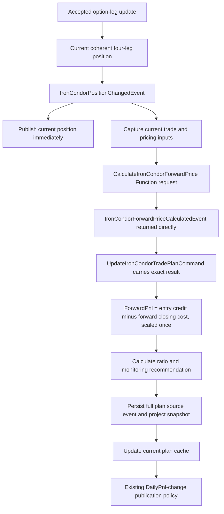

# Iron Condor ForwardPrice Function — Design and Implementation Plan

Date: 2026-10-20  
Status: Implemented; entry-credit projected-PnL v2 supersedes the historical v1 price-scaling rule  
Owner: `TomasAI.IFM.Domain.Trade/Futures/Option/Position/IronCondor`

Execution sequence and test gates: [ForwardPrice Function implementation plan](Iron-Condor-ForwardPrice-Function-Implementation-Plan.md).

## 1. Agreed calculation contract

The ForwardPrice Function returns the **projected Iron Condor price per strategy unit**, in option price points. It does not return ForwardLoss or a loss-probability result.

The Function price remains the amplified projected closing cost. The plan derives whole-trade PnL using the executed opening leg basis:

```text
EntryCreditPoints = -sum(leg.OpeningPrice * leg.SignedQuantity) / StrategyQuantity
ForwardPnl = (EntryCreditPoints - ForwardPrice) * ContractMultiplier * StrategyQuantity
ForwardLoss = min(0, ForwardPnl)
ForwardLossRatio = -ForwardLoss / MaxLossLimit
ExitRecommended = ForwardLoss <= -MaxLossLimit
```

EntryCreditPoints is per complete strategy unit. Contract multiplier and strategy quantity are applied once. A positive projected closing cost may generate a negative projected PnL when it exceeds entry credit. The plan no longer interprets a negative ForwardPrice as the trigger or multiplies price alone into loss. Current daily PnL is independent and does not gate the exit recommendation.

This is `IronCondor/EntryCreditForwardPnl/v2`. It stores entry credit and projected PnL in appended risk-payload keys 8 and 9. Historical v1 payloads retain their stored values/version and have no invented entry basis. Earlier implementation/test records below describe their then-current v1 behavior and are superseded by this contract.

The existing delta/time amplification and raw put-plus-call addition remain unchanged and uncapped. The amplified cost may exceed the physical payoff bound by explicit owner choice to anticipate adverse risk. No opening-price reference is added to the Function itself; the trade plan owns the subtraction and scaling. A failed Function or missing/noncredit opening basis produces the existing zero-price/error snapshot with no successful forward-risk or projected-profit result. This entry-credit rule applies to short/credit condors; debit entries are not silently converted to credits with Abs.

No `LossProbability`, MAD score, probability distribution, or `ForwardDailyPnl` calculation belongs to the new path. Existing per-leg deltas and OTM probabilities may still select the legacy forward adjustment's risk side; that does not invoke the retired loss-probability algorithm.

### 1.1 Purpose and agreed adjustment policy

Iron Condor ForwardPrice is strictly an exit-risk projection used by the trade plan to calculate ForwardLoss and ForwardLossRatio. It must not set an order limit, executable quote, fill valuation, mark-to-market value, or accounting balance.

Use the existing spread service formula unchanged for this migration. The owner considers its delta/time-based skew a gamma-like adjustment intended to amplify projected loss as conditions deteriorate and support an earlier exit. This is the agreed business heuristic; it is not a request to add explicit option gamma, a second-order expansion, a new adverse-price scenario, or an additional penalty.

The adjustment explicitly uses short-option delta, remaining/opening-to-expiry days and the existing risk-side selection. No new gamma input or gamma sensitivity qualification gate is required. Preserve the formula, its fallback/tie behavior and the current pricing conventions, then demonstrate its actual numerical behavior in tests. Do not claim a separate mathematical gamma model or require changes to the heuristic to make it one.

The objective is to recommend exit when the projected forward loss reaches the configured forward-loss exit limit, while actual incurred loss is still below that limit. Tests must prove this anticipatory behavior without waiting for actual loss to reach the same value. This is a model projection, not a guaranteed future executable market quote or guaranteed fill before actual losses increase.

## 2. Source evidence and current gaps

| Existing component | Verified responsibility | Migration treatment |
| --- | --- | --- |
| [IronCondorSpreadDistributionJobService](../../TomasAI.IFM.Domain.OptionPricer/SpreadDistribution/Job/Services/IronCondorSpreadDistributionJobService.cs) | Loads legacy trade/positions, solves leg IV, prices put/call spreads, applies forward adjustment, calculates a MAD loss score, and participates in a job lifecycle | Extract the forward-price behavior only; do not call the job service from the new Function |
| [ProbabilityValueCollection.SetForwardPrice](../../TomasAI.IFM.Domain.OptionPricer.Shared/ProbabilityValueCollection.cs) | Applies the delta/day-count forward adjustment to each spread | Numerical reference for parity tests |
| [OptionSpreadPricer](../../TomasAI.IFM.Framework.OptionPricer/Pricing/OptionSpreadPricer.cs) | Currently produces one theoretical-price observation for each spread | Reuse applicable numerical pricing; no Monte Carlo simulation is required by the current implementation |
| [IronCondorMonitoringDistributionCompute](../../TomasAI.IFM.Domain.Trade/Futures/Option/Position/IronCondor/Plan/Model/IronCondorMonitoringDistributionCompute.cs) | Contains an adaptation of the legacy forward formula to current trade/position inputs, plus unwanted loss-score/distribution mapping | Reuse/extract its forward-only arithmetic and tests. Search found no production caller of this helper's `Calculate` method |
| [IronCondorPositionChanged](../../TomasAI.IFM.Domain.Trade/Futures/Option/Position/IronCondor/Realtime/IronCondorPositionChanged.cs) | Publishes the current position, captures inputs, requests UpdateIronCondorTradePlan, and publishes the completed plan | Insert the ForwardPrice request before constructing the plan request |
| [IronCondorMonitoringInputReader](../../TomasAI.IFM.Domain.Trade/Futures/Option/Position/IronCondor/Plan/Model/IronCondorMonitoringInputReader.cs) | Supplies current trade/reference/pricing observations; background pricing currently captures configured scenarios | Supply one immutable current input capture; stop using scenario outputs as the new forward-price authority |
| [IronCondorTradePlanSnapshotCalculator](../../TomasAI.IFM.Domain.Trade/Futures/Option/Position/IronCondor/Plan/Model/IronCondorTradePlanSnapshotCalculator.cs) | Currently derives forward values from adverse scenarios and converts ForwardDailyPnl into a nonnegative loss | Replace that forward-risk branch with the Function result and the agreed signed scaling formula |
| [UpdateIronCondorTradePlan](../../TomasAI.IFM.Domain.Trade/Futures/Option/Position/IronCondor/Plan/Function/UpdateIronCondorTradePlan.cs) | Builds/persists the current plan; recommendation mapping currently uses forward daily PnL and positive loss fields | Consume the new typed forward result, update signed risk mapping, and remove the old forward-PnL dependency for this version |

Simply assigning the existing `IronCondorTradePlanInputs.PutForwardPrice` and `CallForwardPrice` properties is insufficient: the active daily-risk calculator currently derives its own forward values from scenario leg observations.

## 3. Target event flow



The Function result is returned through Core NATS request/reply. It is not a new event-stream broadcast. The Realtime handler owns orchestration; it passes the returned domain payload into the plan request. The UI performs no forward calculation.

Retain the existing policy: generate/cache/persist every accepted plan calculation; publish plan notifications when the existing publication policy permits them. This migration does not introduce an additional ForwardPrice-change publication trigger.

## 4. Ownership and proposed files

Implementation follows both [Actor Implementation Conventions](Actor-Implementation-Conventions.md#133-functionactor-convention) and [Actor Event Modeling Conventions](Actor-Event-Modeling-Conventions.md), plus [Structured Logging Conventions](Structured-Logging-Conventions.md).

```text
TomasAI.IFM.Domain.Trade/
  Futures/Option/Position/IronCondor/ForwardPrice/Function/
    Actor/
      IronCondorForwardPriceFunctionActor.cs
      IIronCondorForwardPriceFunctionContext.cs
      IronCondorForwardPriceFunctionContext.cs
    CalculateIronCondorForwardPrice.cs
    CompleteIronCondorForwardPrice.cs
    FailIronCondorForwardPrice.cs
    ResolveIronCondorForwardPriceExecutionPolicy.cs
    Model/
      IronCondorForwardPriceCompute.cs
    State/
      IronCondorForwardPriceFunctionState.cs
      IronCondorForwardPriceStateRepository.cs

TomasAI.IFM.Domain.Trade.Shared/
  Futures/Option/Position/IronCondor/ForwardPrice/
    CalculateIronCondorForwardPriceCommand.cs
    IronCondorForwardPriceCalculatedEvent.cs
    IronCondorForwardPriceFailedEvent.cs
    IronCondorForwardPriceInputs.cs
    IronCondorForwardPrice.cs
```

Use an existing compatible position/session identity where possible. Add a dedicated `IronCondorForwardPriceId` only if the existing identity cannot express the required stream/route scope. Keep new files aligned with the actual Shared hierarchy established during implementation; do not relocate published older contracts as part of this work.

The concrete actor inherits the existing Function base directly and owns explicit frozen parse, validation, receive, execution-policy, and terminal-event maps. Each mapped message has its own documented static extension handler. Compute models perform pure arithmetic and return immutable business objects. Any completed Function state is applied through the established event/state dispatcher, with no mutable shadow aggregate in Model.

## 5. Request and return contracts

### 5.0 Trade ownership of required OptionPricer functionality

Any functionality required by the new ForwardPrice path that currently belongs to `TomasAI.IFM.Domain.OptionPricer` or `TomasAI.IFM.Domain.OptionPricer.Shared` moves to Trade ownership. The original `IronCondorSpreadDistributionJobService` is excluded from that relocation: it remains a legacy reference/compatibility service while its needed forward behavior is extracted. The new Function must not invoke it or depend on an OptionPricer job actor to calculate a price.

Needed reusable pure calculation support and shared contracts/types belong under the mirrored ForwardPrice area of `TomasAI.IFM.Domain.Trade.Shared`, with Trade namespaces and business-domain names. Function actor orchestration, persistence/context implementations and actor-specific handlers remain under `TomasAI.IFM.Domain.Trade` according to actor conventions. Move required ownership and consumers; do not leave the active path coupled to OptionPricer through a wrapper.

| Existing dependency | Treatment for the new path |
| --- | --- |
| `ProbabilityValueCollection.SetForwardPrice` arithmetic | Extract the required delta/time/fallback calculation into a pure Trade.Shared helper; preserve the formula exactly |
| `CreditSpreadPricerArgs` and `OptionStyle` | Move needed input fields/conventions into Trade.Shared-owned types if required by the extracted calculation; audit other consumers and published schemas before retiring originals |
| `OptionSpreadResult`, `ProbabilityValue` and `SpreadDistribution` | Move only the required forward-price support to Trade.Shared or replace the legacy container with an equivalent lean Trade-owned forward result; do not carry unused simulation/distribution payloads into the new Function |
| `SpreadDistributionJobReadModel`, `SpreadDistributionReadModel`, job commands/events, device factories and loss-probability support | Not needed by the new forward-only flow; do not migrate these wholesale merely because the old service referenced them |
| `Framework.OptionPricer` numerical engine | Remains the backend framework engine. Any legacy adapter used by the new path must accept Trade-owned inputs or be replaced by direct backend calculator use; do not add a Trade.Shared dependency on the framework implementation |

`Domain.OptionPricer.Shared` already references `Domain.Trade.Shared`. Do not introduce a reverse reference from Trade.Shared to OptionPricer.Shared, or a Trade.Shared → Framework.OptionPricer → OptionPricer.Shared → Trade.Shared cycle. Shared arithmetic must remain independent of the framework calculator; the Trade Function compute implementation can call that backend calculator with captured inputs.

Add an explicit dependency inventory and architecture tests proving that the new request/result types, shared forward helper and active Function path contain no `TomasAI.IFM.Domain.OptionPricer*` dependency. Published legacy contracts may retain narrowly documented compatibility adapters for old callers until their migration is verified; those adapters must not become required by the new path. Preserve MessagePack keys and persisted type compatibility when moving a type that has a published representation.

### 5.1 CalculateIronCondorForwardPriceCommand

The command carries framework identity plus a typed `IronCondorForwardPriceInputs` business property containing:

- Established trade identity, trade type, opening exchange date, and expiry.
- Exact current `StrategyPositionSnapshot` and its route generation/position observation identity.
- Four exact contract/leg identities, option rights, strikes, signed quantities/ratios, and actual contract pricing conventions.
- Current per-leg theoretical prices, short-option deltas and the OTM observations required to choose the legacy risk side. Capture quote marks as well for the existing documented spread fallback.
- The actual contract currency and multiplier, validated against all four legs.
- Source position-change event identity, input capture time, market/pricing provenance, model version, canonical input fingerprint, and bounded deadline.

Capture these once for the request. The pure compute handler does not query Scylla, reload trade history, acquire another option feed, or read changing caches halfway through calculation. Missing inputs produce a typed unavailable/failure result; do not substitute zero, a fake quote, a fixed multiplier, or an older trade's values.

Use the current trade/position and qualified contract pricing inputs. Do not recreate `OptionTradeReadModel` or `TradePositionReadModel` merely to call the legacy service. Reuse already compatible leg valuations where their model/day-count/horizon matches the requested calculation; otherwise compute with the existing backend OptionCalculator using captured inputs. Numerical work stays off tick ingestion and the UI thread.

### 5.2 IronCondorForwardPriceCalculatedEvent

Return `FunctionResult<IronCondorForwardPriceCalculatedEvent, IronCondorForwardPriceFailedEvent>`. Exactly one terminal event is present.

The completed event has a business property named `IronCondorForwardPrice`, containing:

| Field | Meaning |
| --- | --- |
| `ForwardPrice` | Signed projected Iron Condor price per complete strategy unit, in option points |
| `PutForwardPricePoints`, `CallForwardPricePoints` | Signed component prices whose sum equals ForwardPrice; explicit unit names avoid confusion with existing currency-valued plan fields |
| `Currency`, `ContractMultiplier` | Evidence from the actual matching option contracts; the price remains unscaled |
| `StrategyQuantity` | Number of complete strategies represented by the captured position |
| Trade/position/session identity | The exact position that was priced |
| Source event/observation identity, input fingerprint | Correlation to the captured request |
| `CalculatedAtUtc`, model version | Calculation provenance |

There is no `LossProbability`, `ForwardLoss`, or `ForwardDailyPnl` property in this Function result. The typed failure supplies its business reason and request identity; it does not masquerade as a zero-price completion.

Every terminal event factory explicitly assigns `CommandId = command.CommandId`. The subsequent plan request has its own command identity and retains the ForwardPrice command/result identity as provenance. A different input snapshot must not reuse a command identity with a different payload.

## 6. Forward-price computation

### 6.1 Recover the existing spread adjustment as the migration baseline

For each put/call spread, retain the existing rule:

```text
skew = abs(shortOptionDelta) × sqrt(remainingDays / openingToExpiryDays)
forwardSpread = spreadMean × (1 + 2 × skew)    when the spread is selected as the risk side
forwardSpread = spreadMean × (1 - 2 × skew)    for the other side
```

Use the legacy selection rule based on the relative put/call OTM observations. Retain its equality/tie behavior. Preserve the existing fallback from a nonpositive calculated spread mean to the captured current spread magnitude; unavailable required data is a failure, not a fabricated fallback.

The legacy denominator named `tradingDays` actually uses calendar date differences between opening date and expiry. Record the source dates and preserve this convention during migration. Separately pin the numerical leg-pricing convention: the old job's pricing horizon may be capped at 48 days while its forward adjustment uses actual remaining days. Parity fixtures must expose that distinction. Reusing a current full-expiry valuation without matching this policy is a model change and must receive a new explicit calculation version; it must not be described as exact legacy parity.

No simulation arrays, sorting, MAD calculations, probability counts, or `SpreadDistributionReadModel` construction are needed for the new forward-only output. The current legacy pricer produces one theoretical observation per spread; tests must compare against that actual implementation.

### 6.2 Combine into the actual strategy price

Combine the put/call forward spread values using the established trade's actual signed leg ratios and the existing strategy debit/credit price convention. Return the net price for **one** strategy unit. Do not sum absolute spread prices to create an unsigned total, infer direction from a display label, or multiply by strategy quantity inside this price.

Short/long Iron Condors need separate golden cases. The migration must preserve the legacy component formula while explicitly mapping its spread magnitudes to the current signed strategy price. This mapping is a necessary adaptation; copying the legacy positive-magnitude total would lose the requested sign.

All four legs must form the supported atomic strategy with equal absolute strategy quantities and matching positive cash multipliers/currency. Unsupported residual leg ratios or mixed currencies produce a typed failure rather than an approximate combined result.

### 6.3 Preserve the owner's existing gamma-like heuristic

The formula in section 6.1 is the selected model for the initial migration. Keep its calculation in the ForwardPrice Function and return the resulting Iron Condor price. The trade-plan calculator scales that result once and evaluates the configured forward-loss ratio/exit threshold.

Do not add a direct Gamma term, delta/gamma Taylor expansion, extra underlying stress move, alternate scenario repricing, new gamma weighting parameter, or additional risk penalty. Current gamma may remain available as an independent position/display observation, but it does not become a new prerequisite or numerical input to this forward adjustment.

Qualification establishes parity with `IronCondorSpreadDistributionJobService`/`SetForwardPrice`, the correct current-model signed strategy combination, and the requested early-exit behavior. It does not require independent gamma monotonicity. If numerical fixtures show the recovered component formula cannot satisfy the required signed-price or early-exit contract, report the precise mismatch; do not silently change the formula or force the output sign.

## 7. Trade-plan integration

### 7.1 Realtime orchestration

In `IronCondorPositionChanged.ExecuteAsync`:

1. Publish the accepted current position as today.
2. Capture one current trade/contract/pricing input set.
3. Request the ForwardPrice Function with that capture and the source event identity.
4. On completion, attach the exact typed result to `UpdateIronCondorTradePlanCommand` using an appended MessagePack key.
5. Have the plan Function verify that the result belongs to that request's trade, position capture, session and input fingerprint, then use it directly.
6. Update the plan cache and follow the existing plan persistence/publication policy.

This is calculation-result correlation, not a new source-sequence admission rule for incoming option legs. Do not reintroduce provider sequence-based rejection in the hot option cache.

### 7.2 Existing trade-plan forward-loss calculation point

Pass the returned Iron Condor ForwardPrice into `IronCondorTradePlanSnapshotCalculator` where `CalculateForwardRisk` currently calculates ForwardDailyPnl and ForwardLoss. Replace that forward-loss input path; do not calculate ForwardLoss in the ForwardPrice Function or send a pre-scaled loss as its result.

The plan derives the entry credit from the same position's four opening prices, retaining whole-strategy quantity and actual contract currency:

```text
EntryCreditPoints = -sum(leg.OpeningPrice * leg.SignedQuantity) / StrategyQuantity
ForwardPnl = (EntryCreditPoints - returned.ForwardPrice) * returned.ContractMultiplier * returned.StrategyQuantity
ForwardLoss = min(0, ForwardPnl)
```

The Function result stays unchanged; it is a closing-cost projection. The plan stores the exact entry-credit basis and whole-trade ForwardPnl as v2 evidence. No daily-PnL addition, extra gamma term, payoff cap or commission adjustment is introduced. Current daily commissions and marks retain their independent definitions.

| Entry credit points | Forward closing-cost points | Multiplier | Quantity | ForwardPnl currency | ForwardLoss currency |
| ---: | ---: | ---: | ---: | ---: | ---: |
| 10 | 12.5 | 50 | 3 | -375 | -375 |
| 10 | 12.5 | 50 | 4 | -500 | -500 |
| 10 | 10 | 50 | 4 | 0 | 0 |
| 10 | 7.5 | 50 | 4 | 500 | 0 |
| 10 | 12.5 | 20 | 3 | -150 | -150 |

A zero price with ForwardPriceCalculationError is a failure fallback. It never enters this successful-PnL calculation. Missing opening prices or a nonpositive net entry credit leave the new risk unavailable rather than inventing a credit or silently applying the short-condor rule to a debit position.

### 7.3 Ratio, headroom and recommendations

Use `MaxLossLimit` as the positive magnitude of the configured maximum loss for this trade, in the same actual contract currency as ForwardLoss. Capture its exact source identity/version with the inputs. If the configured `TradeLimits.MaxLoss` is stored as a negative currency amount, normalize that limit to its positive magnitude once at the input boundary. ForwardLoss itself retains its negative sign. Do not silently substitute a daily-loss budget or another risk limit when the trade's maximum-loss limit is unavailable. Existing DailyLossLimit fields retain their separate current-daily-risk meaning.

The owner's rule is "exit when projected loss magnitude reaches MaxLossLimit." Because ForwardLoss is signed, express it as:

```text
ForwardLossRatio = -ForwardLoss / MaxLossLimit
ForwardLossHeadroom = MaxLossLimit + min(ForwardLoss, 0)
ExitRecommended = ForwardLoss <= -MaxLossLimit
// Equivalent: ForwardLossRatio >= 1
```

Do not implement the literal signed comparison `ForwardLoss >= MaxLossLimit`: a negative loss cannot cross a positive limit that way. Preserve the negative ForwardLoss value throughout; only the limit/ratio convention provides the magnitude comparison.

With MaxLossLimit = 500:

| Signed ForwardLoss | ForwardLossRatio | Headroom | ExitRecommended |
| ---: | ---: | ---: | --- |
| -375 | 0.75 | 125 | false |
| -500 | 1.00 | 0 | true |
| -600 | 1.20 | -100 | true |
| 0 | 0.00 | 500 | false |
| 0 (projected profit) | 0.00 | 500 | false |

Missing/nonpositive/mismatched-currency MaxLossLimit makes evaluation unavailable. Do not generate a normal or no-risk conclusion from that failure.

There is no `DailyPnl < 0` prerequisite and no requirement that actual DailyLoss first reach any threshold. A successful, applicable ForwardPrice calculation crossing the projected-loss limit is sufficient for this monitoring exit recommendation, including when actual loss is smaller or current DailyPnl is nonnegative. Warning displays may retain separately configured lower thresholds; they cannot prevent or delay exit at ratio 1. The change supersedes the previous design's retained current-DailyPnl exit gate.

Record the exact forward calculation, MaxLossLimit, ratio and reason in the versioned plan evidence. The monitoring plan issues the exit recommendation through its existing action semantics; order placement and financial/broker authorization continue through the separate execution workflow. Earlier projected-loss detection is intended to provide time to exit before actual loss reaches the limit; it does not guarantee fills, a fixed lead time, or an actual loss cap.

### 7.4 Remove competing forward paths

For the new calculation version:

- `IronCondorTradePlanSnapshotCalculator` uses the returned ForwardPrice and signed ForwardLoss formula instead of calculating ForwardDailyPnl from adverse scenario values.
- `UpdateIronCondorTradePlan.ApplyMonitoringRecommendation` maps the new signed result and ratio. Do not copy the value into an old field documented as a nonnegative loss or into `ForwardPnl` as if it were a PnL calculation.
- Audit `IronCondorTradePlanAlgorithm` and its fallback path so its existing positive-loss calculation cannot overwrite the new result or become a silent fallback on Function failure.
- Remove forward scenario generation from the active forward-price path. Keep independently required current Greek/mark observations; do not remove current valuation or DailyPnl calculation.
- Do not call `IronCondorMonitoringDistributionCompute.Calculate` wholesale: its loss-score and distribution-adapter behavior is outside the new contract.

## 8. Versioning, persistence and UI

Existing `IronCondorTradePlanSnapshot.ForwardLoss` at key 59 is documented as a **nonnegative** loss. `StrategyTradePlanSnapshot.ForwardLoss` also currently receives positive loss magnitudes. Changing these values silently would break historical interpretation and potentially affect other strategies.

Append a typed versioned Iron Condor forward-risk object to the relevant plan contract(s), preserving all existing numeric keys. The new object's business property is `ForwardLoss` with the signed definition above, together with the returned ForwardPrice, multiplier, quantity, currency, ratio, source result identity and calculation version. Add the Function result to the plan command at its next available key. Validate exact key choices against the current files when implementing.

For newly generated plans, old forward-daily-PnL observations remain unavailable where nullable. Legacy nonnullable envelope fields retain compatibility behavior and are not used by updated Iron Condor consumers as current forward-risk authority. Consumers must inspect the new typed object/status; a default zero in an old envelope is never a completed new calculation.

Update `TradePlanDbParameters`, schema/projection migrations, hashes, query mappings and UI read adapters to store/display the new signed ForwardLoss and source price explicitly. Preserve old rows and their original model versions. Do not reinterpret historical positive-loss columns as signed values or merge old/new ratios into one unlabelled series. The generic shared strategy fields used by futures/verticals retain their existing semantics.

The UI's ForwardLoss column displays signed currency and the ForwardPrice display shows points. ForwardLossRatio remains a ratio/percentage, never a loss-probability percentage. Retained last-valid display data can remain visible with its original observation/status; it must not be presented as a fresh successful result after a failed calculation. No UI pricing, currency scaling or loss-ratio arithmetic is introduced.

## 9. Function lifecycle, availability and performance

Use the existing completed-only Function framework with no distribution-job projector and no JetStream replay consumer. Its base currently persists successful terminal events; Core NATS request/reply does **not** make that persistence disappear. Implement the compatible completed-state repository, load only the state required for request identity/idempotency, and include the exact completed result in the persisted plan evidence. Failed calculations do not persist a fake completed result.

Do not implement a hidden in-memory repository to bypass the framework convention. A calculation-only Function base without per-call source persistence would require a separately documented framework change. Measure the completed-event append and the additional request/reply in qualification; do not describe this design as a database-free realtime path.

Keep deadlines and generation fencing in the existing framework/typed policy extensions. No indefinite retry, drain wait, job-in-progress polling, or recursive retry loop. A repeated delivery of the same exact request may return its existing matching completion; a new input requires a new request identity. A newer ordinary option update can start a new calculation after a failure.

A timeout/unavailable result must not undo the already published position, block raw option-cache updates, reset the whole market feed, or publish a normal/zero-risk plan. Pass the typed failure status into the existing plan-unavailable path using an explicit contract so current observations remain visible without a fresh risk recommendation.

Structured diagnostics record component/method, trade/position identity, source/request identity, model version, outcome and elapsed time at the boundary. Use existing tracing/metrics for capture, Function round trip, arithmetic, completion persistence, plan calculation and projection. Avoid per-leg payload serialization and synchronous success logging in the hot path. Benchmark p50/p95/p99 and allocations under realistic open-trade counts and option update rates.

## 10. Implementation stages

| Stage | Work | Completion evidence |
| --- | --- | --- |
| 1. Pin contracts and semantics | Add typed input/result/terminal contracts; define signed price convention, currency and quantity basis; append versioned plan payloads | Wire round trips, permanent-key checks, numerical examples and old-payload compatibility |
| 2. Extract the agreed forward-only computation | Adapt the existing forward helper to current inputs with the existing formula unchanged; remove loss-probability/distribution dependencies | Legacy numerical parity, risk-side/fallback behavior, raw component combination without direction-based sign inversion, and early-exit fixtures |
| 3. Implement Function actor | Add five maps, documented extension handlers, typed failure/policy handling and completed-only repository; register API/actor routes and client invocation | Actor dispatch, completion/failure, cancellation, idempotency and persistence tests |
| 4. Connect position events | Capture inputs once; request ForwardPrice before plan; pass completed result or explicit unavailable status | Option-leg update → coherent position → Function → exact plan request integration test |
| 5. Switch plan forward source | Use signed scaling/ratio; remove the active forward-daily-PnL/scenario dependency; update completeness, recommendation mapping and hashing | No competing forward source; numerical and missing-input tests |
| 6. Update storage and views | Add versioned projection/query mappings and schema migration; bind UI fields to signed forward-risk payload | Real storage round trip, historical rows unchanged, Rust/WinForms display checks |
| 7. Qualify development operation | Run isolated NATS and actual provider/frozen-data integration, failure injection, performance measurement and builds | Recorded results; no fabricated quotes, PnL, multipliers or zero-risk completions |
| 8. Retire compatible legacy callers deliberately | Inventory remaining UI/backend/test submissions; remove or disable only migrated entry points after parity passes | No current established-trade path depends on the old job service; remaining compatibility behavior is documented |

The old job implementation is not deleted automatically. It still has legacy callers and integration tests; deleting it before those are assessed would be a separate behavior change.

## 11. Required verification matrix

- Formula preservation: compare the Function compute output to the original spread-service component calculation across short deltas, remaining/opening-to-expiry day ratios, risk-side selections, ties and fallback cases. Changing an unrelated captured Gamma value must not introduce an additional adjustment or change a result when all actual formula inputs are unchanged.
- Early-exit integration: drive captured leg inputs through the real ForwardPrice Function and TradePlan actors so the returned signed price produces a ForwardLoss that reaches/exceeds the configured forward-loss exit threshold while actual DailyLoss remains below its corresponding configured actual-loss limit. Verify the exact price/scaling/ratio and exit recommendation with no current-DailyPnl gate or actual-loss-threshold prerequisite. Include below/at/above MaxLossLimit, equality, and nonnegative current DailyPnl cases.
- Risk-only ownership: the returned forward price is not used to set executable quotes, order prices, marks, fill values or accounting balances.

- Exact legacy component forward adjustment, OTM risk-side selection including ties, positive/nonpositive mean behavior, positive day-count requirements and expiry boundaries.
- Explicit tests of legacy capped pricing horizon versus actual contract expiry; record the selected model version and detect accidental convention changes.
- Short and long Iron Condors with exact contract identities, put/call ordering independence, signed debit/credit convention and atomic leg ratios.
- ForwardLoss scaling for quantities 1, 2 and 10; more than one contract multiplier/currency; scaling applied exactly once. Missing/mismatched multipliers or currencies fail explicitly.
- ForwardPrice computation unit tests use actual captured leg/trade inputs to demonstrate negative (projected loss), zero and positive output under the requested business convention. Cover short and long Iron Condors. Do not satisfy these tests merely by hardcoding a negative mock return or negating every credit strategy. If the recovered legacy formula/sign adapter cannot meet this convention, report the mismatch before implementing an alternative formula.
- Trade-plan unit tests feed negative, zero and positive Function prices into the existing forward-loss calculation point. Verify that the price arrives unchanged and currency/quantity scaling happens exactly once; the plan subtracts closing cost from captured entry credit, clamps ForwardLoss to min(0, ForwardPnl), and applies no DailyPnl addition or commission deduction.
- Integration tests exercise an option-leg update through the real ForwardPrice Function result into `UpdateIronCondorTradePlanCommand` and the final persisted plan. For a completed closing cost of 12.50, entry credit 10, multiplier 50 and quantity 3, assert the plan receives 12.50 unchanged and calculates ForwardPnl/ForwardLoss = -375.00. Repeat for zero/positive prices and another multiplier/quantity. Assert the Function event contains ForwardPrice, not ForwardLoss; no intermediate adapter changes the sign or substitutes ForwardDailyPnl.
- Ratio/headroom cases below, at and beyond the configured trade MaxLossLimit, positive ForwardLoss, missing limits and currency mismatch. Equality triggers exit. Demonstrate that zero/positive current DailyPnl does not suppress the projected-loss exit and that no remaining old recommendation mapper reintroduces that gate.
- Missing leg valuations, incomplete position, stale generation, malformed contract, duplicate/mismatched result identity, nonfinite arithmetic, overflow, timeout, cancellation and failed persistence. No fake success or zero-risk replacement.
- `CommandId` propagation, immutable input fingerprints, matching duplicate request replay, and new-input/new-command behavior. Incoming option-cache acceptance does not acquire a sequence-order filter.
- Real Core NATS transport through the registered Function actor and onward to the TradePlan Function, with exact completed result in plan source evidence.
- Real Scylla projection/query and relevant TradePlanDb storage round trips, additive schema changes, old MessagePack payloads/history and unambiguous new display semantics.
- UI integration: current position remains visible while calculation fails; signed currency and points show in their correct fields; no local computation; status and last-valid observation age remain clear.
- Persistence/publication regression: every accepted plan is cached/persisted; existing DailyPnl-change notification suppression remains intact.
- Load/failure measurements for the additional Function round trip and completed-event append. Record arithmetic time separately from messaging and storage latency.

## 12. Acceptance checklist

- [ ] The original delta/time forward formula is preserved as the agreed gamma-like heuristic, with no extra Gamma model or adjustment.
- [ ] Unit/integration tests establish formula parity and an exit recommendation at the configured projected-loss threshold before the actual-loss limit is reached.
- [ ] ForwardPrice Function returns only the typed projected strategy price and its evidence, with no loss probability or ForwardLoss result.
- [ ] Numerical and integration tests prove a negative generated Iron Condor ForwardPrice is treated as a projected forward loss, and that the exact returned price reaches the existing plan calculation point.
- [ ] Plan ForwardPnl equals (entry credit - returned ForwardPrice) times actual multiplier and quantity; ForwardLoss retains only negative PnL.
- [ ] Ratio, headroom and recommendation consumers use the explicitly versioned signed-value basis and exact trade MaxLossLimit; exit triggers at ForwardLossRatio >= 1 with no actual-loss or current-DailyPnl prerequisite.
- [ ] The active Iron Condor path no longer derives its forward-risk input from ForwardDailyPnl or an independent adverse-scenario forward price.
- [ ] Existing published keys, historical rows and other strategies retain their original meanings.
- [ ] No old spread-distribution job/table is required by the new calculation path.
- [ ] Failure leaves current positions/cache updates available and produces explicit unavailable plan risk.
- [ ] Actor/event-modeling conventions, XML documentation, integration tests and performance evidence are complete.
- [ ] Relevant backend/UI builds pass and development qualification records distinguish simulated/frozen inputs from actual provider observations.

This document supersedes the forward-price/ForwardLoss calculation proposal in earlier discussion for this migration. Other monitoring design sections remain in effect unless explicitly changed above. It does not claim that runtime implementation or live qualification has been completed.


## 13. Implementation status - 2026-10-20

The Function actor, Trade.Shared arithmetic/contracts, position-to-Function-to-plan request chain and versioned signed-risk plan branch are implemented. See the [implementation record](Iron-Condor-ForwardPrice-Function-Implementation-Plan.md#13-implementation-record--2026-10-20) for the concrete paths and verification limits.

**Final sign clarification:** use raw adjusted put price plus adjusted call price; never negate the result because the position is short. Put 21 plus call 9 returns +30 and does not recommend a projected-loss exit. A returned zero produces zero ForwardLoss. A zero current mark is not enough to infer the theoretical forward result.

The required arithmetic is now Trade.Shared-owned; the new Function does not call the legacy spread job. Current captured leg valuations replace distribution construction, and the active input reader no longer constructs an independent adverse forward scenario. The Function returns the typed price and exact inputs; plan generation alone performs currency/quantity scaling. Its configured budget is the initialized trade `MaxLoss` in currency, rather than the similarly named legacy `MaxLossLimit` in points.

The completed result and versioned risk are carried by existing full-plan persistence. Legacy positive-loss members retain their old meaning; Rust binds signed values from the new risk payload. The existing notification policy remains unchanged. Recommendations are generated only; this work does not add a plan-monitor consumer or execute exits.

Numerical/end-to-end testing and performance qualification are deferred at the owner's request. Build checks do not complete the acceptance checklist or establish live qualification.


### Forward-price failure fallback

When the ForwardPrice Function returns an error, plan generation continues with current position values. The snapshot stores `ForwardPrice = 0`, `CombinedForwardPrice = 0` and the append-only `ForwardPriceCalculationError` string (MessagePack key 102), prefixed with `Forward price calculation error:` and followed by the returned error code/detail and message. The same message is carried in the plan explanation/exit reason and persisted with the full plan payload.

The zero is an explicit failure fallback. Forward-risk evidence remains unavailable rather than being fabricated as a successful zero-risk calculation. Existing unavailable-risk status/action behavior is preserved. A subsequent successful calculation supplies the actual forward price and clears the error string. Numerical/end-to-end testing remains deferred as requested; a focused persistence regression case has been added for later execution.


## Test execution results - 2026-10-20

The owner subsequently authorized test execution. The previously deferred numerical and error-fallback tests have now run.

| Suite | Passed | Failed | Skipped | Evidence |
| --- | ---: | ---: | ---: | --- |
| Full Domain.Trade unit suite, including new forward-price cases | 1567 | 0 | 0 | `.artifacts/forward-price-trade-suite.log` |
| Real Function actors/repositories and disposable PostgreSQL event log + trade-plan store | 3 | 0 | 0 | `.artifacts/forward-price-postgres-tests.log` |

Verified: raw positive 21 + 9 = 30 without a short-position sign inversion; formula-generated negative price -77.2; zero-price inputs; signed scaling using actual multipliers and quantities; exact maximum-loss threshold; exit recommendation despite positive current daily PnL; MessagePack input evidence; failure fallback with persisted zero price and explicit error. Database tests cover successful completion committed before reply, idempotent replay with one source event, persisted full-plan risk evidence, and failed Function calculation followed by a persisted error-bearing plan without a successful forward-risk payload.

One convention test initially failed because its explicit inventory omitted the new Function actor. The inventory now includes it and applies the existing frozen-policy-map checks. The first database attempts also revealed an uninitialized stream-ID cache substitute in the new harness; the harness now uses the real cache adapter with a cache-miss test double. These were corrected and the relevant suites rerun successfully. No production calculation change was required by these findings.

Scope: numerical inputs are synthetic controlled fixtures, not provider market data. Integration uses actual actor dispatch, repositories and PostgreSQL, with direct request dispatch and mocked auxiliary service capabilities. Production NATS routing, running UI, live provider operation, failure-injection/load qualification and latency/percentile measurements are not established by this run. Disposable infrastructure was cleaned up by the fixture; running development applications were not restarted.


## Coherent four-leg valuation scenarios - 2026-10-20

The earlier -77.2 fixture is an artificial boundary test, not a coherent market valuation. The new `IronCondorForwardPriceValuationScenarioTests` use the production `OptionCalculator` European upfront-premium futures-option engine to compute every entry, prior-session and current leg price and delta. Current marks equal those computed fair prices; no market quote or execution is claimed. Numerical precision is retained rather than rounding to execution tick sizes.

### Fixed contract and valuation inputs

- One short Iron Condor: short put 5850, long put 5800, short call 6150, long call 6200. Both wings are 50 points.
- USD contract multiplier 50, quantity 1; zero commissions/slippage for this model comparison.
- Entry valuation: 2026-09-21 16:00 UTC; futures 6000, IV 20%.
- Prior-session reference: 2026-10-19 21:00 UTC; futures 6000, IV 20%.
- Current valuation: 2026-10-20 16:00 UTC. Expiry: 2026-11-19 21:00 UTC.
- Continuously compounded annual rate 4%, Actual/365 Fixed. Flat-case IV is solved at the current timestamp to reproduce the prior-session condor price, within USD 0.000001; daily PnL is not overwritten with zero.
- Entry credit is 35.642705870764 points. Prior-session close cost is 30.7490247776802 points.

Each position leg's entry price, baseline mark, current mark and current delta come from those consistent model inputs. Cumulative unrealized PnL and daily opening PnL are independently derived from the entry/baseline marks. Daily PnL = (prior-session close cost - current close cost) * multiplier * quantity, verified against the position's change in cumulative PnL. Put/call parity and vertical/whole-condor price bounds are checked for the current fair valuations.

### Comparison results

Prices below are per-condor points; current close cost is positive and the short holding's signed market price is its negative. ForwardPrice is the unchanged raw heuristic output, without sign inversion. Difference compares that raw output with the positive current close cost; it is not measured prediction error against a subsequently observed market price.

| Scenario | Futures | IV | Daily PnL USD | Current close cost | Raw ForwardPrice | Forward minus current |
| --- | ---: | ---: | ---: | ---: | ---: | ---: |
| Large profit | 6000 | 8.00000000% | +1020.66 | 10.33581911 | 10.44093965 | +0.10512054 |
| Small profit | 6000 | 19.00000000% | +57.51 | 29.59890458 | 29.78886600 | +0.18996142 |
| Flat | 6000 | 20.25729100% | +0.00 | 30.74902478 | 30.93460909 | +0.18558432 |
| Small loss | 6000 | 21.00000000% | -31.14 | 31.37183361 | 31.55457283 | +0.18273922 |
| Large loss | 6600 | 20.00000000% | -671.06 | 44.17025581 | 99.34726587 | +55.17701006 |

### Observed behavior of the unchanged heuristic

All five returned forward prices are positive, including both daily-loss scenarios, so none produces a forward-loss exit under the current negative-price-only convention. The large-loss case returns 99.347265874209068 points versus a current fair close cost of 44.17025581108851 points. The raw heuristic exceeds the 50-point maximum expiry payoff of this condor; it is not a bounded fair option-spread price obtained by repricing the four legs at a future timestamp. The small cases differ from current close cost by approximately 0.1-0.2 points. This is an observed consequence of preserving the requested formula, not a sign change or a test manufactured to force an exit. No production formula/risk-rule changes were made.

Six tests passed: the five specified PnL cases and an evidence export test. Full-precision aggregate data: `.artifacts/forward-price-coherent-valuations/scenarios.csv`; all leg entry/baseline/current prices and deltas: `legs.csv`; all model assumptions and outputs: `scenarios.json`. Execution log: `.artifacts/forward-price-coherent-tests.log`.

Existing artificial boundary fixtures remain only for protocol, failure and threshold coverage and are explicitly labeled accordingly; their -77.2 result is not used to claim realistic valuation or predictive accuracy. Historical market-data replay and comparison to a later realized outcome would be separate qualification.


## Entry-credit projected PnL v2 - implementation and test results

Approved change: retain the original uncapped delta/time amplification and direct put-plus-call price sum. The Function still returns raw projected closing cost. The trade plan now computes gross whole-trade projected PnL from the weighted opening-fill prices already stored on its position legs:

```text
EntryCreditPoints = -sum(OpeningPrice * SignedQuantity) / completeStrategyQuantity
ForwardPnl = (EntryCreditPoints - ForwardPrice) * actualMultiplier * completeStrategyQuantity
ForwardLoss = min(0, ForwardPnl)
ForwardLossRatio = -ForwardLoss / positiveMaxLossLimit
ExitRecommended = ForwardLoss <= -positiveMaxLossLimit
```

Entry credit and ForwardPnl are appended as nullable MessagePack keys 8 and 9 on IronCondorForwardRisk. Fresh results explicitly use `IronCondor/EntryCreditForwardPnl/v2`; old v1 records keep their original version/values and absent basis fields. The generic plan envelope receives projected PnL and a nonnegative loss magnitude for compatibility; the typed risk retains signed ForwardLoss. The actual contract currency and multiplier are unchanged. This calculation excludes fees, slippage and funding adjustments, matching the agreed minimal gross-PnL formula.

A failed Function still produces zero forward price and the persisted error message, with no successful risk/PnL result. Missing or nonpositive opening-credit basis also reports unavailable evidence; it is not assumed to be zero or converted with Abs. No extra database query is required to capture entry credit. Historical numerical/test records above refer to their then-current v1 rule and do not supersede this v2 contract.

### Same coherent valuation scenarios rerun

All rows use entry credit 35.642705870764 points, quantity 1, multiplier USD 50 and a USD 1000 whole-trade loss budget. Current daily PnL remains a separate prior-session observation; the new projected PnL uses the original entry reference.

| Scenario | Current daily PnL USD | Forward closing cost points | Projected whole-trade PnL USD | Signed ForwardLoss USD | Exit recommendation |
| --- | ---: | ---: | ---: | ---: | --- |
| Large profit | +1020.66 | 10.44093965 | +1260.09 | 0.00 | No |
| Small profit | +57.51 | 29.78886600 | +292.69 | 0.00 | No |
| Flat | +0.00 | 30.93460909 | +235.40 | 0.00 | No |
| Small loss | -31.14 | 31.55457283 | +204.41 | 0.00 | No |
| Large loss | -671.06 | 99.34726587 | -3185.23 | -3185.23 | Yes |

The large-loss fixture's actual whole-trade PnL is approximately -426.38 USD, while its amplified projected PnL is -3185.23 USD. The recommendation therefore triggers before actual whole-trade PnL reaches -1000 USD; this is explicitly asserted. Amplification is not capped at the physical payoff bound.

### Verification

- Full Trade unit suite: **1582 passed, zero failed/skipped**. Log: `.artifacts/forward-price-entry-credit-trade-tests.log`.
- Focused forward-price/error/compatibility tests: **34 passed**. Includes old v1 payload decoding, entry-credit basis, alternate multiplier, quantity scaling, threshold equality, no current-daily-PnL gate and missing-entry handling. Log: `.artifacts/forward-price-entry-credit-focused-tests.log`.
- Five coherent valuation cases plus full-precision evidence export: **6 passed** after the explicit anticipatory-exit assertion. Log: `.artifacts/forward-price-entry-credit-scenario-tests.log`.
- Actual Function actors/repositories and isolated PostgreSQL persistence: **3 passed**, covering completed source-event persistence/replay, entry-credit/PnL/version round trips, exit at the exact budget and failed Function followed by a stored error-bearing plan. Log: `.artifacts/forward-price-entry-credit-postgres-tests.log`.
- API Server Core build passed with zero warnings/errors. Log: `.artifacts/forward-price-entry-credit-api-build.log`.

The focused/scenario tests overlap the full unit suite and are not additional unique full-suite counts. Fixtures use controlled computed prices or explicitly identified boundary inputs; no live-provider or production NATS/UI/load qualification is claimed. Running development apps were not restarted. Full-precision v2 outputs replace the scenario CSV/JSON files in `.artifacts/forward-price-coherent-valuations/` and include projected PnL, signed loss, ratio, headroom and version.


## Fixed amplification strength 0.20 (2026-10-20)

Supersedes the strength-2 numerical results above for newly calculated forward prices. Owner approved a hardcoded strength of 0.20; short-option delta selection, the remaining/opening lifetime square-root factor, raw component addition and entry-credit PnL scaling are retained. No runtime configuration or new dynamic factor is introduced.

```text
Adjustment = 0.20 * Abs(ShortOptionDelta) * Sqrt(RemainingDays / OpeningDays)
Risk-side price = BaseSpreadPrice * (1 + Adjustment)
Other-side price = BaseSpreadPrice * (1 - Adjustment)
```

For equal delta, the time adjustment is greatest at entry and decreases toward expiry. Actual dollar PnL and projected dollar PnL both scale by the actual multiplier and strategy quantity; the configured maximum-loss limit remains a whole-trade currency budget. A quantity-one payoff bound is not an implementation blocker. This heuristic does not guarantee that projected loss exceeds actual loss for every combination of component prices, deltas and marks versus theoretical prices.

New Function results explicitly use model version `IronCondor/DeltaTimeStrength020RawSum/v2`. The serialized record's historical default remains the strength-2 v1 version for older payloads; the risk/entry-credit equation version is unchanged. Earlier events are not recalculated.

Verification includes the coherent five-scenario valuations, a 7207 underlying-price / 20% volatility call-side adverse scenario near 700 USD actual whole-trade loss with projected loss exceeding 1000 USD, and a regression for the maximum time adjustment at entry. Scenario CSV/JSON evidence is regenerated by the valuation test. This produces recommendations only; it does not add automatic broker exit execution.

Strength-0.20 verification completed: 36 focused ForwardPrice/monitoring tests passed, zero failures/skips (`.artifacts/forward-price-strength020-tests.log`). The production-calculator adverse scenario at underlying 7207 returned actual whole-trade PnL -700.02834880281292700 USD, ForwardPrice 56.68000572530084859 points, and projected PnL -1051.86499272684242950 USD. The original underlying-6600 case now returns ForwardPrice 49.687956817400596 points and projected PnL -702.262547331829800 USD, without an exit recommendation. Full five-case evidence was regenerated. These use computed consistent option prices, not observed provider quotes.
