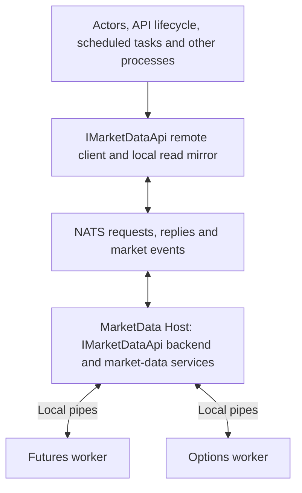

# MarketData Host Single API Separation Implementation Plan

Date: 2026-10-21  
Status: Host/API and UI recovery implementation complete; development startup verified after disposable projection cleanup  
Scope: Development market-data separation, NATS integration and recovery qualification

## 1. Objective and governing decisions

Make `IMarketDataApi` the single public service boundary through which actors, API startup and shutdown, scheduled tasks, and other higher-level processes communicate with the market-data backend. MarketData Host owns market-data implementation and infrastructure. Existing application callers retain their current operations and result semantics; missing capabilities are added to this same interface.

Use NATS for communication between the API and MarketData Host. Keep dataset workers as separately terminable child processes. Preserve a path to a future emulator implementing the same contract. Building a complete backtesting system is outside this implementation.

This plan supersedes the unfinished HTTP publication relay approach and API-owned option-worker prototype. Earlier Stage 3 and Stage 4 documents remain useful for existing behaviour, but their API-owned lifecycle assumptions must be updated during this migration. Proposed contract additions and acceptance tests below are work to complete, not claims that the migration is already operational.

### Required process names

- `TomasAI.IFM.Application.MarketData.Host.exe`
- `TomasAI.IFM.Application.MarketData.Host.Worker.Futures-GLBX.MDP3.exe`
- `TomasAI.IFM.Application.MarketData.Host.Worker.Futures-XCBF.PITCH.exe`
- `TomasAI.IFM.Application.MarketData.Host.Worker.Options-GLBX.MDP3.exe`

Worker namespaces use `TomasAI.IFM.Application.MarketData.Host.Worker`. The Host is an independent executable. It owns its children; actors do not launch or reset processes.

## 2. Scope

### Included

- All market-data framework execution and application orchestration behind Host: provider access, aggregation, normalization, pricing support, option-chain preparation and caches, reference resolution, historical acquisition, subscription ownership, health and recovery.
- Futures and options isolated in child processes, including where both use provider dataset `GLBX.MDP3`. Role and worker identity distinguish their ownership.
- One `IMarketDataApi` contract with local backend and remote client implementations.
- NATS request/reply for operations, Core NATS for replaceable realtime updates, and durable messaging for evidence that requires confirmed persistence.
- Local read mirrors needed to preserve existing synchronous API methods and reader interfaces.
- Startup, market open, market close, shutdown and reconnect behaviour.
- Scoped option recovery, explicit UI failure and a qualified user restart path.
- Development launch scripts, deployment configuration, telemetry, architecture enforcement and integration tests.

### Excluded

- A complete market-data emulator, historical replay controller or backtesting runner.
- A shared simulated clock across trading, session and execution components.
- Backtest fill, slippage, fee and profitability modelling.
- Moving trading strategy actors, trade-plan generation or financial order execution into MarketData Host.
- Redesigning every application API or introducing active/active MarketData Hosts.

## 3. Current implementation and migration baseline

The existing worker publishes length-prefixed MessagePack envelopes through local pipes. The API-side process supervisor reads them, and `DatasetPublicationIngress` applies worker admission, updates current-value mirrors, and hands events to the existing realtime publisher. Durable option trade evidence has a separate acknowledgement path.

The working tree also contains named worker apphosts, a Host scaffold, an HTTP relay/client draft and an API-owned option process service. Those partial changes require reconciliation before enabling this design. Successful named-apphost publishing does not qualify remote operation or recovery.

Relevant source locations:

- `TomasAI.IFM.Application.MarketData/Contracts/IMarketDataApi.cs`
- `TomasAI.IFM.Application.Api.Server.Core/DependencyInjection/MarketData/RegisterMarketDataRuntimeServices.cs`
- `TomasAI.IFM.Application.MarketData.Host.Worker/Runtime/DatasetWorkerRuntime.cs`
- `TomasAI.IFM.Application.MarketData.Host.Worker/Messaging/PipeDatasetWorkerPublisher.cs`
- `TomasAI.IFM.Application.MarketData/DataBento/Workers/DatasetPublicationIngress.cs`
- `TomasAI.IFM.Application.MarketData/DataBento/Workers/DatasetWorkerProcessRecoveryService.cs`
- `TomasAI.IFM.Application.MarketData/OperationsHealth/LivePipelineMonitor.cs`
- `TomasAI.IFM.Application.Api.Server.Core/Development/Verification/LivePipelineProbe.cs`

## 4. Process ownership and dependency boundary

| Owner | Responsibilities |
| --- | --- |
| Higher-level consumers | Call `IMarketDataApi`; consume its data and existing domain events; own trading and analytics decisions. |
| API remote client | Translate operations into NATS messages, maintain read mirrors, expose existing reader interfaces and relay backend outcomes. |
| MarketData Host | Implement market-data operations, own authoritative data state, coordinate workers, reference and history services, leases, health and recovery. |
| Dataset workers | Own provider connections, dataset-specific ingestion, aggregation and pricing work that must be independently terminable. |
| Process launcher or Aspire | Start and stop the independent Host executable and provide endpoint, messaging and secret configuration. |

?Behind Host? includes its worker children. Running provider connections in those children preserves option-only termination. Keeping contracts or immutable DTOs in a shared assembly does not violate the boundary; instantiating backend services inside the API does.

Higher-level code must not resolve concrete `DatabentoMarketDataApi`, worker supervisors, admission registries, recovery services, option discovery implementations or historical provider services. Backend-only interfaces remain internal implementation boundaries. Callers needing those capabilities receive equivalent operations through `IMarketDataApi`.

NATS event subscriptions are transport adapters and existing actor routes, not an alternative backend API. Trading actors receive market events normally; new event delivery must not create a second duplicate actor-publication path.

## 5. Single public market-data contract

### Preserve and complete the interface

Keep existing `IMarketDataApi` method signatures and return semantics. Both implementations must support the same declared capabilities; required operations must not silently fall through to disabled defaults.

- `MarketDataApiClient`: API-side remote implementation, proposed name.
- `MarketDataApiBackend`: Host-side implementation or facade over existing backend services, proposed name.

Existing `IsDatabentoFeedUp` naming remains for compatibility. Define its behaviour explicitly for supported backend modes and expose provider-neutral health through the complete contract.

Add the missing operations to this interface, grouped by capability:

| Capability | Required behaviour |
| --- | --- |
| Session lifecycle | Initialize session, activate value date, open and close market-data session, release caller ownership and query lifecycle progress. |
| Feed ownership | Acquire, renew, release and enumerate futures and option leases with explicit caller identity. |
| Options and pricing support | Prepare option inputs, acquire and release discovery scopes, obtain current snapshots and readiness; replace external uses of `ICompositionMarketDataApi` and concrete discovery services. |
| Reference and history | Expose required contract resolution, expiries, historical requests, estimates, job status, cancellation and retrieval currently accessed through separate backend APIs. |
| Health and recovery | Read backend and role health, request scoped recovery, and return terminal failure or qualified completion with correlation and worker identity. |
| Observation | Supply cache bootstrap and resynchronization data, feed status and realtime observations through the client implementation and existing public events. |

Use domain-specific request and response fields, cancellation and deadlines, and existing actor/event conventions. Where a command handler creates an event, propagate the originating `CommandId`. Classify query retries separately from subscription mutations; retry mutations only using stable operation IDs and backend deduplication.

Long operations return an operation identity and status rather than holding an unbounded request. Backend completion means the documented operation completed; persistence completion requires a successful durable write.

### Synchronous reads and reader handles

Preserve `TryGetLastTickPrice`, option reads, `OptionChainCache`, and `GetFuturesLastPriceReader` / `GetFuturesOptionLastPriceReader` without blocking on NATS. Their remote implementation reads a local mirror maintained by a single client subscription owner.

Host remains authoritative. The mirror performs no provider acquisition, lease orchestration, Greeks calculation, historical transformation or business selection. A reader object is a local client adapter, never a cross-process object reference. Dispose or recreate it according to the existing lifecycle contract.

On reconnect, subscribe and establish a consistent bootstrap boundary, install snapshots, then apply buffered newer observations. Define bounded buffers and resnapshot on overflow or a continuity gap. Retire old role/generation data immediately; a previous session must not appear current. Preserve valid option fields when an incoming field is unavailable, while reporting stale or unavailable source health separately.

Transport generation and operation identity protect against retired workers and duplicate commands. Do not introduce option-leg rejection based on quote order or a source sequence number; accepted leg updates retain the previously agreed arrival-based merge behaviour.

## 6. NATS communication

Reuse the repository's NATS connection, MessagePack serialization, request/reply, publisher and consumer infrastructure. Remove the new streaming HTTP response and receipt routes from the intended market-data transport. HTTP health endpoints may remain for process readiness.

| Traffic | Transport and handling |
| --- | --- |
| Lifecycle, subscription, query and recovery requests | NATS request/reply with deadlines, caller scope, correlation and operation IDs. |
| Prices, quotes, Greeks and replaceable current snapshots | Core NATS with bounded consumers and bootstrap/resynchronization support. |
| Required durable market evidence | Existing qualified JetStream/evidence persistence path, with application acknowledgement only after the required write. |
| Operator and UI feed state | Explicit option feed state and failure notifications, queryable after reconnect. |

Subject names must include deployment scope and protocol version. Separate futures and options roles in control and state subjects. Configure subject permissions so arbitrary clients cannot reset another deployment or dataset. Every state-changing command validates session, ownership and relevant worker/generation identity.

Preserve the exact existing durability boundary for option trade evidence. A NATS publish acknowledgement alone does not prove database persistence. Core NATS events do not acquire per-tick request/reply acknowledgements. Decide durable event ownership once, so Host and API cannot both persist or publish the same evidence accidentally.

Keep market payloads binary. Avoid JSON or repeated full snapshot materialization on the realtime path. Record request latency, publication lag, queue occupancy, dropped replaceable updates, resynchronization and allocation rate.

## 7. Lifecycle and recovery behaviour

### Startup and market sessions

The API uses `IMarketDataApi` to initialize market data and request session activation. MarketData Host validates reference inputs, resolves worker manifests, starts the required roles and reports readiness. API readiness must reflect explicit market-data readiness or a documented degraded state, never a silent local fallback.

Business session scheduling can remain in its existing owner. Market open and close call the interface; they do not reach into worker or provider internals. Preserve indicator seeding, current-session rollover and existing market-close feed-stop policy. Indicators themselves remain with the analytics actors.

Closing a UI view releases that view's ownership. Closing the API releases the API's client scope according to lease policy. Neither action silently removes unrelated backend consumers or active-position ownership. Only the process launcher/Aspire manages the Host executable lifetime.

### Soft recovery

Host serializes recovery by role, fences the failed generation, replaces affected workers or runtime resources, rebuilds current leases and read state, and admits only a qualified replacement. Futures remain unaffected by option recovery. Use configured deadlines and a finite retry policy, initially up to three soft attempts for recoverable failures. A recovery timeout proceeds immediately to terminal option containment rather than leaving closed admission indefinitely.

API-owned disposable realtime actors use the existing generation replacement mechanism when they need recovery. Their lifecycle remains with their supervisor. A market-data worker kill cannot terminate an API actor handler; retired generations must be fenced against current state and publication effects.

### Fatal option recovery

1. Fence option output and close option admission.
2. Force termination of the exact Options worker independently of a stuck command semaphore or handler.
3. Confirm process exit. Do not declare leases gone solely because a stop request was sent.
4. Retire option runtime leases, handles, caches and pending recovery work for the failed session. Cancel monitoring ownership that must require a fresh user start.
5. Preserve financial position records and durable business ownership. Explicitly suspend affected durable intent where needed so reconciliation cannot silently reactivate it.
6. Publish a terminal option-feed error with reason, affected scope and cleanup status. Set affected trade views' Live Feed state to OFF and display the error. Retain this status for reconnecting UI clients.
7. Permit a user to turn Live Feed ON only after containment is confirmed. Create fresh worker/generation identities and new leases. Do not resurrect canceled monitoring registrations.

If termination cannot be confirmed, publish `CleanupUnconfirmed`, keep options off, and allow a bounded containment retry through `IMarketDataApi`. Do not report a successful reset, spin indefinitely, or stop futures or the API as an option-only recovery action.

MarketData Host failure is a separate scope from option-worker failure: Host health and client status must reveal that broader outage. This migration does not promise that futures stay available after the coordinator or messaging service itself fails.

## 8. Implementation stages

| Stage | Work | Completion evidence |
| --- | --- | --- |
| 1. Reconcile the baseline | Inventory every public market-data consumer and backend dependency; classify unfinished changes; replace the HTTP draft and direct API process ownership with this design. | Consumer/capability map, clean project references and explicit migration checklist. |
| 2. Complete the contract | Extend `IMarketDataApi` for lifecycle, options, history, status and recovery while retaining existing members. Define transport DTOs and semantic outcomes. | Contract parity tests and no required disabled default behaviour. |
| 3. Assemble Host backend | Move market-data registrations, caches, ownership, reference/history services and recovery into Host; retain fixed named child apphosts. | Host starts independently; both roles can start and terminate separately. |
| 4. Implement NATS adapters | Add Host request handlers, client request/reply and market event publication using existing messaging infrastructure. Preserve durability acknowledgement rules. | Real NATS integration tests for operations, events, duplicates, deadlines and evidence retention. |
| 5. Preserve read behaviour | Implement client mirrors, reader adapters, bootstrap, reconnect and generation invalidation. | Existing synchronous callers remain compatible; reconnect and stale-generation tests pass. |
| 6. Migrate every consumer | Switch actors, API startup/shutdown, session tasks, composition/pricing consumers, historical callers, health checks and other processes to the single interface. | Architecture tests and searches find no higher-level backend bypasses. |
| 7. Finish scoped recovery and UI | Route recovery through Host; remove option escalation to global API shutdown; wire terminal status, OFF state, cleanup and explicit restart. | Both requested recovery scenarios pass, plus futures isolation and restart tests. |
| 8. Wire development hosting | Update VS Code API + Rust UI tasks, publish layout, configuration, secrets and shutdown ownership. Support externally managed Host for Aspire. | One development launch produces the expected Host and child process tree without duplicate owners. |
| 9. Qualify and document | Build affected solution, run regression suites, inspect UI behaviour, measure steady-state and recovery performance, update operational documentation. | Recorded test results, process evidence, latency/allocation measurements and completed acceptance checklist. |

## 9. Test and acceptance plan

### Required recovery scenario one

Inject a recoverable option error while futures and option subscriptions are active. Soft recovery completes within its deadline. All desired option leases are reconstructed, current values and trade plans resume, admission is open and no terminal UI error is shown. Futures process identity and progress remain unchanged.

### Required recovery scenario two

Inject a non-cooperative Options worker or a recovery operation that exceeds its deadline. Prove the exact process is terminated without waiting for its control lock. Verify option admission is retired, old option leases cannot resume, Live Feed turns OFF and an actionable error is visible. Futures and API remain alive. Turn Live Feed ON and verify fresh worker/generation/lease identities and resumed updates.

### Additional required coverage

- Exercise actual child executables and actual NATS transport in integration tests; mocks supplement these tests.
- Compile all higher-level consumers against `IMarketDataApi`; enforce forbidden backend references through architecture tests.
- Verify existing query, subscription and snapshot behaviour across backend and remote implementations.
- Validate startup, market close/open, shutdown, API reconnect and Host restart; prevent duplicate subscriptions and publishers.
- Verify request deduplication, canceled/late replies, late stop requests and stale generation publications cannot affect replacements.
- Verify asynchronous event delivery retains existing domain routes without duplicate trade-plan or EOD updates.
- Verify mirror bootstrap under concurrent updates, disconnect gaps, unavailable fields, reader invalidation and resynchronization.
- Verify durable evidence is not acknowledged before successful persistence; persistence retries are idempotent.
- Verify durable position ownership survives client loss and terminal option handling does not erase financial state.
- Verify NATS outage, unauthorized control requests and worker exit produce explicit bounded failure states.
- Measure normal and recovery latency, queue occupancy, allocation and GC against a captured baseline. Investigate regressions before enabling the new default.
- Validate terminal UI state through Rust UI automation and FlaUI where supported, including reconnect and explicit reactivation. Use controlled development data and keep financial order submission outside the fault injection.

## 10. Backtesting compatibility and scope boundary

A future emulator must implement the same `IMarketDataApi` operations and emit the same public market events. The API must select its implementation through dependency injection/configuration rather than branching actor logic on live versus replay mode.

Keep provider details behind Host and use injectable time where this migration adds lifecycle timing. Do not implement historical replay controls, accelerated scheduling, deterministic cross-process execution, simulated fills or a full virtual clock in this change. Existing synthetic feeds provide recovery qualification; they are not a completed backtesting system.

## 11. Completion criteria

The migration is complete when all higher-level market-data communication uses `IMarketDataApi`, backend execution is owned by Host and its children, NATS replaces the HTTP draft, and no direct API-owned worker/provider implementation remains active. Both recovery scenarios, restart, lifecycle and contract compatibility tests must pass with recorded results. Full backtesting remains a separate implementation.

## 12. Execution status on 2026-10-21

### Process layout decision

`DatabentoDatasetSelection.Resolve` assigns VX to `XCBF.PITCH`; ES uses `GLBX.MDP3`. `SupervisedDatabentoLifecycleRuntime` already groups futures registrations by dataset and starts one worker per group. Independent options require an additional lane even when their provider dataset is also `GLBX.MDP3`.

The owner confirmed a process per dataset and requested the dataset suffix, such as `-GLBX.MDP3`. Host ownership is therefore keyed by role and dataset, with the three named children listed above. ES futures and options use separate `GLBX.MDP3` worker lanes so an option-only reset cannot terminate ES futures. VX remains in its own `XCBF.PITCH` process. This resolves the process-layout decision without changing the single public `IMarketDataApi` requirement.

### Implemented and checked

- Replaced the HTTP transport draft with NATS control and binary publication adapters.
- Separated ordinary control and emergency stop subscriptions so blocked control handlers cannot consume the stop execution path.
- Added exact worker lifetime checks, stop-before-start retirement, shared concurrent termination and late-stop protection.
- Added a typed client adapter covering `IMarketDataApi`, a whitelist dispatcher, and contract tests. Default API composition now registers the remote client and read mirrors; native provider lifecycle, worker ownership and option recovery run in Host.
- Ran tests against actual independent Host and named worker executables through real NATS on unique qualification subjects.
- The selected regression run passed 32 tests, failed zero and skipped two explicitly gated soak tests (34 total). Coverage includes all three dataset-suffixed process names, soft reset with restoration of an acquired option scope, a hung option command with two acquired leases, saturated control handlers, concurrent stops, independent futures survival, fresh restart, late stops, pre-start retirement, nullable ownership, polymorphic results and a non-cooperative API deadline.
- The public recovery operation is idempotent for its operation identity and validates both worker and generation. Failed recovery terminates the owned options process and emits a queryable `StoppedError` state. The API relays terminal errors through the existing UI event channel. Trade views turn Live Feed OFF, display the reason, reject stale callbacks, and permit manual reactivation only after confirmed containment. Runtime-status bootstrap covers missed notifications and reconnects.
- End-to-end option qualification exposed and fixed worker shutdown ordering: producers finish while the publication/receipt pipe remains available, before it is closed. An opt-in synthetic UTC timestamp conversion allows strict pricing freshness checks against native synthetic records without relaxing live-provider rules.
- Host publishing and API builds have succeeded during the implementation. Local results are in `.artifacts/market-data-host-tests/market-data-host-datasets.trx` and the associated build/test logs.
- After the final stop-status and stale-lifetime guards, the eight actual Host/NATS integration tests passed again with no failures or skips (`.artifacts/market-data-host-tests/market-data-host-final.trx`). The API build completed with zero warnings and zero errors. No qualification Host/child processes remained running after fixture cleanup.

### Host/API cutover and UI recovery verification (2026-10-21)

- Completed Host backend composition for live dataset workers, reference data, history, pricing, option preparation, committed ownership, caches and recovery. Higher-level consumers use `IMarketDataApi`; the explicit legacy configuration branch is retained for rollback tests.
- Added generation-fenced local read mirrors, bootstrap contract/price data, status reconciliation and bounded option-cache frames. Host persists option evidence before acknowledging worker publications; the remote API receiver does not persist that evidence a second time.
- Reserved separate NATS subscriptions for ordinary commands, emergency containment, and status/readiness observations. Saturated ordinary handlers cannot consume the containment or observation handlers.
- Updated Server Manager, VS Code tasks, publishing and development process ownership. Host starts before API, has an independent health port, and owns the three dataset/role children. Shutdown recognizes only owned Host/worker lifetimes.
- Fixed startup composition issues exposed by a real launch: API Kestrel configuration leaking into Host, remote-only missing dependencies, a receiver/supervisor dependency cycle, premature producer startup, and mismatched NATS URL strings within the shared API connection manager.
- Normal Debug API and Server Manager builds passed. The managed Rust bridge and native Rust UI build passed.
- Final selected Host regression run: **19 passed, zero failed/skipped**, including nine actual Host/NATS/child-process tests for soft recovery, timeout containment, saturated commands, independent datasets, stale stops, restoration and fresh restart. Results: `.artifacts/market-data-host-tests/host-api-final.trx` and `.artifacts/market-data-host-api-final-tests.log`.
- API remote registration regression: **1 passed**, including independent admission composition and reuse of the actor-configured NATS connection (`.artifacts/market-data-cutover-registration-final.log`).
- UI recovery regression selection: **12 passed**, including confirmed/unconfirmed containment, OFF/error state, manual reactivation and stale notifications (`.artifacts/market-data-ui-recovery-tests.log`). Other selected reference, feed, handoff and receiver regressions are recorded in `.artifacts/market-data-*-tests.log`; these runs overlap and are not summed as unique tests.

### Initial development startup blocker (resolved by the follow-up below)

Host independently reaches HTTP 200 readiness. Two attempts to launch the full development API stopped at the existing Iron Condor event-projector recovery, before the supervisor became ready and before Server Manager launched the UI. The API's two-minute actor startup deadline expires; rollback then awaits the durable replay worker. Async stack captures show `EventProjectorRecoveryCoordinator.RecoverAsync` enqueueing through `NatsJSDurableReplayQueue`, followed by rollback waiting for that queue. This is separate from the new Host's option-worker recovery.

A read-only database check found approximately **69,000 Iron Condor position projection states at ApplyProjection**, with additional scheduler and download backlogs. No projection records, event logs or financial state were deleted, and financial recovery was not bypassed. Evidence: `.artifacts/host-cutover-startup-active-async.log` and `.artifacts/host-cutover-startup-async.log`.

The final readiness check returned Host HTTP 200 and API HTTP 503 (`actor_runtime` incomplete; application lifecycle still `Bootstrapped`). The unsuccessful development verification session was stopped using the managed stop script; it verified all owned IFM application processes stopped.

This initial attempt did not qualify the complete development session. Actual Rust terminal-error display, manual live-feed restart, overnight market close/open and steady-state allocation/latency comparison remain live qualification gates. Automated recovery tests establish bounded behaviour for the injected cases; they do not prove recovery can never fail under every operating-system, provider or messaging failure.

### Disposable position recovery correction (2026-10-21 follow-up)

The backlog originated in PostgreSQL `event_projector_state` joined to `event_log` and `event_name_id`. Startup copied these payloads into the projector's JetStream process queue. The remaining **68,834** unfinished Iron Condor records all referenced `ChangeTradeLegDataCommand`; they were quote-driven observations, not unexecuted orders.

- Added an explicit `IsRealtimeMarketObservation` flag to quote-generated Iron Condor position events. Only flagged `MarkToMarket` observations are discarded by the runtime projector at admission, recovery and old queue delivery. A phase-only rule is unsafe because partial executions can also produce that phase. Open/close/correction/EOD and unflagged execution events retain their existing recovery policy.
- Source events and PostgreSQL position history continue to commit through their existing atomic path. Current marks still publish directly to UI and plan processing. The redundant projector work no longer creates durable recovery markers for quote observations.
- Added a development-only maintenance mode, `--discard-iron-condor-market-mark-recovery`, requiring the API to be stopped and the local development database. It decodes source payloads and checks originating command names before deleting obsolete recovery markers and their associated outbox entries. Source event logs, position history and financial records are retained. It clears the exact Iron Condor process/replay transport queues only after confirming no unfinished financial or unclassified work remains.
- Executed the cleanup: **68,834 deleted recovery markers; zero unfinished Iron Condor projections remain**. Evidence: `.artifacts/iron-condor-disposable-cleanup.log`.
- **18 targeted tests passed**, including financial/partial-fill classification, recovery filtering, and equivalent whole-position valuation after skipping 400 intermediate leg marks and applying current quotes for every leg. API build passed with zero warnings/errors.
- The next real startup passed actor initialization, confirming removal of the prior replay stall. It exposed a remaining feed-start call to the local contract authority; this now uses `IMarketDataApi.PrepareSessionAsync`. **Five session/feed-start tests passed**, including a regression exercising the actual command handler with only the public API registered.
- Final development restart succeeded at approximately 11:31 Toronto time. API launch readiness returned **Healthy**, the Rust UI and Scheduler launched, and all three named dataset workers were running (ES futures, VX futures, and isolated ES options). The unfinished Iron Condor projection count remained **zero**. The session was left running. Evidence: `.artifacts/iron-condor-cleanup-api-readiness.json` and Server Manager's 2026-10-21 logs.

### Live option acquisition timestamp correction (2026-10-21)

The loaded trade could not enable Live Feed because the isolated options worker cached its ES underlying quote with a source timestamp in 2083, despite a local receipt time in 2026. Worker bootstrap enabled synthetic UTC conversion for DatabentoLive; the shared native ticker reader added a monotonic-to-Unix offset to provider timestamps that were already Unix UTC. Option acquisition correctly rejected the resulting future quote as `UnderlyingQuoteUnavailable`, eventually timing out the leg requests.

- Worker bootstrap now requests synthetic UTC conversion only for `FeedDataSourceMode.Synthetic`.
- The reader independently checks the data-source mode before translating timestamps, preserving live event/receive timestamps even if synthetic options are accidentally enabled by a caller. Freshness checks remain enforced.
- Four regression cases cover both sources with conversion enabled and disabled; all passed. All ten synthetic ticker tests passed.
- An opt-in actual Databento ESZ6 native-feed test deliberately enables the synthetic flag and verifies both source event and receive timestamps remain near current UTC; passed with live native support enabled. The initial attempt used a synthetic-only native binary and returned `NotSupported`; rebuilding with `DatabentoEnableLive=true` resolved the test prerequisite.
- All ten Host/NATS integration tests passed (32 seconds), including the new real-child option acquisition test asserting current UTC underlying quotes, soft recovery, timeout containment, fresh restart and futures isolation. These process integration tests use isolated NATS subjects and synthetic market data.
- Host and dataset workers published successfully. API build succeeded with zero warnings and errors. Development was restarted to remove the previously corrupted cached quotes.
- Evidence: `.artifacts/live-provider-timestamp-test.log`, `.artifacts/live-timestamp-regression-tests.log`, `.artifacts/timestamp-host-integration-tests.log`, `.artifacts/timestamp-fix-publish.log`, `.artifacts/timestamp-fix-api-build.log`.

The first post-fix live UI attempt revealed a second cutover omission: `BackendServices` did not register `PricingSourceClockPolicy`, so Host-generated pricing contexts had a zero source-clock lead allowance. The workstation was approximately 0.8 seconds behind the exchange/provider clock (Windows Time service reported stopped); acquisition still correctly rejected those quotes under that zero-tolerance context. Host now preserves the same 2,000 ms allowance that the former API backend used only for explicitly opted-in Development live qualification with Stage 3 enabled. Production, PaperTrading and non-opted-in configurations retain zero allowance. No machine clock settings or pricing freshness limits were changed.

Final verification after both corrections:

- **16/16 Host composition and NATS/process integration tests passed**; five clock-policy cases confirm only explicitly opted-in Development gets the allowance. Evidence: `.artifacts/host-final-integration-tests.log`.
- Development API launch readiness is Healthy; all three independent workers report Healthy. Evidence: `.artifacts/timestamp-fix-final-readiness.json` and `.artifacts/final-live-backend-status.log`.
- Used FlaUI/UIA3 to load the established trade `101.701.1901.1501` and select **LiveFeed ON**. At 12:20:39?12:20:40 Toronto time the API logged successful streaming starts for `ES20261120C8050`, `ES20261120C8100`, `ES20261120P7375`, and `ES20261120P7325` under monitoring owner `b92b409a-c7c9-4274-928b-853bd666eb9c`. The UI subsequently displayed LiveFeed ON, current bid/ask values and populated delta, gamma, theta, vega, rho and implied volatility for both spread legs. The Options worker had consumed 79,044 option records at the first post-start sample. Both futures workers remained healthy.
- FlaUI evidence: `.artifacts/live-feed-probe/final-live-verified.log`, `.artifacts/live-feed-probe/state.json`, `.artifacts/live-feed-probe/live-feed-on-verified.png`. This verifies option subscription and market-data delivery; it is not a financial execution test. The development session was left running with this trade's Live Feed enabled.

### Feed toolbar readiness contract correction (2026-10-21)

The green Start Market Feeds button while futures were running was a query-contract regression: Host readiness mapped healthy datasets to `State=Running` and `DisplayHealth=Healthy`, while the existing shell recognizes lifecycle `Healthy` and display color `Green`. Its periodic readiness poll consequently reset the active flag to false. The runtime-status query independently confirmed `IsRunning=true`.

`DatabentoQueryModel` now maps Host dataset status into the established lifecycle/display-health vocabulary: Healthy/Green, Resetting/Orange, Starting/Orange, Degraded/Yellow, Failed/Red, and ScheduledStopped/Inactive. Optional option-worker failures do not mark healthy core futures stopped. Eight query tests passed, including the actual query actor response and six lifecycle mappings; API build succeeded with zero warnings/errors. Evidence: `.artifacts/feed-toolbar-contract-tests.log` and `.artifacts/feed-toolbar-api-build.log`.

After restart, FlaUI confirmed an enabled **Stop Market Feeds** button; screenshot inspection confirmed its red background and white text. Trade `101.701.1901.1501` was reloaded and its Live Feed switched on again. Evidence: `.artifacts/live-feed-probe/toolbar-stop-verified.log`, `.artifacts/live-feed-probe/toolbar-stop-verified.png`, and `.artifacts/live-feed-probe/toolbar-and-live-trade-verified.png`.
