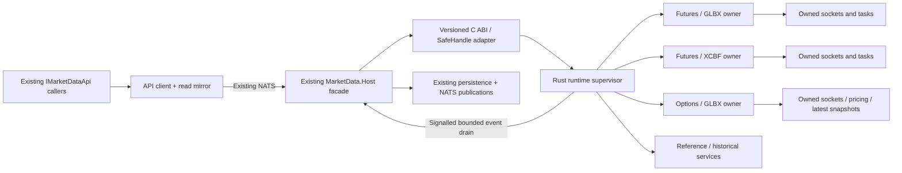

# MarketData Rust FFI Runtime and Dataset Lifecycle Design

Date: 2026-10-25  
Status: Investigated proposal; no runtime implementation or cutover authorized by this document  
Scope: Preserve the complete `IMarketDataApi` feature surface while replacing provider/runtime machinery with Rust

## 1. Recommendation and feasibility

Build a Rust market-data runtime behind a small, versioned C ABI and retain `IMarketDataApi` as the application boundary. Run the DLL in the existing `TomasAI.IFM.Application.MarketData.Host` process, with independently owned dataset/role runtimes instead of child worker executables. Actors, scheduled tasks, startup/shutdown, and the Rust UI keep their current API contracts. API-to-Host NATS communication stays; Host-to-child processes, pipes and frame serialization can eventually disappear.

This is feasible as a substantial staged replacement. It is not a DLL swap. Session ownership, subscriptions, reference resolution, history, aggregation, pricing contexts, cache refresh, publication, recovery, diagnostics and persistence boundaries all require explicit assignments. The companion [source and API inventory](MarketData-Rust-FFI-Inventory-v0.1.md) enumerates the affected code and all interface methods, including overloads.

**RAII provides deterministic ownership and cleanup when execution can make progress. It cannot guarantee termination of an arbitrary blocked OS thread.** Dropping a Rust `JoinHandle` detaches its thread; it does not kill it. Tokio task abortion is cooperative, and already running `spawn_blocking` work cannot generally be aborted. Therefore an in-process design can replace dataset subprocesses only after demonstrating cancellation of every supported provider/control path. It cannot provide the same containment for memory corruption, an uninterruptible library call or a deadlocked OS thread. See [Rust thread ownership](https://doc.rust-lang.org/std/thread/struct.JoinHandle.html) and [Tokio cancellation](https://docs.rs/tokio/latest/tokio/task/struct.JoinHandle.html#method.abort).

Recommended deployment: **one existing Host process, no dataset child processes after qualification, one Rust DLL, independent dataset/role owners, and the existing external Host/API supervision as the last resort**. If termination remains unconfirmed, report the failure at the deadline; a whole Host restart is the available physical cleanup boundary. Such a restart also interrupts its futures lanes. Do not describe logical generation replacement as proof that the old thread terminated.

## 2. Investigation basis and limits

- Inspected the current working tree, including existing uncommitted architecture changes. This is not an audit of a clean historical commit.
- Reviewed the three `IMarketDataApi` partial interfaces, remote client/mirror, Host backend dispatch, worker ownership, subscription/option lease paths, background strategy cache, provider framework, native bridges, API recovery coordinator and deployment references.
- Confirmed the existing Rust `native.rust/DatabentoFeed.Rust` crate is a `cdylib`/`rlib`, with optional live Databento SDK support pinned to `0.58.0`. A Rust numerical kernel also exists in `native.rust/OptionPricer.Rust`.
- The managed resolver loads the filename `databento_feed_native` from the RID directory. That filename alone does not establish whether a deployed binary was built from C++ or Rust. Binary provenance must be recorded during migration.
- The existing Rust bridge uses an owned producer thread and a current-thread Tokio runtime. Its `stop(timeout)` can return `TIMEOUT`; `dbf_feed_destroy` refuses destruction while work remains active. Existing Rust code does not already provide the proposed reset guarantee.
- This design uses static dependency/call references plus the logs reviewed for the 2026-10-25 incident. Source presence does not prove every provider or compatibility branch is active. No feeds were restarted, no fault was injected, and no code tests were run for this documentation task.
- Provider cancellation behavior was checked against the locally installed **0.58.0 source**, not assumed from newer SDK documentation. Any SDK upgrade needs a new cancellation audit.

Inventory totals: **71 API methods including overloads, two properties, 113 production/source files directly referencing the interface, and 58 test/benchmark reference files**. The per-file disposition appendix covers **883 source files across 14 explicitly inventoried roots**, including shared contracts, numerical dependencies and native comparison utilities. These numbers are scope measurements, not an estimate that all 883 files should be rewritten. The external-operation index and project-reference list identify additional consumers outside those roots.

## 3. Current execution path

Host also runs strategy option-chain preparation/caching, storage/reference adapters, historical orchestration, durable subscription reconciliation and trade live-feed restoration. Therefore moving only `Framework.MarketData` will leave much of the current lifecycle complexity intact.

The important active lanes are `Futures/GLBX.MDP3`, `Futures/XCBF.PITCH`, and `Options/GLBX.MDP3`. **Dataset name alone is not an ownership key:** ES futures and ES options share a provider dataset but must retain separate reset ownership, sockets, queues and generation state. A role/dataset owner can own multiple provider connections; neither one thread per contract nor one TCP connection per provider dataset is a requirement.

## 4. Feature inventory and target ownership

| Feature | Current source anchors | Target assignment |
|---|---|---|
| Public service surface and synchronous readers | `Application.MarketData/Contracts/IMarketDataApi*.cs`, `Remote/MarketDataApiClient*.cs`, `Remote/MarketDataReadMirror*.cs` | Preserve managed contract; implement Host facade over Rust; preserve reader generation semantics and API mirrors. |
| Native transport, DBN decode, symbology, provider errors/warnings, heartbeats and replay | `Framework.MarketData.DataBento/Interop`, `Runtime`, `native/DatabentoFeed.Native`, `native.rust/DatabentoFeed.Rust/src` | Rust provider module; reuse audited Rust decoder/SDK work; no retained C++ transport in the target path. |
| Dataset session, startup, reset, teardown, readiness and watchdog | `Application.MarketData/DataBento`, `DataBento/Workers`, `DataBento/Resiliency`, `Host/Workers`, `Host.Worker` | One Rust owner per lane and one recovery coordinator; thin Host adapter; retire child supervisor/pipe machinery after parity. |
| Owner-aware subscriptions, batch acquisition, renew, release and durable composition | `Application.MarketData/Subscriptions`, `Pricing/RecoveringOptionLeaseRegistry.cs`, `Pricing/WorkerOptionChainRuntime.cs` | Rust owns active registrations/refcounts and transport. Managed application owns persisted user/business intent and commits. |
| Futures/option definitions, expiry calendar, symbol catalog, current/next contracts and rollover | `Host/OptionChains`, `Application.MarketData/TradeStrategySymbols`, `DataBento/DatabentoCurrentFuturesContractResolver*`, BlackBoard query/mapping caches | Rust queries/normalizes provider data; managed storage/reference services remain authoritative. Explicit plans enter Rust, no ambient DB lookup in quote callbacks. |
| Hot quotes/trades, last-price readers, session OHLC, statistics, volume and VWAP | `Framework.MarketData.DataBento/LastPrice`, `TickAggregation`, `Framework.MarketData/TickAggregation`, `DataBento/Workers/DatasetWorkerCurrentValues.cs` | Rust hot state/accumulators and bounded outputs; managed DTO/event mapping and remote mirror retained. |
| Live routing and publication | `TickLiveRouter`, bounded publishers, `DataBento/DatabentoTickAggregationPublisher.cs`, Host messaging relays | Rust routing/coalescing; managed Host publishes the existing NATS/event contracts. No second Rust NATS owner initially. |
| Historical estimates, metadata, downloads, manifests, replay, checkpoints and five-minute seed bars | `Framework.MarketData.DataBento/Historical`, `Application.MarketData/DataBento/Historical`, `Historical`, `Host/Seeding` | Rust provider I/O/decode/streaming and temporary-resource ownership; managed durable loader/checkpoint/observation stores and job orchestration. |
| Individual option and chain pricing observations | `Application.MarketData/Pricing`, `Framework.OptionPricer`, `Shared/MarketData/Pricing` | Rust quote/context coherence, IV/Greek execution, snapshot caching and lease lifecycle. Reuse existing numerical Rust kernel only for models it actually implements. |
| Strategy-chain universe and prepared candidate cache | `OptionUniversePlanner`, `OptionChainBackgroundUpdater`, `QualifiedCompositionDiscovery`, `Host/OptionChains/StoredOptionUniverseSource.cs` | Rust volatile coverage/lease/snapshot runtime; managed published strategy policy and definitions source. Pure planning/ranking can move to Rust under parity tests. |
| Treasury curves, economic calendar and reference calculations | `Framework.MarketData/ReferenceData`, `Framework.MarketData.FinancialModelingPrep`, `Application.MarketData/FinancialModelingPrep` | Port framework HTTP/parsing/conversion runtime if completing the full framework scope; preserve managed persistent reference services and business publication rules. Independent of dataset teardown. |
| Trade live-feed recovery table and restoration | `IMarketDataApi.TradeFeedRecovery.cs`, `Host/Api/MarketDataApiBackend.TradeRecovery.cs`, `Application.Storage/TradeDb` | Retain managed durable records keyed by trade and API ValueDate; replay desired active ownership to Rust once session/trade prerequisites are ready. |
| Market outlook/ITI/EMA/BB and trade plan actors | `Application.MarketData/MarketOutlook`, domain analytics/trade actors | Retain algorithms and workflows outside the provider DLL. Redirect existing API consumers; do not duplicate the actor system in Rust. |
| Operational health, UI failures and external restart | API `Actors/Recovery`, `Recovery/Databento`, `Observability`, ServerManager | Retain application/UI authority; consume one Rust recovery result/evidence model. Retire duplicate provider reset coordinators after parity. |
| Interactive Brokers market-data directory | `Framework.MarketData.InteractiveBrokers` | Current inventory found no C#/Rust/C++ source in this directory. Do not invent an active provider port; recheck project/package/deployment references before deletion. |

The full framework target means executable framework logic is Rust. Managed interfaces, DTOs, API adapters, storage and wire compatibility may remain. It does **not** mean that every method behind `IMarketDataApi` becomes a direct unmanaged call: database reads and durable trade intent legitimately remain managed orchestration behind that interface.

### Pricing coverage must not shrink

`Application.MarketData/Pricing/Black76PricingModel.cs` currently delegates to the unified managed `Framework.OptionPricer.Pricing.OptionCalculator`. It selects behavior using exercise style, premium style and contract metadata. The existing Rust Black-76 kernel is useful but is not evidence of parity for every American/European and paid-upfront/futures-style combination. Inventory and qualify those actual call paths before moving pricing; an unsupported model must return a typed failure rather than silently substitute Black-76. Port only the market-data-required calculator dependency closure, not unrelated dividend/equity features by assumption. Preserve Greek units, rho conventions, numerical policies, tolerances, semantic hashes and engine version tags.

## 5. Proposed structure

Suggested new Rust library: `native.rust/MarketData.Rust`, library artifact `ifm_market_data_native`. Reuse or refactor `DatabentoFeed.Rust` into an internal crate instead of exposing two competing lifecycle owners. The existing ABI remains available only for comparison/rollback during migration. One production lane has one runtime authority at a time.

Suggested internal modules: `ffi`, `runtime`, `dataset`, `databento`, `subscriptions`, `catalog`, `latest`, `aggregation`, `pricing`, `option_chain`, `historical`, `reference`, `diagnostics`, `clock`, `synthetic`. They can start in one crate; splitting them into many packages is not required for ownership correctness.

### Managed/native responsibility boundary

- Managed: authenticate/validate application requests, read policies/reference stores, persist durable intent/checkpoints, supply API ValueDate/time context, translate results/events, publish UI/actor notifications and apply external restart policy.
- Rust: own provider connections/tasks/buffers, normalize records, maintain hot state and runtime leases, execute supported pricing/aggregation, drive dataset reset and report evidence.
- Managed code must not hold mutable references into a running Rust owner. Rust must not call business actors, PostgreSQL or UI callbacks from provider tasks.
- Keep the application/domain/framework reference direction. Shared/managed domain objects are mapped into neutral ABI records; Rust does not consume CLR reflection, assembly-qualified event names or managed service locators.

## 6. Lifecycle ownership and RAII rules

Each `DatasetOwner` owns its session clients, task collection, cancellation signal, generation, active lease table, hot-state buffers and event producers. A small independent runtime supervisor owns the dataset owners and control completion records. Historical/reference work has separate ownership, so a long HTTP download cannot block option reset.

Prefer a dedicated runtime thread for each lane with a current-thread Tokio executor and bounded async tasks. This offers scheduling separation and explicit owner exit evidence. It does not create a force-termination mechanism. All CPU-heavy pricing/aggregation must process bounded chunks and check cancellation; long-running blocking calls are prohibited on these executors. Any additional thread pool must be explicitly bounded, cancellable at job boundaries, and included in join evidence.

Rules:

1. Create sockets/tasks under a single generation owner; never detach a thread or task as normal cleanup.
2. Use cancellation-first explicit `stop/reset` operations. Await task completion and thread exit before recording cleanup confirmed. `Drop` is a last-resort signal/resource guard, not an unbounded join on a CLR finalizer thread.
3. Audit DNS, TLS, connect, auth, subscribe, start, read, replay, HTTP, decoding, calculation, locks, event output and destructors. Every wait must be interruptible or bounded by the one operation deadline.
4. `next_record` in pinned SDK 0.58.0 is documented cancellation safe; `subscribe` and `start` are not. If cancelled mid-handshake, abandon that entire client/socket generation. Never resume a partially cancelled protocol session. The task/future containing the client must be dropped, not merely its join handle.
5. Do not hold a shared mutex across I/O or joins. Control/reset must bypass data backlog and cannot depend on a full quote queue draining.
6. Exiting code may stop acknowledging old-generation results immediately. It may free buffers only after readers/tasks are known to be finished.
7. Do not use Windows `TerminateThread`, unload a DLL with live frames/threads, or reuse freed handles to simulate reset. These cannot establish memory-safe cleanup.
8. If the owner cannot exit, do not report cleanup confirmed or keep creating replacement owners. Record failure, retain ownership of still-live memory, bound total resources, and invoke the existing external containment decision. Whole-Host termination is the only physical cleanup boundary in the proposed deployment.

## 7. One simple reset flow and one two-minute budget

State exposed per lane: `Stopped`, `Starting`, `Running`, `Recovering`, `Failed`. Detailed readiness/last-error information is evidence, not a collection of independently latched admission modes.

`Running/Starting -> Recovering -> Running` or `Failed + UI notification`. An explicit new start/reset can leave `Failed`; market close clears session-scoped attempts while preserving the audit record. No silent permanent quarantine.

For each episode, starting when failure is accepted:

1. Capture the desired plan: role/dataset, ValueDate, actual underlyings, enabled trade owners, published background policies and relevant reference versions. Separate desired state from disposable lease IDs.
2. Advance the generation so obsolete results cannot mutate new state. Atomically discard obsolete queued replaceable observations; notify consumers that values are temporarily unavailable/stale.
3. Cancel old owner work, close/drop its sockets through the audited cancellation path, and join all tasks/threads. Emergency reset never drains old quotes/plans first.
4. Recreate a clean owner, rebuild underlying dependencies, acquire fresh physical subscriptions and issue fresh generation-scoped lease IDs. Restore desired ownership exactly once; released/disabled owners stay absent.
5. Verify provider acknowledgements, heartbeat/transport status, active desired registrations and required downstream evidence. Reuse a successfully created replacement on subsequent verification attempts.
6. On success, publish one completion and reset the recovery-attempt indicator according to the agreed restart policy. On failure, keep trying repair/recreation only within the original budget.
7. At **120 seconds maximum**, publish one terminal result and durable/reconnect-visible UI error with the exact failing stage and cleanup status. Notification cannot wait for cleanup/join. No nested timeout starts a fresh two-minute window.

Use one monotonic deadline within the Rust runtime and pass **remaining budget** to I/O. Derive it from the supplied request once; do not compare unrelated process-local monotonic clock values across NATS. UTC deadlines can be carried for diagnostics/remote admission, with remaining-budget reconciliation at the boundary. Caller cancellation still cancels an explicit caller operation; independent provider heartbeat detection is not a competing recovery deadline.

Episode ID identifies the incident; attempt ID identifies a particular execution. Idempotent duplicates return the same execution result, while a new attempt does not accidentally replay a cached failure/success from an earlier attempt. Cleanup completion and service recovery completion are distinct fields.

### Verification with and without loaded trades

| Desired workload | Required success evidence |
|---|---|
| No option owners and no background policies | Old owner terminated; desired ownership empty; lane correctly idle. Do not wait for quotes. |
| Background strategy cache only | Provider subscription/transport evidence plus usable snapshots for currently required eligible scopes. No trade-position evidence is required. |
| Live trade owners | Fresh/coherent required leg observations and risk, a newer complete plan and downstream publication for those trades, in addition to provider health. |
| Quiet/inactive session | Session-aware heartbeat/control evidence; no fabricated quote freshness and no success claim based on stale pre-reset data. Session scheduling comes from the API context. |
| Unavailable optional policy/expiry | Explicit policy-level unavailable result; reacquire/repair its dependencies. If an exception has uncertain transience, report unhealthy and apply the bounded recovery policy rather than swallowing it. |

Policies define which caches are required for service readiness. Do not redefine all missing quotes as success, nor force an idle service to invent a live position. Missing required evidence eventually reaches the same UI failure path.

## 8. Leases, cache rebuild and underlying selection

The 2026-10-25 incident exposed logic defects that a language rewrite alone will preserve:

- A strategy refresh reused a lease the worker had ended.
- Recovery demanded live-position evidence even with no loaded trades.
- Subsequent recovery calls reused an episode ID also used for Host request deduplication, and replacement proof compared the current PID repeatedly.
- Old-generation refresh/release operations continued after replacement.
- A policy asked for an on-the-run contract absent from the active epoch.

Target rules:

- Desired owner registration is stable and persisted only where business intent requires it. Runtime lease identity is disposable and belongs to one generation. Expired/released lease IDs are never resurrected; reacquisition gets a new ID.
- Consolidate renewal into one authority. The present updater and discovery refresh loop must not maintain independent competing expiry/renewal state.
- On generation retirement, cancel all corresponding refresh jobs and forget their runtime registrations. A late release is idempotent and cannot release a new-generation owner.
- Validate dependencies from each option definition's actual underlying. Subscribe that exact futures contract first. A generic root/on-the-run price must not substitute for a different underlying.
- Keep published policy limits (DTE, preferred expiry, maximum expirations/contracts, strike range, quote age/skew and sizing) and deduplicate overlapping physical subscriptions. Policy availability is visible to clients.
- Today's Development policies include 5-10 DTE vertical-spread caches and 30-45 DTE iron-condor caches, independent of loaded trades. These are configuration, not hardcoded Rust expiry rules.
- Maintain distinct flags/evidence for transport connected, subscriptions acknowledged, quotes coherent, pricing valid, cache ready and trade proof. Present a simple state plus explanation rather than collapsing all of them to one boolean.

## 9. FFI and event delivery design

Expose an explicit C ABI with opaque integer handles, ABI version/struct size, typed error codes, request IDs, lane/generation identity and explicit ownership. Examples of operation families, not a frozen header:

- `md_runtime_create`, `md_submit`, `md_cancel`, `md_dataset_start`, `md_dataset_reset`, `md_dataset_stop`.
- `md_subscription_acquire/release`, `md_catalog_read`, `md_snapshot_copy`, `md_history_submit`.
- `md_wait_event`, `md_events_copy`, `md_operation_result_copy`, `md_runtime_close`, `md_handle_release`.

Long work returns an operation ID promptly. The managed adapter awaits signalled completion and maps cancellation to the native request. No FFI call holds an API request thread inside an unbounded provider wait. The existing C# API stays idiomatic; actors never see native handles.

Use blittable fixed-width records, integer price scales and explicit decimal conversions, UTF-8 pointer/length pairs or caller-owned buffers. Encode dates, units, timezone identifiers and missing values explicitly. Do not share CLR `decimal`, `DateTime`, Rust enums/collections/trait objects or allocator ownership implicitly. Preserve existing MessagePack/NATS wire contracts through managed translation; a new ABI does not require an event-log migration.

Prefer copy into caller-owned pooled batches. If zero-copy buffers are introduced, each has an explicit release token and no reuse until release. Capture or hold snapshots for only a bounded interval; state references cannot outlive their generation. Validate lengths/overflow, handle generation and concurrency at every unsafe boundary. Catch Rust panics before unwinding across C ABI; panic containment does not catch access violations or repair corrupted state.

Provider tasks write to bounded runtime-owned outputs and signal an event. A Host event-drain adapter waits for that signal and forwards results immediately; no timer-based quote/status polling is introduced. Avoid synchronous managed callbacks on provider threads. Structured provider warnings/errors retain codes, fatal/transient classification, request/subscription IDs, lane, generation, recovery episode, timestamp and sanitized detail. Unknown exceptions report unhealthy and enter the recovery policy.

Managed `SafeHandle` protects native lifetime, but `ReleaseHandle` cannot do a two-minute stop on the finalizer thread. Normal `IAsyncDisposable` explicitly closes and proves quiescence. Concurrent handles carry references to the owning runtime; they cannot free it while operations are active. If close cannot prove quiescence, it must not free live memory. Do not unload/reload the DLL as the dataset reset mechanism.

## 10. Bounded queues and correct loss semantics

- Live option quote/risk views: bounded **latest value per contract**, plus a bounded set of dirty contract IDs. A busy contract cannot evict every update for a quiet contract. Slow subscribers receive the latest coherent state.
- Raw records still need the processing required for statistics before coalescing. Losing arbitrary futures trades can corrupt volume, VWAP, bars and ITI/EMA/BB inputs. Preserve those calculations, or explicitly mark the aggregate incomplete and reseed/recompute it; never silently treat lossy raw data as complete.
- Trade executions, order acknowledgements, durable subscription intent, historical checkpoints and errors are not interchangeable quote updates. Give them independent bounded control/durable paths.
- Reset/control commands have reserved admission capacity and an independent wake signal. Full quote buffers never close mailboxes or prevent cancellation. A stale generation identity check remains necessary for correctness; it is not a permanent reject state.
- Pool/preallocate buffers with hard size limits. Export queue occupancy, coalesced/skipped counts, outstanding buffer leases and per-generation retained memory. RAII cannot bound memory while arbitrary consumers retain `Arc` snapshots indefinitely; enforce that ownership contract.

## 11. API compatibility and persistence

The appendix lists every API operation. Preserve all groups: lifecycle/status, current/next contract reconciliation, contracts/definitions/expiry discovery, hot reads/readers, owner-aware and compatibility stream operations, strategy symbol/cache access, composition and monitored-option operations, Treasury/calendar, historical acquisition/seeding, fault injection/recovery and trade recovery-table operations.

`ProcessId`, worker instance, generation and manifest fields currently cross the API. Removing child processes changes their meaning. Do not fill fake worker PIDs or claim a PID change as reset proof. Keep Host PID as process identity and expose dataset-generation/task-exit evidence through a versioned additive contract. Adapt all health/recovery readers, tests and UI diagnostics before removing compatibility fields. Consumers requiring the old process model need an explicit deprecation path.

Keep event subjects, DTO layouts, timestamps, trade ValueDate authority, numerical scales and persistent identities stable. Preserve database history and saved live-feed intent. Define and test canonical semantic hashing across C# and Rust; byte order, decimal formatting and map ordering must not change persisted/cache identities accidentally. No event-sourcing/domain actor state is migrated into native memory by this proposal.

All business dates come from the API. Inject a session/business clock and explicit UTC values into pricing/history requests; use monotonic elapsed time for live watchdogs. A future replay source can implement the same runtime contracts and virtual clock, but a complete backtester is outside this proposal. Runtime cancellation deadlines must continue to work even when simulated business time is paused.

## 12. Code that can be retired after replacement

Subject to the inventory and acceptance gates:

1. Child-worker executable project/runtime/bootstrap code and dataset-specific executable copies.
2. Host-to-child process supervision, pipe/frame codecs, child bootstrap authentication and process-only qualification plumbing.
3. Duplicate managed provider decode/drain/ring/channel/session/reset/watchdog machinery now owned by Rust.
4. Managed hot stores/aggregation implementations whose responsibilities are fully covered by Rust and compatibility adapters.
5. Parallel lease renewal/context-refresh/cache authorities replaced by the consolidated Rust owner.
6. Old native C++ provider backend after Rust feature, ABI, deployment and fault qualification.

Retain the thin application facade, public/shared contracts, API read mirrors, storage adapters, NATS publications, reference/policy persistence, trade recovery table, analytics/trade actors, UI notification flow and external supervisor. Some managed validation or conversion wrappers will remain. Do not remove `Application.BlackBoard` wholesale merely because its Databento query cache changes.

## 13. Alternatives and consequences

| Option | Simplicity and cost | Reset boundary |
|---|---|---|
| Improve current implementation | Smallest change; fixes known logic now | Existing per-worker process termination retained. |
| Rust DLL inside existing Host, no children (recommended target to explore) | Removes interprocess worker transport and duplicated runtime ownership; substantial port | Cooperative per-lane cancellation; whole Host restart for uncooperative work. |
| Rust DLL directly in API | Removes Host/NATS hop but expands API failure blast radius and changes established separation | Unrecoverable native fault requires API restart and trade restoration. Not recommended initially. |
| Rust worker subprocesses | Rust ownership improvements with strong failure isolation; still process plumbing | Independent process termination remains possible. |

The requested in-process target trades independent process containment for fewer layers. If **physical termination of any dataset regardless of its behavior** is a non-negotiable acceptance requirement, a threads-only design cannot meet it. Keep a process boundary for that requirement. This is an architectural limit, not a missing Rust API that can be filled by more RAII wrappers.

## 14. Implementation sequence and review gates

| Phase | Deliverable | Exit criteria |
|---|---|---|
| 0. Baseline and contract freeze | Inventory, API/wire fixtures, behavioral matrix, deployed binary provenance | Every API operation assigned to Rust or a retained managed service; no unsupported default silently accepted. |
| 1. Lifecycle feasibility spike | One synthetic and one real SDK owner; cancel/connect/read/start/replay/reset/stop; FFI handle tests | Join and resource-release proof for every supported path; explicitly blocked-thread test produces deadline failure and external-containment result. Keep existing child deployment. |
| 2. Rust core and ABI | Versioned handles, supervisor, per-lane owners, signalled output, clocks, errors/metrics | C#/Rust ABI fixtures, handle lifetime/concurrency tests, cancellation/deadline tests, no unbounded data/control queues. |
| 3. Futures and discovery parity | Both futures datasets, definitions, rollover, normalization, session stats, aggregation, live outputs | Replay-to-replay equality within stated numeric tolerances; volume/sequence/session/DST gates; one-lane reset leaves others progressing. |
| 4. Options and references | Exact underlying dependencies, leases, price/risk/chain cache and supported pricing, reference providers | Model/Greek parity, background-only and live-owner recovery, expired lease replacement, generation transitions, unavailable-data visibility. |
| 5. History and durable orchestration | All historical API groups, seed bars, persistence/checkpoint adapters, trade restore | Cancellation/resume/idempotency, date-range and billing/estimate behavior, saved-trade restoration and market close cleanup. |
| 6. Host facade cutover | Selectable Rust backend with unchanged external API and NATS contracts | Full API parity suite, current hybrid and standalone UI smoke/acceptance, logs/traces and existing recovery dialog verified. |
| 7. Sustained qualification | Repeated resets, long replay/soak and live market open/close | Bounded memory/thread/socket/lease counts; no old-generation effects; recovery deadline and independent futures-lane continuity proven. |
| 8. Remove child runtime | Deploy one Host plus DLL; retire replacement code and launch artifacts | Explicit rollback package tested, build/package/architecture tests clean, no production bypass references, failure-containment limitation accepted. |

Maintain one active publisher for each lane. Shadow/replay comparison must not duplicate live actor events, user trade intent or provider subscriptions unintentionally. Store baseline behavior fixtures before replacing the managed path. Do not remove the proven backend until the Rust backend passes the same suite. Repair the incident's logic defects regardless of implementation language.

## 15. Required acceptance matrix

| Test | Required result |
|---|---|
| All API methods/properties | Correct result or the same explicitly documented capability failure; no new hidden unsupported defaults. |
| No trade loaded, background cache enabled | Cache starts and recovers using chain/service evidence; no position-required exception. |
| No owners/policies | Idle state is healthy for the desired empty workload; no quote wait. |
| Loaded live trade(s) | Restore precisely the saved current-ValueDate owners; fresh leg/risk/complete-plan proof; UI resumes. |
| Ended lease and explicit release races | Fresh runtime lease for desired owner, idempotent late release; disabled owner never restored. |
| Control loss/retry after replacement | Same attempt is idempotent; next attempt runs or verifies current generation; no cached first result or repeated PID-change requirement. |
| Cancel during connect/auth/subscribe/start/read/replay/history | Old session abandoned safely where required; join/resource evidence; replacement within remaining budget. |
| Queue saturation/slow UI/slow NATS | Latest option state stays bounded; reset/control still works; required aggregates remain complete or explicitly unavailable. |
| Never-returning calculation/blocked thread simulation | 120-second failure notification still arrives from an independent observer; no false cleanup proof or repeated leaked replacements; external Host containment path explicit. |
| Native panic/invalid FFI input/concurrent dispose | Typed failure or deliberate process-containment result; no unwind over ABI, use-after-free or stale handle aliasing. |
| Stale generation results and cache refresh jobs | Cannot update active state or release active leases; obsolete registrations fully retired. |
| Missing underlying/expiry/Treasury/calendar | Correct typed unavailable reason, authoritative contract/date mapping and recovery classification; no substitute price. |
| Futures and options independence | Reset Options/GLBX while both Futures lanes continue receiving/processing; if whole Host restart required, interruption is explicitly reported. |
| DST/weekend/holiday/value-date rollover | API-controlled dates, correct UTC/session conversion, no invalid provider replay start, quiet-market health distinguished from data freshness. |
| Pricing | Every currently used exercise/premium convention and IV/Greek unit/formula matches its approved baseline. |
| Session statistics/history | OHLC, volume, VWAP, bars, seed series, corrections/replay overlap and checkpoint resume match baseline. |
| Provider errors/warnings and unknown exception | Full sanitized diagnostics; recognized transient handling; uncertain/non-transient failure reports unhealthy and enters recovery. |
| Deadline expiry and restart indicators | One original two-minute budget; one UI failure per episode; successful recovery resets indicator according to policy; no restart loop. |
| Repeated reset/soak | Measured bounded live threads, sockets, task handles, native buffers and registrations; no false success on abandonment. |
| Market close/open and stop during recovery | Cancel obsolete work, retire correct ValueDate state, restore current intended ownership on next session without stale replay. |
| Packaging/rollback | Matching ABI/runtime builds, correct x64/RID loading, credentials excluded from logs, restart previous backend without data/schema loss. |

Existing test candidates and source files are listed in the inventory. Add the lifecycle/FFI matrix rather than replacing the existing financial, subscription and projection assertions with shallow compile tests.

## 16. Decision summary

Proceed with a **lifecycle feasibility prototype first**, then the staged full runtime migration. Target one MarketData Host containing the Rust DLL and independent dataset/role owners; keep the existing single public API and managed durable/business orchestration. The major simplification comes from one owner, one lease authority, one reset coordinator and one deadline, together with eliminating Host-to-worker IPC.

Do not promise arbitrary thread termination from RAII. Demonstrate cancellation and cleanup for supported failure modes before removing dataset processes. If a dependency cannot meet that requirement, retain process isolation for it or accept/report a whole-Host restart. The design remains useful even if that feasibility gate requires preserving the final process boundary.

## 17. Primary references

- [Rust `JoinHandle`: drop detaches; join observes termination](https://doc.rust-lang.org/std/thread/struct.JoinHandle.html).
- [Tokio `JoinHandle::abort`: task cancellation and blocking-task limits](https://docs.rs/tokio/latest/tokio/task/struct.JoinHandle.html#method.abort).
- Pinned Databento SDK `0.58.0`, inspected locally at `databento-0.58.0/src/live/client.rs`, especially `close`, `subscribe`, `start`, `next_record`; repository dependency pin: `native.rust/DatabentoFeed.Rust/Cargo.toml`.
- [Databento official Rust SDK source](https://github.com/databento/databento-rs). Newer SDK API pages must not be treated as a cancellation guarantee for the pinned version.
- Existing [Host/API separation plan](MarketData-Host-Single-Api-Separation-Implementation-Plan-v1.0.md): the proposed no-child deployment is an intentional future change to its process-isolation decision, not a claim that the current implementation already works this way.
