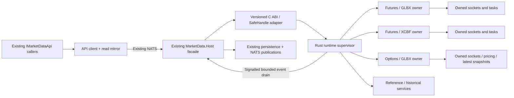

# MarketData Rust FFI Runtime and Dataset Lifecycle Design

Date: 2026-10-25  
Status: Live implementation design; current behavior documented first; emulator/backtesting design deferred

Scope: Fully implement the current live `IMarketDataApi` runtime and Framework.MarketData behavior through Rust FFI; no emulator design in this phase

## Authoritative ownership revision - 2026-10-27

The revised [implementation plan](MarketData-Rust-FFI-Implementation-Plan-v0.1.md#10-required-ownership-and-transport-boundary-2026-10-27) supersedes earlier target-design references to managed lease/lifecycle/recovery orchestration and streaming through FFI. Target: `IMarketDataApi -> thin C# command/query FFI -> Rust owner -> independent dataset resources`; all continuous datafeed publication is directly Rust -> NATS. Rust owns leases, renewal, scopes, connections, tasks, bounded queues, cancellation, health and one original 120-second dataset recovery deadline. Managed consumers, database writes and broker publication cannot pin native dataset resources or block cancel/join/rebuild. C# tick persistence remains downstream; direct Rust Scylla ingestion and API-server restart changes are outside this revision. Current-baseline descriptions below remain historical facts, not authorization to retain managed control in the new backend. Revised ownership/publication and downstream-stall acceptance gates remain open.

## 1. Current IMarketDataApi implementation and framework responsibilities

### 1.1 Public contract, remote client and local backend

`IMarketDataApi` is a C# application interface defined in `TomasAI.IFM.Application.MarketData/Contracts/IMarketDataApi.cs`, `.Backend.cs` and `.TradeFeedRecovery.cs`. It currently exposes 71 methods including overloads and two properties. It is not a native ABI and it is not implemented by one self-contained provider class.

The current implementations divide responsibility as follows:

| Component | Current behavior |
|---|---|
| `Remote/MarketDataApiClient*.cs` | Implements the application interface in the API process. Asynchronous backend operations go through NATS to Host. Synchronous hot reads, readers, health and `OptionChainCache` use the API-side read mirror. |
| `Remote/MarketDataReadMirror*.cs` and `MarketDataClientReceiver` | Maintain local observations of Host state and accept incoming publications so synchronous reads do not make a remote round trip. The receiver is infrastructure registered with the API; actors do not run it. |
| `Host/Api/MarketDataApiBackend*.cs` | Implements the Host-side service boundary. Dispatches reference, historical, option composition, session and trade-feed recovery operations to Host services, and routes appropriate provider calls to the owned futures/options worker. |
| `DataBento/DatabentoMarketDataApi.cs` | Implements date-scoped orchestration over framework feeds and a current epoch. Resolves/registers current and next futures contracts, owns start/stop and stream ownership integration, and serves provider contract/price/reader operations. Host-only operations are supplied by the Host facade; this class alone is not the full production backend. |
| `DataBento/Workers` and `DataBento/Resiliency` | Implement supervised lifecycle, dataset manifests, health/qualification, publication/current-value state and recovery coordination around the provider epoch. |
| `Host/Workers` and `Host.Worker/Runtime/DatasetWorkerRuntime.cs` | Launch, control and monitor child processes; transport operations and observations through pipes; run the managed provider epoch within each child. |

Higher-level actor contexts already resolve `IMarketDataApi` for contracts, price/risk access, option subscriptions and composition operations. `ApiApplicationStartupActivities` calls `PrepareSessionAsync(valueDate, token)` through this interface. `RegisterRemoteMarketDataRuntimeServices` registers `MarketDataApiClient` as `IMarketDataApi`, plus the receiver/mirror and lifecycle services. Replacing the provider backend must preserve those application behaviors.

Live data is not delivered by method return values alone: Host publications update the API mirror and feed the existing actor event pipeline. The Rust replacement must implement both operation completion and ongoing event publication. A DLL that only implements query/start/stop calls would be incomplete.

### 1.2 What Framework.MarketData itself currently implements

`TomasAI.IFM.Framework.MarketData` contains 10 source files in the inventory. It is the provider-independent execution layer, not the complete Databento implementation. Its current code is:

| Source file under `TomasAI.IFM.Framework.MarketData` | Responsibility that the Rust solution must preserve |
|---|---|
| `TickAggregation/TickLiveRouter.cs` | Contract-specific activation/deactivation and routing of live quote/trade service events. Runtime ownership determines which consumers receive live data. |
| `TickAggregation/TickQuoteBufferPool.cs` | Reusable quote buffers and explicit return/reuse ownership. Rust needs equivalent bounded allocation and lifetime behavior. |
| `TickAggregation/BoundedTickLiveEventPublisher.cs` | Bounded live-event publication, producer lifecycle and publication failure handling. |
| `TickAggregation/BoundedRealtimeTickPublisher.cs` | Optional bounded realtime delivery, cancellation/session isolation, queue/transport diagnostics and accounting for accepted, rejected, failed or discarded events. It currently contains fault/admission latches; preserve observable correctness while replacing those lifecycle mechanics with the simpler owner/reset design below. |
| `TickAggregation/TickAggregationEventPublisher.cs` | Actor-producer integration and aggregate/event publication; the native runtime supplies normalized results, while a thin managed bridge can continue publishing the existing actor/NATS contracts. |
| `TickAggregation/NullTickLiveEventPublisher.cs` | Explicit no-op publisher used when live routing is intentionally disabled. Keep an explicit disabled output mode, not silent loss in the production live mode. |
| `OptionChainCache/OptionChainSnapshotStore.cs` | Bounded immutable scope snapshots, monotonic publication versions, current-generation admission, retirement/removal and immediate snapshot reads. Old generations cannot overwrite a replacement. |
| `OptionChainCache/OptionChainPublication.cs` | Snapshot publication envelope with version, UTC publication time and immutable payload. Preserve the managed/wire shape where needed and map it explicitly to native records. |
| `ReferenceData/UsTreasuryCurve.cs` | Official US Treasury curve HTTP acquisition/XML parsing, date-range/latest selection, bounded cached observations and source/convention identity. Missing observations are not synthesized. |
| `ReferenceData/TreasuryRateConversion.cs` | Trading-day-based tenor selection, validation and approved yield conversion, including curve identity/digest. Preserve units, convention checks, failure results and numerical parity. |

Public market-data DTOs/interfaces formerly associated with framework folders are now largely under `TomasAI.IFM.Shared.Contracts/MarketData`, with the existing `TomasAI.IFM.Shared.MarketData...` namespaces. Their managed type definitions can remain for application compatibility. Their existence is not evidence that the runtime algorithms still need to remain managed.

**All executable Framework.MarketData behavior above is required in the live Rust FFI solution.** Managed code may remain as a contract/FFI/event-publication adapter, but the target cannot depend on the old managed buffering, routing, cache, lifecycle or reference-calculation engines to perform the supposedly migrated work. Adapter glue that invokes actor/NATS APIs is an explicit integration boundary, not a second market-data engine.

### 1.3 Provider framework and application features beyond that project

`TomasAI.IFM.Framework.MarketData.DataBento` has 185 inventoried source files covering the provider factory/feeds, native interop, contract-definition and latest-price clients, batching/drain queues, hot last-price stores, option-chain sessions, normalization, aggregation, session statistics, volume/VWAP, diagnostics, placement/affinity and historical provider access. These are also part of the Rust replacement scope; migrating only the 10 provider-independent files would leave the current market-data engine in C#.

The current factory's `SyntheticTickerFeed` and `SyntheticOptionChainFeed` names must not be treated as proof that a route is simulated: feed options/native data-source configuration and the actual runtime path determine the source. Record that configuration and native binary provenance in parity tests.

`Framework.MarketData.FinancialModelingPrep` supplies additional Treasury/economic-calendar HTTP/parsing/error behavior. Its framework execution is included in the complete migration. Reference persistence, approved publication policies and storage operations remain application services.

Host also runs strategy option-chain preparation/caching, storage/reference adapters, historical orchestration, durable subscription reconciliation and trade live-feed restoration. `Application.MarketData/Pricing` prepares coherent pricing inputs and executes IV/Greeks through the unified pricing calculator; `OptionChainCache` maintains strategy scopes independently of loaded trades. Those volatile/runtime features must be implemented or explicitly delegated behind the new facade too. Database ownership, saved user intent and domain analytics remain managed application responsibilities.

### 1.4 Current lifecycle and data flow

1. Startup obtains the authoritative API ValueDate, prepares session/reference/contract dependencies and establishes the required market-data lanes.
2. Host owns the worker processes and desired manifests. Each worker owns its current managed epoch, native feed handle and dataset-specific observations.
3. Framework/native code receives provider records; managed normalization/aggregation/pricing and publication produce hot state and events.
4. Host relays observations to the API receiver/mirror and existing event consumers. Actors read prices/risk through the application API/readers and receive ongoing events.
5. Background strategy-cache owners can acquire option-chain data even when no trade is loaded. Live-trade ownership and saved recovery-table intent are separate application registrations.
6. Stop/reset currently spans several levels: application recovery, Host worker supervision, managed epoch/feed shutdown and native handle cleanup. This duplication is the machinery to consolidate in Rust; it is not a requirement to retain every current gate or latch.

### 1.5 Ownership keys

The important active lanes are `Futures/GLBX.MDP3`, `Futures/XCBF.PITCH`, and `Options/GLBX.MDP3`. **Dataset name alone is not an ownership key:** ES futures and ES options share a provider dataset but must retain separate reset ownership, sockets, queues and generation state. A role/dataset owner can own multiple provider connections; neither one thread per contract nor one TCP connection per provider dataset is a requirement.

## 2. Recommendation and feasibility

Build a Rust market-data runtime behind a small, versioned C ABI and retain `IMarketDataApi` as the application boundary. Run the DLL in the existing `TomasAI.IFM.Application.MarketData.Host` process, with independently owned dataset/role runtimes instead of child worker executables. Actors, scheduled tasks, startup/shutdown, and the Rust UI keep their current API contracts. API-to-Host NATS communication stays; The Rust backend does not use Host-to-child processes, pipes or worker-frame serialization. The current backend retains that existing implementation unchanged.

This is feasible as a substantial staged replacement. It is not a DLL swap. Session ownership, subscriptions, reference resolution, history, aggregation, pricing contexts, cache refresh, publication, recovery, diagnostics and persistence boundaries all require explicit assignments. The companion [source and API inventory](MarketData-Rust-FFI-Inventory-v0.1.md) enumerates the affected code and all interface methods, including overloads.

**RAII provides deterministic ownership and cleanup when execution can make progress. It cannot guarantee termination of an arbitrary blocked OS thread.** Dropping a Rust `JoinHandle` detaches its thread; it does not kill it. Tokio task abortion is cooperative, and already running `spawn_blocking` work cannot generally be aborted. Therefore an in-process design can replace dataset subprocesses only after demonstrating cancellation of every supported provider/control path. It cannot provide the same containment for memory corruption, an uninterruptible library call or a deadlocked OS thread. See [Rust thread ownership](https://doc.rust-lang.org/std/thread/struct.JoinHandle.html) and [Tokio cancellation](https://docs.rs/tokio/latest/tokio/task/struct.JoinHandle.html#method.abort).

Selected Rust-backend deployment: **one existing Host process, no Rust-created child processes, one new Rust DLL, independent Tokio dataset/role owners, and the existing external Host/API supervision as the last resort**. The selectable current backend continues using its existing workers and native libraries unchanged. If termination remains unconfirmed, report the failure at the deadline; a whole Host restart is the available physical cleanup boundary. Such a restart also interrupts its futures lanes. Do not describe logical generation replacement as proof that the old thread terminated.

### 2.1 Implementation priorities and delivery plan

The [implementation plan](MarketData-Rust-FFI-Implementation-Plan-v0.1.md) is the execution checklist for this design. The new backend must prioritize simple explicit ownership, idiomatic Rust, recovery resilience, bounded resource use and measured latency. Use one lane owner, one lease-renewal authority and one recovery deadline; do not reproduce independent permanent quarantine latches or layers of reset coordinators.

Use cancellation-aware Tokio tasks and signalled delivery. Reserve control/error capacity independently of data traffic, preallocate/pool buffers, and preserve authoritative aggregation when coalescing disposable views. Prefer ordinary safe Rust data structures until measurements justify more complex lock-free or zero-copy machinery. CPU work and third-party waits must have qualified cancellation behavior.

Document Rust crate/module boundaries, public APIs, safety contracts, nontrivial private invariants, cancellation and lifecycle transitions as they are implemented. New-crate formatting, Clippy, tests/doctests and Rustdoc checks are phase gates. The implementation plan specifies the documentation and reproducible performance/recovery evidence required for acceptance.

A successful recovery must be proved inside the original 120-second budget. At expiry, publish failure independently of unfinished cleanup. No promise of arbitrary thread termination or exact UI presentation timing under an unavailable network/desktop replaces the required lifecycle/notification tests. The current backend is preserved and emulator design remains deferred.

## 3. Investigation basis and limits

- Inspected the current working tree, including existing uncommitted architecture changes. This is not an audit of a clean historical commit.
- Reviewed the three `IMarketDataApi` partial interfaces, remote client/mirror, Host backend dispatch, worker ownership, subscription/option lease paths, background strategy cache, provider framework, native bridges, API recovery coordinator and deployment references.
- Confirmed the existing Rust `native.rust/DatabentoFeed.Rust` crate is a `cdylib`/`rlib`, with optional live Databento SDK support pinned to `0.58.0`. A Rust numerical kernel also exists in `native.rust/OptionPricer.Rust`.
- The managed resolver loads the filename `databento_feed_native` from the RID directory. That filename alone does not establish whether a deployed binary was built from C++ or Rust. Binary provenance must be recorded during migration.
- The existing Rust bridge uses an owned producer thread and a current-thread Tokio runtime. Its `stop(timeout)` can return `TIMEOUT`; `dbf_feed_destroy` refuses destruction while work remains active. Existing Rust code does not already provide the proposed reset guarantee.
- This design uses static dependency/call references plus the logs reviewed for the 2026-10-25 incident. Source presence does not prove every provider or compatibility branch is active. No feeds were restarted, no fault was injected, and no code tests were run for this documentation task.
- Provider cancellation behavior was checked against the locally installed **0.58.0 source**, not assumed from newer SDK documentation. Any SDK upgrade needs a new cancellation audit.

Inventory totals: **71 API methods including overloads, two properties, 113 production/source files directly referencing the interface, and 58 test/benchmark reference files**. The per-file disposition appendix covers **883 source files across 14 explicitly inventoried roots**, including shared contracts, numerical dependencies and native comparison utilities. These numbers are scope measurements, not an estimate that all 883 files should be rewritten. The external-operation index and project-reference list identify additional consumers outside those roots.

## 4. Feature inventory and target ownership

| Feature | Current source anchors | Target assignment |
|---|---|---|
| Public service surface and synchronous readers | `Application.MarketData/Contracts/IMarketDataApi*.cs`, `Remote/MarketDataApiClient*.cs`, `Remote/MarketDataReadMirror*.cs` | Preserve managed contract; implement Host facade over Rust; preserve reader generation semantics and API mirrors. |
| Native transport, DBN decode, symbology, provider errors/warnings, heartbeats and replay | `Framework.MarketData.DataBento/Interop`, `Runtime`, `native/DatabentoFeed.Native`, `native.rust/DatabentoFeed.Rust/src` | Rust provider module; reuse audited Rust decoder/SDK work; no retained C++ transport in the target path. |
| Dataset session, startup, reset, teardown, readiness and watchdog | `Application.MarketData/DataBento`, `DataBento/Workers`, `DataBento/Resiliency`, `Host/Workers`, `Host.Worker` | One Rust owner per lane and one recovery coordinator; thin Host adapter; bypass child supervisor/pipe machinery only in Rust mode and preserve the current backend. |
| Owner-aware subscriptions, batch acquisition, renew, release and durable composition | `Application.MarketData/Subscriptions`, `Pricing/RecoveringOptionLeaseRegistry.cs`, `Pricing/WorkerOptionChainRuntime.cs` | Rust owns active registrations/refcounts and transport. Managed application owns persisted user/business intent and commits. |
| Futures/option definitions, expiry calendar, symbol catalog, current/next contracts and rollover | `Host/OptionChains`, `Application.MarketData/TradeStrategySymbols`, `DataBento/DatabentoCurrentFuturesContractResolver*`, BlackBoard query/mapping caches | Rust queries/normalizes provider data; managed storage/reference services remain authoritative. Explicit plans enter Rust, no ambient DB lookup in quote callbacks. |
| Hot quotes/trades, last-price readers, session OHLC, statistics, volume and VWAP | `Framework.MarketData.DataBento/LastPrice`, `TickAggregation`, `Framework.MarketData/TickAggregation`, `DataBento/Workers/DatasetWorkerCurrentValues.cs` | Rust hot state/accumulators and bounded outputs; managed DTO/event mapping and remote mirror retained. |
| Live routing and publication | `TickLiveRouter`, bounded publishers, `DataBento/DatabentoTickAggregationPublisher.cs`, Host messaging relays | Rust routing/coalescing; managed Host publishes the existing NATS/event contracts. No second Rust NATS owner initially. |
| Historical estimates, metadata, downloads, manifests, replay, checkpoints and five-minute seed bars | `Framework.MarketData.DataBento/Historical`, `Application.MarketData/DataBento/Historical`, `Historical`, `Host/Seeding` | Rust provider I/O/decode/streaming and temporary-resource ownership; managed durable loader/checkpoint/observation stores and job orchestration. |
| Individual option and chain pricing observations | `Application.MarketData/Pricing`, `Framework.OptionPricer`, `Shared/MarketData/Pricing` | Rust quote/context coherence, IV/Greek execution, snapshot caching and lease lifecycle. Reuse existing numerical Rust kernel only for models it actually implements. |
| Strategy-chain universe and prepared candidate cache | `OptionUniversePlanner`, `OptionChainBackgroundUpdater`, `QualifiedCompositionDiscovery`, `Host/OptionChains/StoredOptionUniverseSource.cs` | Rust volatile coverage/lease/snapshot runtime; managed published strategy policy and definitions source. Pure planning/ranking can move to Rust under parity tests. |
| Treasury curves, economic calendar and reference calculations | `Framework.MarketData/ReferenceData`, `Framework.MarketData.FinancialModelingPrep`, `Application.MarketData/FinancialModelingPrep` | Port framework HTTP/parsing/conversion runtime as a required part of the full framework scope; preserve managed persistent reference services and business publication rules. Independent of dataset teardown. |
| Trade live-feed recovery table and restoration | `IMarketDataApi.TradeFeedRecovery.cs`, `Host/Api/MarketDataApiBackend.TradeRecovery.cs`, `Application.Storage/TradeDb` | Retain managed durable records keyed by trade and API ValueDate; replay desired active ownership to Rust once session/trade prerequisites are ready. |
| Market outlook/ITI/EMA/BB and trade plan actors | `Application.MarketData/MarketOutlook`, domain analytics/trade actors | Retain algorithms and workflows outside the provider DLL. Redirect existing API consumers; do not duplicate the actor system in Rust. |
| Operational health, UI failures and external restart | API `Actors/Recovery`, `Recovery/Databento`, `Observability`, ServerManager | Retain application/UI authority; consume one Rust recovery result/evidence model. Use backend-specific provider reset adapters; preserve the current backend coordinators unchanged. |
| Interactive Brokers market-data directory | `Framework.MarketData.InteractiveBrokers` | Current inventory found no C#/Rust/C++ source in this directory. Do not invent an active provider port; recheck project/package/deployment references before deletion. |

The full framework target means executable framework logic is Rust. Managed interfaces, DTOs, API adapters, storage and wire compatibility may remain. It does **not** mean that every method behind `IMarketDataApi` becomes a direct unmanaged call: database reads and durable trade intent legitimately remain managed orchestration behind that interface.

### Pricing coverage must not shrink

`Application.MarketData/Pricing/Black76PricingModel.cs` currently delegates to the unified managed `Framework.OptionPricer.Pricing.OptionCalculator`. It selects behavior using exercise style, premium style and contract metadata. The existing Rust Black-76 kernel is useful but is not evidence of parity for every American/European and paid-upfront/futures-style combination. Inventory and qualify those actual call paths before moving pricing; an unsupported model must return a typed failure rather than silently substitute Black-76. Port only the market-data-required calculator dependency closure, not unrelated dividend/equity features by assumption. Preserve Greek units, rho conventions, numerical policies, tolerances, semantic hashes and engine version tags.

## 5. Proposed structure

Required implementation root: `TomasAI.IFM.Application.MarketData.Rust`, library artifact `ifm_market_data_native`. The Rust crate and its managed adapter live under this root; the earlier `native.rust/MarketData.Rust` location is superseded. Implement a separate managed `RustMarketDataApi : IMarketDataApi` facade for Host, backed by the new library. Copy the required, audited provider/decoder implementation from `native.rust/DatabentoFeed.Rust` into the new library or a new private crate owned exclusively by that library. Apply all required Tokio, cancellation, resource-ownership and ABI changes to that copy. Do not refactor or edit the existing Rust Databento crate, its public ABI, existing DLL, current backend or build scripts. Record the source commit and copied module provenance; temporary duplication is intentional to preserve the working baseline.

### 5.1 Two selectable implementations; current version preserved

- The production choices are the current backend and the new Rust FFI backend, both serving the same `IMarketDataApi` operations and existing event/wire contracts.
- Existing `MarketDataApiClient`, actor contexts, startup workflows, scheduled tasks and UI consumers keep their application behavior. They do not select a provider, pass a native handle or branch on Rust versus current implementation.
- Host composition/configuration selects one backend at startup, for example a new `MarketData:Backend` setting with `Current` as the default and `RustFfi` as the opt-in value. This is a proposed setting, not an existing implemented switch.
- Confine necessary new code to the market-data implementation, backend composition, native packaging and infrastructure adapters. Current implementations remain intact. If a consumer depends on process replacement rather than the API contract, supply a backend-specific infrastructure adapter; do not add Rust conditionals to business consumers or claim that incompatible behavior is transparent.
- No automatic fallback to the current backend following a Rust failure. Report the failure through the agreed recovery/UI flow. Switching backends is an explicit startup/deployment choice until a separate handover design is approved.
- Only one backend publishes production updates and owns subscriptions for the session. Both packages may be installed; running both requires isolated qualification sessions with separate subscriptions/state and no duplicate business events.

### 5.2 New DLL, separate ABI and Tokio execution

The new DLL has a distinct filename (`ifm_market_data_native.dll` on Windows), ABI version, FFI entry points and native loader binding. It must not overwrite or impersonate `databento_feed_native.dll`. Keep release manifests/output directories separate; selecting Rust must load the new artifact explicitly. The old ABI is not the expanded MarketData ABI and does not need to change.

The new library does not spawn worker executables or introduce Rust process supervision. Dataset sessions execute as Tokio tasks with explicit cancellation, owned client lifetimes and awaited completion. Tokio uses OS threads internally; no subprocesses does not mean no threads. The dataset/role lanes remain independent ownership units even if they share a provider dataset name. Existing native Databento implementation code is integrated into this new Tokio runtime, not called through an unchanged legacy lifecycle that still owns producer threads outside the new reset authority.

Suggested internal modules: `ffi`, `runtime`, `dataset`, `databento`, `subscriptions`, `catalog`, `latest`, `aggregation`, `pricing`, `option_chain`, `historical`, `reference`, `diagnostics`, `clock`, `synthetic`. They can start in one crate; splitting them into many packages is not required for ownership correctness.

### Managed/native responsibility boundary

- Managed: authenticate/validate application requests, read policies/reference stores, persist durable intent/checkpoints, supply API ValueDate/time context, translate results/events, publish UI/actor notifications and apply external restart policy.
- Rust: own provider connections/tasks/buffers, normalize records, maintain hot state and runtime leases, execute supported pricing/aggregation, drive dataset reset and report evidence.
- Managed code must not hold mutable references into a running Rust owner. Rust must not call business actors, PostgreSQL or UI callbacks from provider tasks.
- Keep the application/domain/framework reference direction. Shared/managed domain objects are mapped into neutral ABI records; Rust does not consume CLR reflection, assembly-qualified event names or managed service locators.

## 6. Lifecycle ownership and RAII rules

Each `DatasetOwner` owns its session clients, task collection, cancellation signal, generation, active lease table, hot-state buffers and event producers. A small independent runtime supervisor owns the dataset owners and control completion records. Historical/reference work has separate ownership, so a long HTTP download cannot block option reset.

Use Tokio tasks for provider/session work. A runtime thread per lane with a current-thread Tokio executor and bounded async tasks is the proposed scheduling arrangement; it is internal to the DLL, not a dataset process. This offers scheduling separation and explicit owner exit evidence. It does not create a force-termination mechanism. All CPU-heavy pricing/aggregation must process bounded chunks and check cancellation; long-running blocking calls are prohibited on these executors. Any additional thread pool must be explicitly bounded, cancellable at job boundaries, and included in join evidence.

Rules:

1. Create sockets/tasks under a single generation owner; never detach a thread or task as normal cleanup.
2. Use cancellation-first explicit `stop/reset` operations. Await task completion and thread exit before recording cleanup confirmed. `Drop` is a last-resort signal/resource guard, not an unbounded join on a CLR finalizer thread.
3. Audit DNS, TLS, connect, auth, subscribe, start, read, replay, HTTP, decoding, calculation, locks, event output and destructors. Every wait must be interruptible or bounded by the one operation deadline.
4. `next_record` in pinned SDK 0.58.0 is documented cancellation safe; `subscribe` and `start` are not. If cancelled mid-handshake, abandon that entire client/socket generation. Never resume a partially cancelled protocol session. The task/future containing the client must be dropped, not merely its join handle.
5. Do not hold a shared mutex across I/O or joins. Control/reset must bypass data backlog and cannot depend on a full quote queue draining.
6. Exiting code may stop acknowledging old-generation results immediately. It may free buffers only after readers/tasks are known to be finished.
7. Do not use Windows `TerminateThread`, unload a DLL with live frames/threads, or reuse freed handles to simulate reset. These cannot establish memory-safe cleanup.
8. If the owner cannot exit, do not report cleanup confirmed or keep creating replacement owners. Record failure, retain ownership of still-live memory, bound total resources, and invoke the existing external containment decision. Whole-Host termination is the only physical cleanup boundary in the proposed deployment.

## 7. One simple reset flow and one two-minute budget

State exposed per lane: `Stopped`, `Starting`, `Running`, `Recovering`, `Failed`. Detailed readiness/last-error information is evidence, not a collection of independently latched admission modes.

`Running/Starting -> Recovering -> Running` or `Failed + UI notification`. An explicit new start/reset can leave `Failed`; market close clears session-scoped attempts while preserving the audit record. No silent permanent quarantine.

For each episode, starting when failure is accepted:

1. Capture the desired plan: role/dataset, ValueDate, actual underlyings, enabled trade owners, published background policies and relevant reference versions. Separate desired state from disposable lease IDs.
2. Advance the generation so obsolete results cannot mutate new state. Atomically discard obsolete queued replaceable observations; notify consumers that values are temporarily unavailable/stale.
3. Cancel old owner work, close/drop its sockets through the audited cancellation path, and join all tasks/threads. Emergency reset never drains old quotes/plans first.
4. Recreate a clean owner, rebuild underlying dependencies, acquire fresh physical subscriptions and issue fresh generation-scoped lease IDs. Restore desired ownership exactly once; released/disabled owners stay absent.
5. Verify provider acknowledgements, heartbeat/transport status, active desired registrations and required downstream evidence. Reuse a successfully created replacement on subsequent verification attempts.
6. On success, publish one completion and reset the recovery-attempt indicator according to the agreed restart policy. On failure, keep trying repair/recreation only within the original budget.
7. At **120 seconds maximum**, publish one terminal result and durable/reconnect-visible UI error with the exact failing stage and cleanup status. Notification cannot wait for cleanup/join. No nested timeout starts a fresh two-minute window.

Use one monotonic deadline within the Rust runtime and pass **remaining budget** to I/O. Derive it from the supplied request once; do not compare unrelated process-local monotonic clock values across NATS. UTC deadlines can be carried for diagnostics/remote admission, with remaining-budget reconciliation at the boundary. Caller cancellation still cancels an explicit caller operation; independent provider heartbeat detection is not a competing recovery deadline.

Episode ID identifies the incident; attempt ID identifies a particular execution. Idempotent duplicates return the same execution result, while a new attempt does not accidentally replay a cached failure/success from an earlier attempt. Cleanup completion and service recovery completion are distinct fields.

### Verification with and without loaded trades

| Desired workload | Required success evidence |
|---|---|
| No option owners and no background policies | Old owner terminated; desired ownership empty; lane correctly idle. Do not wait for quotes. |
| Background strategy cache only | Provider subscription/transport evidence plus usable snapshots for currently required eligible scopes. No trade-position evidence is required. |
| Live trade owners | Fresh/coherent required leg observations and risk, a newer complete plan and downstream publication for those trades, in addition to provider health. |
| Quiet/inactive session | Session-aware heartbeat/control evidence; no fabricated quote freshness and no success claim based on stale pre-reset data. Session scheduling comes from the API context. |
| Unavailable optional policy/expiry | Explicit policy-level unavailable result; reacquire/repair its dependencies. If an exception has uncertain transience, report unhealthy and apply the bounded recovery policy rather than swallowing it. |

Policies define which caches are required for service readiness. Do not redefine all missing quotes as success, nor force an idle service to invent a live position. Missing required evidence eventually reaches the same UI failure path.

## 8. Leases, cache rebuild and underlying selection

The 2026-10-25 incident exposed logic defects that a language rewrite alone will preserve:

- A strategy refresh reused a lease the worker had ended.
- Recovery demanded live-position evidence even with no loaded trades.
- Subsequent recovery calls reused an episode ID also used for Host request deduplication, and replacement proof compared the current PID repeatedly.
- Old-generation refresh/release operations continued after replacement.
- A policy asked for an on-the-run contract absent from the active epoch.

Target rules:

- Desired owner registration is stable and persisted only where business intent requires it. Runtime lease identity is disposable and belongs to one generation. Expired/released lease IDs are never resurrected; reacquisition gets a new ID.
- Consolidate renewal into one authority. The present updater and discovery refresh loop must not maintain independent competing expiry/renewal state.
- On generation retirement, cancel all corresponding refresh jobs and forget their runtime registrations. A late release is idempotent and cannot release a new-generation owner.
- Validate dependencies from each option definition's actual underlying. Subscribe that exact futures contract first. A generic root/on-the-run price must not substitute for a different underlying.
- Keep published policy limits (DTE, preferred expiry, maximum expirations/contracts, strike range, quote age/skew and sizing) and deduplicate overlapping physical subscriptions. Policy availability is visible to clients.
- Today's Development policies include 5-10 DTE vertical-spread caches and 30-45 DTE iron-condor caches, independent of loaded trades. These are configuration, not hardcoded Rust expiry rules.
- Maintain distinct flags/evidence for transport connected, subscriptions acknowledged, quotes coherent, pricing valid, cache ready and trade proof. Present a simple state plus explanation rather than collapsing all of them to one boolean.

## 9. FFI and event delivery design

Expose an explicit C ABI with opaque integer handles, ABI version/struct size, typed error codes, request IDs, lane/generation identity and explicit ownership. Examples of operation families, not a frozen header:

- `md_runtime_create`, `md_submit`, `md_cancel`, `md_dataset_start`, `md_dataset_reset`, `md_dataset_stop`.
- `md_subscription_acquire/release`, `md_catalog_read`, `md_snapshot_copy`, `md_history_submit`.
- `md_wait_event`, `md_events_copy`, `md_operation_result_copy`, `md_runtime_close`, `md_handle_release`.

Long work returns an operation ID promptly. The managed adapter awaits signalled completion and maps cancellation to the native request. No FFI call holds an API request thread inside an unbounded provider wait. The existing C# API stays idiomatic; actors never see native handles.

Use blittable fixed-width records, integer price scales and explicit decimal conversions, UTF-8 pointer/length pairs or caller-owned buffers. Encode dates, units, timezone identifiers and missing values explicitly. Do not share CLR `decimal`, `DateTime`, Rust enums/collections/trait objects or allocator ownership implicitly. Preserve existing MessagePack/NATS wire contracts through managed translation; a new ABI does not require an event-log migration.

Prefer copy into caller-owned pooled batches. If zero-copy buffers are introduced, each has an explicit release token and no reuse until release. Capture or hold snapshots for only a bounded interval; state references cannot outlive their generation. Validate lengths/overflow, handle generation and concurrency at every unsafe boundary. Catch Rust panics before unwinding across C ABI; panic containment does not catch access violations or repair corrupted state.

Provider tasks write to bounded runtime-owned outputs and signal an event. A Host event-drain adapter waits for that signal and forwards results immediately; no timer-based quote/status polling is introduced. Avoid synchronous managed callbacks on provider threads. Structured provider warnings/errors retain codes, fatal/transient classification, request/subscription IDs, lane, generation, recovery episode, timestamp and sanitized detail. Unknown exceptions report unhealthy and enter the recovery policy.

Managed `SafeHandle` protects native lifetime, but `ReleaseHandle` cannot do a two-minute stop on the finalizer thread. Normal `IAsyncDisposable` explicitly closes and proves quiescence. Concurrent handles carry references to the owning runtime; they cannot free it while operations are active. If close cannot prove quiescence, it must not free live memory. Do not unload/reload the DLL as the dataset reset mechanism.

## 10. Bounded queues and correct loss semantics

- Live option quote/risk views: bounded **latest value per contract**, plus a bounded set of dirty contract IDs. A busy contract cannot evict every update for a quiet contract. Slow subscribers receive the latest coherent state.
- Raw records still need the processing required for statistics before coalescing. Losing arbitrary futures trades can corrupt volume, VWAP, bars and ITI/EMA/BB inputs. Preserve those calculations, or explicitly mark the aggregate incomplete and reseed/recompute it; never silently treat lossy raw data as complete.
- Trade executions, order acknowledgements, durable subscription intent, historical checkpoints and errors are not interchangeable quote updates. Give them independent bounded control/durable paths.
- Reset/control commands have reserved admission capacity and an independent wake signal. Full quote buffers never close mailboxes or prevent cancellation. A stale generation identity check remains necessary for correctness; it is not a permanent reject state.
- Pool/preallocate buffers with hard size limits. Export queue occupancy, coalesced/skipped counts, outstanding buffer leases and per-generation retained memory. RAII cannot bound memory while arbitrary consumers retain `Arc` snapshots indefinitely; enforce that ownership contract.

## 11. API compatibility and persistence

The appendix lists every API operation. Preserve all groups: lifecycle/status, current/next contract reconciliation, contracts/definitions/expiry discovery, hot reads/readers, owner-aware and compatibility stream operations, strategy symbol/cache access, composition and monitored-option operations, Treasury/calendar, historical acquisition/seeding, fault injection/recovery and trade recovery-table operations.

### 11.1 Preserve worker/process contracts with truthful backend semantics

Keep the existing public worker/process fields, names, types and serialization keys. Do not fabricate separate process IDs for Tokio tasks or require consumers to understand native runtime handles.

| Existing information | Current backend | Rust FFI backend |
|---|---|---|
| `ProcessId` | Actual dataset worker PID, unchanged | Actual hosting MarketData Host PID; it may be the same for every lane and remains stable across dataset resets |
| `WorkerInstanceId` | Existing worker identity, unchanged | Identity of the logical dataset/role owner; allocate a new identity when that owner is replaced |
| `GenerationId` | Existing epoch identity, unchanged | Fresh session generation for every recreated dataset session |
| `ManifestRevision` | Existing desired subscription revision | Same desired-state revision meaning, independent of thread/process identity |
| `Running`, `Healthy`, `Lifecycle`, `Error` | Existing behavior, unchanged | Truthful Tokio lane state/readiness and failure detail; never infer healthy merely because Host is alive |
| `ValueDate`, operation identity and timestamps | Existing meanings | Same API-authoritative date and operation/timestamp meanings |

Rust task/socket cleanup proof is internal evidence returned by the native runtime and consumed by the managed backend recovery adapter. It does not require replacing the public process fields or exposing task handles to actors. Retain existing status schema and lifecycle values through explicit mapping.

A PID change cannot prove a Rust dataset reset because the Host process remains alive. Preserve the current process-replacement proof in the current backend. Select a new backend-specific recovery verification implementation through infrastructure composition for Rust: require old-generation cancellation/completion, resource release, new-generation readiness and the workload-specific service/trade evidence described in section 7. It must accept an already successful replacement on a retry. No fake PID increments and no weakening the current backend's proof.

The current API `OptionPipelineRecoveryRuntime` has a process-change assertion, so changing only `DatabentoMarketDataApi.cs` cannot achieve transparent interchangeability. Keep that existing implementation unchanged and supply the Rust-specific verification through its infrastructure boundary. Such composition/adapter work is explicitly included in the new backend implementation scope. If an invariant cannot be adapted without changing a business consumer or breaking a wire contract, report it as a compatibility blocker before cutover.

Keep event subjects, DTO layouts, timestamps, trade ValueDate authority, numerical scales and persistent identities stable. Preserve database history and saved live-feed intent. Define and test canonical semantic hashing across C# and Rust; byte order, decimal formatting and map ordering must not change persisted/cache identities accidentally. No event-sourcing/domain actor state is migrated into native memory by this proposal.

All business dates come from the API. Inject a session/business clock and explicit UTC values into pricing/history requests; use monotonic elapsed time for live watchdogs. An emulator/backtesting implementation will be designed separately only after the live Rust backend is complete and accepted. This phase preserves the authoritative date/time boundary but does not define emulator APIs, replay scheduling, virtual-time execution or backtesting behavior. Historical downloads and startup seed replay remain required live-system features; they are not the deferred emulator.

## 12. Replacement scope and preservation of the current backend

**No current-backend code, worker executable, native DLL, ABI or build path is removed or rewritten in this implementation.** The following responsibilities are absent from or replaced inside the new Rust backend only:

1. Child-worker bootstrap/executables: not used or launched in Rust mode.
2. Host-to-child pipes, frame codecs and process qualification: replaced by the new direct FFI and Tokio lifecycle in Rust mode.
3. Managed provider decode/drain/session/reset machinery: replaced by Rust-owned execution, with compatibility adapters where required.
4. Managed hot-store/aggregation execution: replaced by Rust equivalents validated against current results.
5. Competing lease renewal/context-refresh/cache authorities: consolidated under the Rust runtime.
6. Existing C++ or Rust Databento DLL: remains available to the current backend; the new backend uses its distinct new library and privately copied/adapted provider code.

The application facade/contracts, API read mirrors, storage adapters, NATS publications, durable reference/policy state, trade recovery table, analytics/trade actors, UI notifications and external supervision continue serving their existing roles. Add backend-specific infrastructure adapters only where the physical runtime differs. Do not remove `Application.BlackBoard` or its unrelated services.

Removing the current backend or consolidating the two Rust source trees is a future decision requiring explicit approval after both implementations have been verified. Passing Rust acceptance does not itself authorize deleting the baseline or changing the default backend.

## 13. Alternatives and consequences

| Option | Simplicity and cost | Reset boundary |
|---|---|---|
| Improve current implementation | Smallest change; fixes known logic now | Existing per-worker process termination retained. |
| Rust DLL inside existing Host, no children (recommended target to explore) | Removes interprocess worker transport and duplicated runtime ownership; substantial port | Cooperative per-lane cancellation; whole Host restart for uncooperative work. |
| Rust DLL directly in API | Removes Host/NATS hop but expands API failure blast radius and changes established separation | Unrecoverable native fault requires API restart and trade restoration. Not recommended initially. |
| Rust worker subprocesses (excluded from selected design) | Retains process plumbing; does not implement the agreed Tokio-only backend | Independent process termination would remain possible. |

The requested in-process target trades independent process containment for fewer layers. If **physical termination of any dataset regardless of its behavior** is a non-negotiable acceptance requirement, a threads-only design cannot meet it. Keep a process boundary for that requirement. This is an architectural limit, not a missing Rust API that can be filled by more RAII wrappers.

## 14. Implementation sequence and review gates

Detailed tasks, phase exit criteria, Rust documentation requirements and recovery/performance tests are defined in the [implementation plan](MarketData-Rust-FFI-Implementation-Plan-v0.1.md). The implementation root is `TomasAI.IFM.Application.MarketData.Rust`.

### Delivery order: live implementation first

1. Document and freeze the current live implementation and its complete API/framework behavior.
2. Implement the Rust live backend, including all framework behavior, required application runtime features, event delivery, reference/historical operations and recovery.
3. Complete offline parity, cancellation/fault, sustained and live acceptance gates against the current backend.
4. Only after that acceptance, create a separate emulator/backtesting design using the established boundary. Do not expand this implementation with a parallel emulator project.

Synthetic records, fake endpoints and fault-injection harnesses are test tools needed to verify the live implementation. They do not constitute designing or implementing the future market-data emulator. The presence of an existing `FrozenEmulatorOptionChain` helper or synthetic feed mode does not bring a full emulator into this scope.

| Phase | Deliverable | Exit criteria |
|---|---|---|
| 0. Baseline and contract freeze | Freeze current source/artifact provenance, API/wire fixtures, behavioral matrix and backend selector design | Every API operation assigned; current implementation/build remains unchanged; no unsupported default silently accepted. |
| 1. Lifecycle feasibility spike | One synthetic and one real SDK owner; cancel/connect/read/start/replay/reset/stop; FFI handle tests | Join and resource-release proof for every supported path; explicitly blocked-thread test produces deadline failure and external-containment result. Keep existing child deployment. |
| 2. Rust core and ABI | New crate/DLL and distinct loader/ABI; copied provider code, Tokio supervisor, per-lane owners, signalled output, clocks, errors/metrics | C#/Rust ABI fixtures, handle lifetime/concurrency tests, cancellation/deadline tests, no unbounded data/control queues. |
| 3. Futures and discovery parity | Both futures datasets, definitions, rollover, normalization, session stats, aggregation, live outputs | Exact replay-to-replay results, with only approved explained field-specific exceptions; volume/sequence/session/DST gates; one-lane reset leaves others progressing. |
| 4. Options and references | Exact underlying dependencies, leases, price/risk/chain cache and supported pricing, reference providers | Model/Greek parity, background-only and live-owner recovery, expired lease replacement, generation transitions, unavailable-data visibility. |
| 5. History and durable orchestration | All historical API groups, seed bars, persistence/checkpoint adapters, trade restore | Cancellation/resume/idempotency, date-range and billing/estimate behavior, saved-trade restoration and market close cleanup. |
| 6. Host backend selection | Two selectable implementations, Rust facade/recovery adapter and unchanged external API/NATS contracts | Run the same contract/integration/UI suite with each backend; business consumers unchanged; current backend remains default. |
| 7. Sustained qualification | Repeated resets, long replay/soak and live market open/close | Bounded memory/thread/socket/lease counts; no old-generation effects; recovery deadline and independent futures-lane continuity proven. |
| 8. Package both backends | Rust mode deploys Host plus new DLL without children; current mode retains existing artifacts | Explicit startup selection/rollback tested; baseline source/artifacts unchanged; no duplicate publishers; architecture/packaging gates pass. No baseline deletion or default cutover. |

Maintain one active publisher for each lane. Shadow/replay comparison must not duplicate live actor events, user trade intent or provider subscriptions unintentionally. Store baseline behavior fixtures before replacing the managed path. Keep the proven backend unchanged and available after Rust acceptance; removal/default cutover requires a later explicit decision. Correct the identified incident logic in the new Rust implementation and its adapters; any fixes to the existing backend require a separate authorized change.

## 15. Required acceptance matrix

The current C# implementation is the behavioral baseline. Given identical recorded inputs, commands, policies, reference state, ValueDate and controlled business time, the Rust implementation must mirror observable results exactly. Every difference must be fixed or have a reproducible explanation, consumer/trading impact assessment and accepted disposition in the implementation plan's difference register. Unexplained or unapproved differences fail acceptance. Numerical tolerances and normalization of nondeterministic fields are explicit, field-specific exceptions rather than blanket allowances. The already agreed worker/process identity mapping and intentional recovery corrections must also be recorded and tested as explained differences. See implementation plan section 1.1 for the required comparison procedure.

| Test | Required result |
|---|---|
| All API methods/properties | Run one shared suite against Current and RustFfi; correct results or the same documented capability failures, with no new hidden unsupported defaults. |
| Current-backend preservation | Current C#/native Rust/C++ sources, old ABI/DLL, worker packaging and existing behavior unchanged; new backend changes do not overwrite baseline artifacts. |
| No Rust child processes | Runtime/launch audit confirms Rust mode starts no worker executables; dataset work uses Tokio tasks and bounded owned threads. |
| Worker/process compatibility | Existing fields/wire keys preserved; Rust reports real Host PID and logical owner/generation IDs; dataset reset succeeds with stable Host PID and verified cleanup/new generation. |
| Consumer transparency | Same actors, startup workflows, scheduled tasks and UI run against either selected backend without Rust-specific code changes. Infrastructure selection/recovery adapters are isolated. |
| Complete framework migration | Every Framework.MarketData responsibility in section 1.2 and provider/reference framework capability in section 1.3 maps to a Rust implementation and parity test. Only explicit managed contracts, persistence and integration adapters remain on the target path. |
| No trade loaded, background cache enabled | Cache starts and recovers using chain/service evidence; no position-required exception. |
| No owners/policies | Idle state is healthy for the desired empty workload; no quote wait. |
| Loaded live trade(s) | Restore precisely the saved current-ValueDate owners; fresh leg/risk/complete-plan proof; UI resumes. |
| Ended lease and explicit release races | Fresh runtime lease for desired owner, idempotent late release; disabled owner never restored. |
| Control loss/retry after replacement | Same attempt is idempotent; next attempt runs or verifies current generation; no cached first result or repeated PID-change requirement. |
| Cancel during connect/auth/subscribe/start/read/replay/history | Old session abandoned safely where required; join/resource evidence; replacement within remaining budget. |
| Queue saturation/slow UI/slow NATS | Latest option state stays bounded; reset/control still works; required aggregates remain complete or explicitly unavailable. |
| Never-returning calculation/blocked thread simulation | 120-second failure notification still arrives from an independent observer; no false cleanup proof or repeated leaked replacements; external Host containment path explicit. |
| Native panic/invalid FFI input/concurrent dispose | Typed failure or deliberate process-containment result; no unwind over ABI, use-after-free or stale handle aliasing. |
| Stale generation results and cache refresh jobs | Cannot update active state or release active leases; obsolete registrations fully retired. |
| Missing underlying/expiry/Treasury/calendar | Correct typed unavailable reason, authoritative contract/date mapping and recovery classification; no substitute price. |
| Futures and options independence | Reset Options/GLBX while both Futures lanes continue receiving/processing; if whole Host restart required, interruption is explicitly reported. |
| DST/weekend/holiday/value-date rollover | API-controlled dates, correct UTC/session conversion, no invalid provider replay start, quiet-market health distinguished from data freshness. |
| Pricing | Every currently used exercise/premium convention and IV/Greek unit/formula matches its approved baseline. |
| Session statistics/history | OHLC, volume, VWAP, bars, seed series, corrections/replay overlap and checkpoint resume match baseline. |
| Provider errors/warnings and unknown exception | Full sanitized diagnostics; recognized transient handling; uncertain/non-transient failure reports unhealthy and enters recovery. |
| Deadline expiry and restart indicators | One original two-minute budget; one UI failure per episode; successful recovery resets indicator according to policy; no restart loop. |
| Repeated reset/soak | Measured bounded live threads, sockets, task handles, native buffers and registrations; no false success on abandonment. |
| Market close/open and stop during recovery | Cancel obsolete work, retire correct ValueDate state, restore current intended ownership on next session without stale replay. |
| Packaging/rollback | Matching ABI/runtime builds, correct x64/RID loading, credentials excluded from logs, restart previous backend without data/schema loss. |

Existing test candidates and source files are listed in the inventory. Add the lifecycle/FFI matrix rather than replacing the existing financial, subscription and projection assertions with shallow compile tests.

## 16. Decision summary

Keep two selectable implementations and preserve the existing backend, Rust Databento FFI and deployment paths unchanged. Copy/adapt existing provider code into the separate new library; make no Rust subprocess implementation. Keep public worker/process contracts with truthful Host-PID/logical-owner semantics and backend-specific internal reset proof.

Proceed with a **lifecycle feasibility prototype first**, then the staged full runtime migration. Target one MarketData Host containing the Rust DLL and independent dataset/role owners; keep the existing single public API and managed durable/business orchestration. The major simplification comes from one owner, one lease authority, one reset coordinator and one deadline, together with eliminating Host-to-worker IPC.

Do not promise arbitrary thread termination from RAII. Demonstrate cancellation and cleanup for supported failure modes before removing dataset processes. If a dependency cannot meet that requirement, retain process isolation for it or accept/report a whole-Host restart. The design remains useful even if that feasibility gate requires preserving the final process boundary.

## 17. Primary references

- [Rust `JoinHandle`: drop detaches; join observes termination](https://doc.rust-lang.org/std/thread/struct.JoinHandle.html).
- [Tokio `JoinHandle::abort`: task cancellation and blocking-task limits](https://docs.rs/tokio/latest/tokio/task/struct.JoinHandle.html#method.abort).
- Pinned Databento SDK `0.58.0`, inspected locally at `databento-0.58.0/src/live/client.rs`, especially `close`, `subscribe`, `start`, `next_record`; repository dependency pin: `native.rust/DatabentoFeed.Rust/Cargo.toml`.
- [Databento official Rust SDK source](https://github.com/databento/databento-rs). Newer SDK API pages must not be treated as a cancellation guarantee for the pinned version.
- Existing [Host/API separation plan](MarketData-Host-Single-Api-Separation-Implementation-Plan-v1.0.md): the proposed no-child deployment is an intentional future change to its process-isolation decision, not a claim that the current implementation already works this way.

## 18. Qualified DNS ownership path (SDKDNS-001)

The pinned SDK default hostname path reaches Tokio's blocking system resolver.
The new Rust backend must instead use `dns::Resolver` and pass its numeric
`SocketAddr` slice to the SDK. Neither the old backend nor its existing bridge is
changed. The replacement uses Hickory 0.25.2 solely as a DNS packet codec, with
Tokio-owned TCP sockets and no background resolver tasks or OS DNS fallback.

Require explicitly configured numeric recursive resolver endpoints with TCP DNS
support. This transport/configuration requirement is an explained difference from
the current implementation; provider gateway hostnames and data semantics remain
the same. Deployment TCP DNS reachability is a later acceptance prerequisite.

A/AAAA and bounded CNAME resolution runs afresh on reconnect. Resolver candidates
race under the same original recovery deadline as SDK connect/authentication.
Losers, cancelled sockets and capacity permits drop before completion is reported.
There is no DNS cache, extra retry timeout or abandoned blocking DNS thread.

Local integration qualification passed cancellation/partial replies, malformed
and negative responses, alternate-resolver failover, address refresh, IPv4-to-IPv6
SDK fallback, capacity cancellation and 1,000 reset cycles. The explicit stalled
DNS test completed at 120.016227 seconds with both sockets closed and zero active
exchanges. See the [evidence report](../../TomasAI.IFM.Application.MarketData.Rust/docs/IMPLEMENTATION-STATUS.md).
This closes the identified DNS feasibility blocker; it does not accept the full
Rust API, actor recovery or live provider deployment.

## Unified availability and recovery policy (2026-10-28)

This policy supersedes the internal one-second capture window and automatic
90-second browser-view expiry. Market-data demand is explicit; UI inactivity
does not release a live subscription. Directories remain bounded, explicit
release is idempotent, and ValueDate/runtime teardown disposes their demand.
Provisional preparation leases are not committed live-trade ownership.

Required quotes and derived outputs have a **30-second continuous availability
allowance**, measured monotonically per workload. This is not a quote-age limit:
unchanged prices may remain usable. Explicit caller/strategy age, skew, future
clock, reference and contract qualification rules remain financial policies.
Their failures cannot silently suppress required output forever: the dataset
owner names the unavailable leg/scope/pricing/publication workload and reports it
to its supervisor. Control-only/closed workloads do not require invented quotes.

Initial source observation and temporary underlying acquisition are bounded by
the same availability requirement. The latter must obtain an actual qualified
quote; a received trade, acknowledgement or heartbeat is insufficient. Required
browser risk, discovery pricing and background scope output are monitored as
well as loaded-trade legs. Result expiry wakes observation without polling.

Known operational errors are reported immediately, **before cleanup awaits**.
One original **120-second recovery deadline** covers cancellation, actual joining,
reconstruction, subscription restoration and required output verification. Failed
attempts retry within that deadline. An incomplete join retains ownership and
cannot certify a replacement. Successful full verification clears the episode;
heartbeats, partial success or another command cannot renew a failing episode.

Terminal failure remains in the bounded native notification journal independently
of the broker. Delivery retries cannot block dataset cancellation or recovery.
A UI message requires the notification path to be available; retained status
supports catch-up when it reconnects. API restart policy is outside this change.

Capture result validity uses the original operation's remaining allowance,
shortened by real source/reference validity, rather than an extra one-second
timer. Maintenance/retry intervals are scheduling, not competing recovery budgets.
Maintenance retains its scheduled instant across health events so normal traffic
cannot postpone reference refresh indefinitely. A health-channel failure after
hours of healthy operation starts its incident at detection, not at a deadline
captured before the idle wait.

Qualification must cover exact 30/120-second boundaries, idle and unrelated
traffic, missing individual legs, stale capture output, broker stalls, explicit
release, bounded demand and clean joined replacement. Full real-stack acceptance
still requires the futures/signals/eGui baseline in the implementation plan;
offline protocol fixtures alone do not establish live trading acceptance.

### Remaining timing rules and expiration outcomes

| Rule | Expiration outcome |
|---|---|
| Required output unavailable for 30 monotonic seconds | Name the missing workload and fault its dataset supervisor; unrelated traffic cannot renew the allowance. |
| Initial/active dataset recovery, 120 seconds total | Retain terminal failure, cancel the owned subtree, refuse to certify replacement without actual joins, notify independently. |
| Caller-selected ordinary query/import deadline | Return a typed deadline error; accepted desired intent survives a caller disappearing. Required live output still has its independent availability monitor. |
| Databento SDK record/heartbeat silence, 35 seconds | Live read error propagates to source recovery; the initial quote-availability detector can fire earlier. |
| FMP HTTP headers, configurable default 20 seconds | Bounded retry under its original operation allowance; exhausted requests return unavailable. This auxiliary service is not the Databento socket. |
| FMP circuit break, configurable default 30 seconds | Requests return unavailable while open; subsequent requests can resume after expiry. Required reference owners propagate errors into recovery. |
| Explicit financial quote age/skew/IV/context validity | Do not fabricate usable output. Required output remaining unavailable is monitored; read-only cache queries do not acquire or repair resources. |
| Explicit provisional/ephemeral preparation TTL, up to 120 seconds | Remove only that provisional claim. Committed live intent and explicit browser ownership are not expired by inactivity. |
| Treasury XML cache, 60 seconds | Refetch on a subsequent request under its existing deadline; not a live dataset stop timer. |
| Maintenance/capture/calculation/publication cadence | Schedule work, never extend an incident. Maintenance keeps its scheduled instant across notifications. |
| Retry spacing (200 ms; FMP configured backoff) | Retry within the original allowance; cancellation remains selectable. |
| Terminal-notification retry spacing, 5 seconds | Retry independent delivery; retain the terminal failure while delivery is unavailable. |

The extra one-second internal capture validity and the 90-second browser-owner
expiration are removed. Short explicit caller financial policies and auxiliary
reference-service policies are not silently redefined as dataset recovery timers.

## Native final reset lifecycle (2026-10-28 correction)

The persistent supervisor is the sole dataset recovery authority. At expiry of
the original soft-recovery deadline it performs one final in-process reset:
signal the resource subtree, abort/await the main Tokio task, await all tracked
socket/reference/pricing/publication descendants, drop the retired group, then
reconstruct the most recent desired subscriptions. Final retirement and readiness
share one fresh maximum 120-second allowance. This is not an extension granted
by an API caller. Successful readiness rearms this allowance for a later
independent incident; a failed final attempt cancels/removes its candidate and
retains a failure event rather than looping indefinitely.

Cancellation and release are different evidence. `Drop` only signals/fences;
explicit joins prove task retirement. Provider protocol shutdown, broker drain,
managed consumers and durable receipt delivery are never prerequisites for
cancellation. Owned NATS worker handles remain tracked through abort and join.
A panicked old task is already terminated and cannot suppress descendant cleanup.

Emergency signal directories contain only copied cancellation tokens; book/query
work does not hold their control lock. Retained numerical readers share a source
retirement token. Book destruction fences readers atomically. Buffer return uses
a bounded nonblocking channel; abandoned catalog refreshes mark rollback
atomically; committed-source loading flags no longer need destructor locking.
Remaining short synchronous state mutations and financial kernels are bounded
in-memory work, not indefinite I/O or cancellation waits. They must never gain
awaits, network/disk operations or external callbacks while holding their locks.

For TokioDatasetOwner, API recovery inspection and the polling recovery/duplicate
notification services stop. Rust's retained direct NATS failure event includes
root cause and missing proofs. Operations-screen reads remain read-only and do
not supervise/restart datasets. The process backend retains its existing policy.

This design qualifies cooperative async resources under faults; it does not
claim forced termination of an arbitrary deadlocked OS thread or corrupted
runtime. Inability to prove retirement is an explicit terminal failure, never
permission to overlap generations or to report successful cleanup.

### Qualification status - 2026-10-28

The in-process correction is implemented and offline-qualified: 404 native tests
passed with zero failures (16 separately gated tests ignored), a separately run
real 120-second reference-stall test passed in 120.04 seconds, and 50 targeted
managed recovery/mirror tests passed. Strict Clippy and native Host packaging
passed. See the implementation plan's qualification section and
`.artifacts/rust-baseline-20261028/lifecycle-qualification.json` for evidence and
scope. Live baseline and provider/UI acceptance remain pending on the rebuilt
package; no live fault injection or process replacement occurred for this audit.
