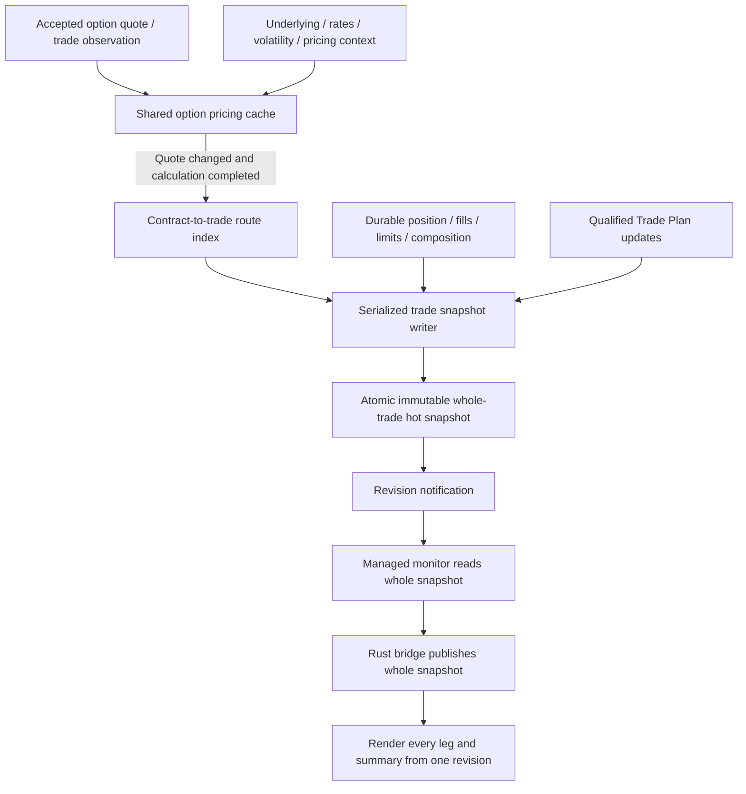

# Realtime Trade Leg Hot Cache Implementation Plan

**Status:** Phase-one runtime implemented; verification record below. Value-sign colors remain a separate phase.
**Version:** 1.0
**Date:** 2026-10-16
**Initial scope:** Established futures-option iron-condor trades, with contracts reusable for vertical spreads.

## 1. Required outcome

Whenever an option leg changes, update its entry in a server-side hot cache and publish a new immutable snapshot of the entire trade. The snapshot contains every leg, its prices and calculated metrics, spread totals, and the latest qualified Trade Plan. The UI reads one complete snapshot and renders all visible values from that revision.

Calculations complete asynchronously. A quote update publishes current prices immediately with explicit risk status; calculation completion publishes another revision with the resulting risk metrics. The UI must receive both updates even if no further market tick arrives.

Phase two will apply foreground colors according to value sign. Phase one supplies typed numeric values and availability metadata; it does not change color rules.

## 2. Current implementation and reasons to change

The current path splits observations, position marks, and plans into separate UI notifications and bridge rows:

- `DatabentoOptionChainSessionManager` publishes quotes using the immediate result of `CoalescedOptionChainPricing.EnrichQuote`.
- `EnrichQuote` records work and returns `CalculationPending`. Background pricing writes completed results to a separate risk cache, without republishing completed leg observations.
- `IndividualOptionObservationPublisher` consequently reports pending Greeks as unavailable on the quote path.
- `IronCondorViewModel` maintains separate observation, position and plan properties.
- `TradeWorkspaceSession` serializes these independently; Rust joins them and calculates some display totals.
- Rust currently has an unpopulated Forward Price column and does not render per-leg Vega/Rho.

This permits prices to change while risk cells remain unavailable and allows a single render to combine independently sourced revisions. A cache cannot manufacture missing pricing context, policy, currency or commission inputs: those dependencies must also be supplied or reported unavailable.

Existing durable positions, Portfolio ownership, trade limits, plan history and exit workflows remain authoritative. The cache is a disposable live read model, not an order or accounting authority.

## 3. Architecture and ownership



### 3.1 Two cache levels

1. **Shared option pricing cache**, owned by the market-data/pricing worker: one quote and completed calculation state per fully qualified option identity. A contract used in ten trades is priced once for the same input version.
2. **Whole-trade hot cache**, owned by the trade monitoring runtime: one immutable display snapshot per full `StrategyPositionId`, value date and monitor session generation. It combines shared contract data with that trade's quantities, opening prices, multipliers, limits and qualified plan.

Extend the existing pricing cache and monitoring infrastructure; do not introduce a competing market-data subscription service. Keep writes behind a single owner per trade and use the existing actor conventions for new actor messages. Proposed names below are design names, not existing APIs.

The market-data worker and trade runtime may be separate processes. Publish versioned option changes through the existing messaging infrastructure; do not assume direct access to another process's memory. Maintain a local immutable mirror in the UI bridge. Reading the whole cache means one complete trade snapshot, not a remote request from every paint callback.

### 3.2 Identities and routing

- Trade key: complete `StrategyPositionId`, exchange value date, monitoring generation.
- Leg key: `TradeLegId`; contract identity includes dataset, publisher, instrument, contract and source generation.
- Contract-to-trade index maps one option to every interested trade and leg, with explicit registration/removal.
- Each trade snapshot has a strictly increasing `SnapshotRevision` within its monitoring generation.
- Quotes, trades, position events and pricing completions retain separate source cursors. Their sequence numbers are not interchangeable.

## 4. Snapshot contracts

### 4.1 Whole trade

Proposed `TradeRealtimeSnapshot`:

| Field | Purpose |
|---|---|
| SchemaVersion | Explicit managed/Rust wire compatibility |
| PositionId, ValueDate, MonitoringGeneration | Full identity and session boundary |
| SnapshotRevision, PublishedAtUtc | Atomic snapshot identity and local publication time |
| PositionSequence, CompositionVersion | Durable inputs used to assemble display values |
| Legs | Immutable collection containing every expected trade leg |
| Spreads | Strategy-specific put/call spread calculations |
| Summary | Position value, P&L, underlying, aggregate Greeks and coverage |
| Plan | Latest plan plus its input versions, status and unavailable reasons |
| ConnectionStatus, SnapshotStatus | Subscription, initialization, stale and error states |
| ChangedLegIds, ChangeReason | Optional diagnostics/invalidation hints; never required to rebuild a snapshot |

### 4.2 Each leg

Proposed `TradeLegRealtimeSnapshot` groups:

- **Definition:** leg ID, qualified contract, put/call, expiry, strike, signed quantity, currency, cash multiplier and tick size.
- **Position:** opening/fill price, authoritative current position mark, mark basis, position sequence, market value, unrealized P&L and known costs.
- **Quote:** bid, ask, sizes, midpoint, latest trade price/size, provider event time, received time, source generation and source sequence.
- **Pricing:** IV, delta, gamma, theta, vega, rho, model price, underlying price and reference/version identifiers. Preserve the model's units and record them explicitly.
- **Scenario:** forward/scenario price only when supplied by a qualified scenario calculation, including scenario identity and horizon. Do not substitute model price for forward price.
- **Quality:** separate quote, mark, pricing and scenario statuses, timestamps, validity deadlines and reason codes.
- **Provenance:** quote input revision, underlying revision, pricing context version, calculation revision and pricing model version.

Keep per-contract unit Greeks distinct from signed quantity-weighted and cash-adjusted portfolio exposures. Document delta/gamma/vega/theta/rho units in the contract and tests before exposing aggregated fields. Never infer risk scaling from a generic multiplier without the existing model convention.

### 4.3 Availability and freshness

Use nullable numeric values with component statuses such as `Initializing`, `Pending`, `Available`, `Stale`, `Unavailable`, `Error`, and `Stopped`. Zero is a valid value and must not mean missing.

A new quote may retain the previous calculated risk as explicitly stale/pending, with its original provenance. It must not relabel that risk as current. Include optional last-good values separately if the UI needs them; current aggregate risk is unavailable when required constituent risk is unavailable or incompatible.

Atomic publication guarantees a consistent read of the assembled state; it does not imply simultaneous exchange timestamps across four legs. Record per-leg ages and enforce the configured freshness/skew policy before classifying aggregate risk as qualified.

## 5. Update algorithm

### 5.1 Quote or trade change

1. Validate qualified contract, source generation and that stream's cursor. Reject duplicate/out-of-order input.
2. Merge the event into shared option state. A trade event updates last trade fields; it must not erase bid/ask with zero placeholders.
3. Publish a versioned option-state change and schedule/reuse background pricing for the new input fingerprint.
4. Route the change to all interested trade writers.
5. The writer replaces only affected leg state, retaining definition and unrelated quote fields. It computes display-only values from eligible inputs and invalidates dependent risk as appropriate.
6. Build an immutable snapshot containing all expected legs, then atomically replace the cached reference.
7. Notify subscribers of the new revision after publication. A reader can immediately obtain the entire new snapshot.

Persisted position marks and P&L retain their existing domain source. The cache can expose a separately named indicative quote valuation while awaiting a durable position update, but must not present that estimate as authoritative position P&L.

### 5.2 Calculation completion

1. Pricing completion emits an explicit event containing values and the full input fingerprint. A cache write alone is insufficient.
2. Check source/monitor generation and match the completion to its quote, underlying and context revisions.
3. A superseded result cannot overwrite current risk. It may be retained only as explicitly labelled last-good evidence.
4. Accepted completion updates the leg, recomputes eligible aggregates, publishes a new whole-trade revision and notifies the UI without waiting for another quote.
5. Failed calculation also publishes a classified unavailable/error state, preventing indefinite pending cells.

### 5.3 Other invalidations

- Underlying, rate, volatility, time-to-expiry or pricing-context changes trigger relevant recalculation even if option prices are unchanged.
- Position/fill/composition changes rebuild trade-dependent fields, update routing and invalidate calculations using old quantities/composition.
- Limits, strategy policy and scenario changes invalidate dependent plan metrics and request evaluation through the existing workflow.
- Qualified plan completion is merged only when its trade/date/generation and recorded dependencies match. Older plans may remain visible as labelled history, never as current qualified risk.
- A freshness timer publishes stale transitions even when no market event arrives. This is an expiry mechanism, not database polling.

## 6. Aggregation rules

- Keep quote midpoint and position mark distinct, including their price basis and timestamps.
- Preserve existing signed-position conventions for spread value and P&L; move display arithmetic from Rust into tested managed snapshot assembly.
- Calculate spread totals only when both required leg inputs are present; calculate whole-strategy totals only when all required legs qualify.
- Account for signed quantities, currency and cash multipliers explicitly. Do not silently assume multiplier one or a default currency.
- Aggregate Greeks only with documented compatible units and coherent input versions.
- OTM probability, forward loss, forward prices, headroom and exit costs come from the qualified strategy calculation. Do not approximate absent results in the UI.
- Keep gross unrealized P&L separate from net P&L after known fees and estimated exit costs.
- Preserve Trade Plan business revision/history semantics. Display cache revisions do not create durable plan revisions or trigger orders.

## 7. Read and subscription API

Proposed API shape:

```text
AcquireMonitor(positionId, valueDate, ownerId) -> lease + initial whole snapshot
ReadSnapshot(key) -> immutable whole snapshot or explicit not-ready result
SubscribeSnapshotChanged(key, afterRevision) -> revision notifications
ReleaseMonitor(lease)
```

Register subscription and capture the initial revision through one serialized operation, or subscribe first and recheck the latest revision, so no update is lost between initial read and subscription. Reconnection must request a full snapshot; clients do not depend on receiving every delta.

Use latest-value notification coalescing for display consumers. Every accepted leg change updates the server cache, but the UI may skip intermediate revisions under load and must converge to the latest one. Preserve existing durable business-event processing independently; do not coalesce commands needed for accounting or plan evaluation.

Initial tuning: retain the existing approximately 50 ms monitor and 100 ms bridge limits as configurable starting values. Measure end-to-end latency before tightening them. Inactive tabs keep their latest snapshot without serializing/rendering every intermediate revision.

## 8. Lifecycle, recovery and concurrency

- Single writer per trade; immutable snapshots and atomic reference replacement for lock-free local reads. No mutable dictionaries exposed to readers.
- Reference-count shared contract subscriptions across monitor owners and existing business consumers. Closing one tab cannot stop another trade's feed.
- On restart, rebuild definitions/position/limits from durable sources, expose an initializing snapshot, then attach live sources. Saved snapshots are historical, not current live quotes.
- A reconnect changes the source generation. Reject late messages from previous generations; do not compare sequence numbers across generations.
- Live Feed Off stops that monitor's live display subscription and shows a clearly frozen/saved state. It does not disable independent business monitoring.
- Closing a tab releases only its lease. Bound cache retention by active business/monitor ownership and configurable idle expiry. Keep one current snapshot and optional last-good components, not unlimited tick history.
- A slow UI cannot block market-data pricing or the trade writer. Bound display notification queues and retain the newest revision.

## 9. Concrete implementation work

| Area | Work |
|---|---|
| `Domain.Trade.Shared` | Add immutable whole-trade/leg DTOs, quality/provenance contracts and notification/query contracts using repository actor conventions |
| `Application.MarketData/Pricing/CoalescedOptionChainPricing.cs` | Expose versioned quote state and explicit completed/failed pricing notifications; invalidate on dependent input changes |
| `IndividualOptionObservationPublisher.cs` and market-data contracts | Carry qualified revision/provenance; distinguish quote/trade partial updates; stop relying on immediate pending enrichment for final Greeks |
| Trade position monitoring runtime | Implement routed serialized snapshot writer and hot cache; integrate position, limits and qualified plan events |
| `IronCondorMonitoringInputReader` / plan calculator | Assemble all four qualified leg inputs from existing pricing facilities, retain validation, make missing dependencies observable; ensure cache and plan use consistent evidence |
| `IronCondorViewModel.cs` | Subscribe to one whole-trade snapshot; retain saved-history selection separately; retire independent live display assembly after migration |
| `TradeMonitorUpdates.cs` / `TradeWorkspaceSession.cs` | Publish one typed snapshot per revision, avoid independent leg/position/plan joins and retain existing editor state |
| `src/trading/trade_workspace/iron_condor.rs` | Deserialize/render snapshot fields directly; add agreed Vega/Rho and scenario bindings; remove duplicated display calculations |

Do not move authoritative domain calculations into a UI bridge. Keep strategy calculations in the domain and orchestration/cache ownership in the trade runtime. Final folders/classes should follow applicable repository conventions during implementation.

## 10. Delivery phases

1. **Contract and metric inventory:** enumerate every current cell, source, unit, status and desired binding; agree forward-price scenario meaning. Add DTO/schema compatibility coverage.
2. **Pricing publication:** implement versioned completion/invalidation events and correct quote/trade merge semantics. Verify the final quote still produces a completed-risk notification without another tick.
3. **Whole-trade cache:** implement routing, serialized writes, atomic reads, dependency validation, aggregate assembly and expiry transitions.
4. **Backend qualification:** repair/configure missing four-leg risk inputs, currency, multipliers, policy and cost dependencies. Validate cache values against existing calculators and durable positions.
5. **UI migration:** switch the managed monitor, bridge and Rust grids together to one snapshot revision. Retain historical browsing. Remove the obsolete parallel display path after parity passes.
6. **Integration and soak:** run deterministic cross-process tests, out-of-order/reconnect tests, multi-tab lifecycle tests and UI verification. Establish measured latency/allocation baselines.
7. **Value colors, separate follow-up:** define positive/negative/zero/unavailable colors by field and render from numeric snapshot values. Do not infer sign from formatted strings or use colors as the sole availability indication.

## 11. Verification and acceptance criteria

### Deterministic unit and concurrency tests

- One leg quote change creates a new revision with all four legs; unaffected leg values remain intact.
- A final quote followed by pricing completion updates IV and all Greeks without another market event.
- A delayed completion for old quote/context/generation cannot overwrite current risk.
- A trade update preserves existing bid/ask; size-only changes reach fields that display size.
- Underlying-only changes and freshness expiry publish appropriate new revisions.
- Missing, zero, stale and failed metrics remain distinguishable; invalid legs cannot produce misleading complete totals.
- Concurrent reads observe an entire old or new snapshot, never mixed mutable state.
- Different trades sharing one contract receive independent quantity-weighted values with shared contract pricing.
- Fill/composition changes invalidate old aggregate/plan dependencies; reconnect and initial-read races do not lose the latest state.

### Integration and UI tests

- Inject deterministic four-leg quotes, underlying inputs and pricing completions through the real messaging boundary. Assert cache, query, managed monitor, bridge and Rust show matching revision and values.
- Use asymmetric quantities and non-unit multipliers to catch sign/scaling errors. Compare Greeks to the existing model with documented tolerances.
- Validate plan availability both with complete inputs and each deliberately missing dependency; no invented zero risk values.
- Test disconnected/slow subscribers, reconnect, feed off/on, two trades sharing a leg and closing one of multiple tabs.
- Validate against the running UI with FlaUI: all expected values, no clipping, historical/live separation, and updates without further ticks. Test through the existing native bridge contract where UIA cannot expose custom-painted values.
- Run a sustained burst/soak and record event-to-cache, pricing-completion-to-cache and cache-to-display latency, queue depth, dropped display revisions, allocations and bounded memory.

### Release gates

- Every displayed field has an explicit source, unit and availability rule.
- The whole-trade cache changes on both quote updates and calculation completion.
- No hot-path database reads and no per-frame remote cache requests.
- Latest revisions converge after coalescing/reconnect; stale generations and late results never become current.
- Existing position persistence, plan history, execution and portfolio tests continue to pass.
- UI parity is verified before retiring the independent live observation/position/plan display path.

## 12. Observability and implementation decisions

Record trade/leg identities, source and monitor generations, input revisions, snapshot revision, calculation age, reject reason, missing dependency and subscription ownership. Keep per-tick diagnostics sampled; expose counters for rejected late results, pending duration, stale legs and subscriber lag.

The implementation uses the existing unified model's Greek units, the existing strategy's qualified Forward Price scenario, and the current worker-to-host messaging boundary. Backend cache capacity is 4,096 trades; deployment-specific throughput and latency limits require the live soak described below. Unavailable values remain explicit until their dependencies are available. No production recovery, trade resubmission or durable data mutation is part of this plan.

## 13. Implementation record

### Delivered architecture

- `TradeRealtimeHotCache` implements serialized writes, immutable leg/spread collections, atomic reads, component quality, expiry, source-generation/revision checks, position/plan checks and client-mirror acceptance.
- `TradeRealtimeCacheRegistry` is a dependency-injected backend singleton. It routes shared contract changes to interested trades, bounds resident trades at 4,096, initializes from open positions, updates composition routing, rejects session/composition rollback and releases closed trades.
- Removed/replaced caches are retired so router work captured before removal cannot publish further updates. Closing transitions publish their final position snapshot before releasing the backend entry. Client-local expiry uses a separate quality revision and never invents backend snapshot revisions.
- The backend publishes `TradeRealtimeSnapshotChangedEvent` after accepted observation, position and plan changes. `GetTradeRealtimeSnapshotQuery` reads only the resident cache, with an explicit empty result when not ready. Cold initialization uses existing persisted definitions/positions outside the hot update path.
- `CoalescedOptionChainPricing` publishes completed or failed full-risk calculations through a latest-per-contract drain outside calculation locks. Individual monitor contracts and business-owned contracts receive full-risk updates. A final quote and an underlying-only change both produce completion notifications without another option tick.
- `IndividualOptionObservationPublisher` carries source generation, independent observation revision, source/calculation times, effective validity deadline, underlying source sequence, context digest and theoretical price. Size changes are no longer hidden by unchanged-price suppression.
- Pricing-only events update caches/displays without sending another position-price command. Actual trade observations update last-trade fields without replacing the bid/ask book or its quote-based Greeks.
- `TradeRealtimeCacheExpiryService` publishes backend freshness transitions every 250 ms. The UI mirror also checks expiry locally. Both timers inspect memory; neither polls a database.
- UI monitoring subscribes before requesting its initial snapshot and performs another hot-cache read when its NATS listener reconnects. Mirror acceptance rejects an older query reply or retired monitoring generation. Existing saved-history browsing remains separate.
- The bridge captures one live snapshot reference per publication. Rust renders the snapshot's leg and spread values directly, including Vega, Rho and qualified scenario Forward Price. Legacy arithmetic remains only in the saved/history fallback.
- Backend-authoritative snapshots replace the startup compatibility mirror after the first accepted server snapshot. Existing observation/position listeners remain for WinForms compatibility and history; they no longer assemble the Rust live display once server snapshots are active.

### Metric conventions and qualification

- Unit option Greeks retain the unified calculator convention: Theta per year; Vega and Rho per unit decimal. Snapshot summary Greeks are signed contract-weighted model sensitivities. They are not cash-adjusted exposures.
- Existing strategy scenario observations retain their separate convention: Vega per volatility percentage point and Theta per day. Their contract comments identify the units.
- Forward Price is the existing qualified strategy scenario price, not theoretical current price. Scenario fields require matching position evidence, non-expired risk inputs and matching leg quote times. Stale scenario values remain available in timestamped plan history but are not presented as qualified current spread risk.
- Spread cash value/P&L uses each leg's cash multiplier and actual signed position quantity. A partially balanced pair has no per-unit Net Spread; its cash valuation may still be available.
- A cache does not supply missing currency, policy, quote, commission or reference inputs. Those conditions continue to produce explicit unavailable/stale results rather than fabricated risk values.

### Verification approach and evidence

The implementation adds pricing-publication, atomic cache, shared-contract routing, scenario freshness, real NATS transport and native rendering tests. A 5,000-update concurrent read/write test checks whole-snapshot publication. A 200-revision real NATS burst checks convergence to the final complete trade snapshot on an isolated actor subject.

The isolated native example `TomasAI.IFM.UI.Rust/examples/trade_realtime_cache.rs` consumes publications generated by managed cache tests. It uses the production Rust trade view with no broker or market-data connection. FlaUI captured the actual rendered probe; visual inspection confirmed four-leg Delta/Gamma/Theta/Vega/Rho/IV values and layout. The probe's custom client cells were not exposed through its UIA tree, so cell-value assertions are covered by native accessibility/rendering tests rather than claiming a successful FlaUI cell-tree assertion.

Verification artifacts are written under `.artifacts/`:

- `hot-cache-server-build.log`: API/server build.
- `hot-cache-pricing-tests.log`: pricing publication and worker-generation regressions.
- `hot-cache-domain-tests.log`: backend pipeline, routing and existing monitoring regressions.
- `hot-cache-ui-tests.log`: snapshot/mirror, bridge/history, real NATS and display-time tests.
- `hot-cache-messaging-tests.log`: messaging regression suite.
- `hot-cache-native-cache-tests.log` and `hot-cache-native-regression.log`: Rust bindings and trade/grid regressions.
- `hot-cache-flaui.png`: actual isolated Rust-window capture.

The core build completed with zero warnings/errors. All 202 selected tests passed: 16 market-data tests, 21 domain tests, 18 realtime UI/transport tests, all 121 messaging unit tests, one native cache-binding test and 25 existing native trade/grid tests. The suite logs above are the execution record; tests against actual broker execution or long-running live market subscriptions were not performed.

### Reproduction

```powershell
dotnet build TomasAI.IFM.Application.Api.Server.Core --no-restore
dotnet test TomasAI.IFM.Application.MarketData.UnitTests --filter FullyQualifiedName~CoalescedOptionChainPricingTests
dotnet test TomasAI.IFM.Domain.Trade.UnitTests --filter FullyQualifiedName~TradeRealtimePipelineTests

# This opt-in enables a test against the existing configured NATS endpoint;
# it does not configure an application connection string or change broker state.
$env:IFM_TRADE_CACHE_NATS_TEST = '1'
dotnet test TomasAI.IFM.UI.Rust.SystemTests --filter FullyQualifiedName~TradeRealtime
cargo test --manifest-path TomasAI.IFM.UI.Rust/Cargo.toml --lib realtime_cache_tests
cargo test --manifest-path TomasAI.IFM.UI.Rust/Cargo.toml --test trade_blotter --test grid_column_borders

# Optional isolated visual probe, using the fixture generated by managed tests.
$env:IFM_TRADE_CACHE_FIXTURE = "$PWD/.artifacts/hot-cache-ui-fixture.json"
dotnet test TomasAI.IFM.UI.Rust.SystemTests --filter FullyQualifiedName~Generate_native_visual_fixture
cargo run --manifest-path TomasAI.IFM.UI.Rust/Cargo.toml --example trade_realtime_cache -- $env:IFM_TRADE_CACHE_FIXTURE
```

### Remaining operational validation

The user's existing API/worker/UI processes were not restarted or replaced during implementation. Applying the change requires rebuilding/restarting those processes together because the new snapshot query/notification contracts and pricing metadata cross process boundaries. A long-running test against that restarted application's actual market subscriptions is still a release gate; isolated tests and the visual probe do not establish live-market latency or data availability for trade 1501. Value-sign coloring remains the explicitly separate second part.
