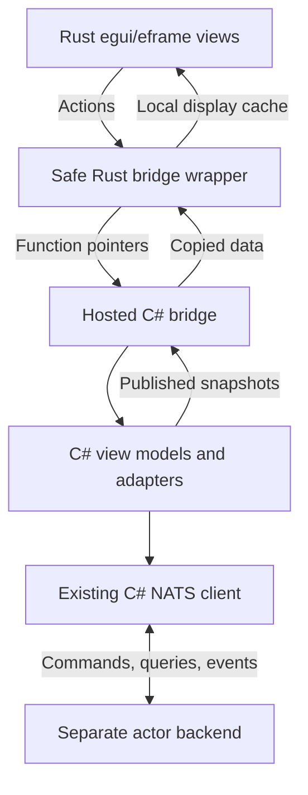

# WinForms to Rust egui/eframe Porting Guide

**Version:** 0.1  
**Date:** 2026-10-12 (America/Toronto)  
**Status:** Architecture and requirements guideline for a repository-specific Codex porting specification  
**Target:** Windows desktop trading UI; Rust executable hosting modern .NET in-process

## 1. Purpose and interpretation

Replace the application's WinForms views with Rust egui/eframe views while retaining the existing C# MVVM application behavior, models, view models, Simple Injector composition, and C# NATS communication with the separate actor backend.

This guide defines the architectural constraints and information that Codex must carry into a detailed porting specification. It is not a claim that the existing repository has been inspected. Type names, function names, project boundaries, numeric targets, and examples below are proposed contracts, not descriptions of existing code.

**MUST** identifies a required property of the proposed port. **SHOULD** identifies the preferred implementation unless repository evidence supports another choice. **MAY** identifies an optional extension. Requirements that depend on backend features must be recorded as prerequisites or gaps when those features do not exist; Codex must not silently assume they are implemented.

The objective is behavioral preservation with a new presentation implementation. Visual layout may improve, but command semantics, validation, permissions, and financial interpretation must remain traceable to the current application.

## 2. Confirmed architecture and decisions

| Topic | Agreed baseline |
| --- | --- |
| UI entry executable | Native Rust application using egui/eframe |
| C# execution | Normal modern .NET runtime hosted inside the Rust process |
| NativeAOT | Not required for this migration; optional future investigation |
| View-model architecture | Existing C# MVVM compatible with WPF, subject to dependency inspection |
| DI container | Preserve Simple Injector and existing registration behavior |
| Backend | Existing actor-based trading engine in a separate process |
| Messaging | Preserve existing C# NATS commands, queries, events, and subscriptions |
| Display GPU | RTX 3060 Ti dedicated to display duties |
| LLM GPU | RTX 4090 used for Gemma; outside the UI migration |
| Interoperation | Versioned C ABI using unmanaged-callable managed entry points |
| Display data | Coherent C# publications copied into Rust-owned snapshots |
| Fixed labels | Versioned fixed-string catalog cached by Rust |
| Development | VS Code Rust/native and C# debugging with matching symbols |

Hosting .NET is a migration choice to preserve managed library behavior. It does not inherently improve or reduce egui GPU rendering performance. NativeAOT is not a rendering acceleration requirement. The existing separate backend process already provides isolation from UI process failure.

## 3. System boundaries and authority

### 3.1 Ownership

| Responsibility | Owner |
| --- | --- |
| Trading state and execution decisions | Existing backend actors/services |
| Risk checks and final command authorization | Existing backend authority |
| UI application behavior and validation | Existing C# view models/application services |
| NATS transport and message mapping | Existing C# layer |
| Presentation projection and bridge lifecycle | C# bridge/adapters |
| Display cache, layout, focus, scrolling and local drafts | Rust |
| GPU rendering and native windows | eframe and selected rendering backend |

C# view models are authoritative for client application behavior and projected state; they are not a replacement for backend authority. Rust MUST NOT independently implement trading strategy, risk, authorization, broker execution, or financial rules already owned by C# or the backend.

UI termination MUST NOT issue an implicit backend shutdown, position close, or order cancellation. Any such operation remains an explicit existing application action.

## 4. Repository assessment required before specification

Codex MUST inspect the actual solution and record:

1. Current target frameworks and whether any assemblies require .NET Framework.
2. WinForms entry point, initialization sequence, DI registrations, scopes and disposal ownership.
3. Every view and associated view model, including shared view models and navigation behavior.
4. Model properties, notifications, commands, validation and converters used by each view.
5. NATS connection ownership, subscriptions, correlation, reconnect and cancellation behavior.
6. Dependencies on WinForms controls, dispatching, resources, binding components or message loops.
7. Dependencies on WPF Dispatcher, Application, CollectionView, CommandManager, DependencyObject, converters, dialogs or other presentation services.
8. Existing logs, metrics, traces, tests, fake broker and paper environment.
9. Windows-specific native libraries, COM/STA requirements and symbol/deployment requirements.
10. Current keyboard workflows, grids, custom drawing, charts, docking and multi-monitor layouts.

WPF-compatible MVVM does not establish that a view model is presentation-framework independent. Interfaces such as INotifyPropertyChanged and ICommand can be retained, while dependencies on WPF application or dispatcher infrastructure may need adapters.

If the code targets .NET Framework, the specification MUST identify a modern .NET migration prerequisite. hostfxr does not host the legacy .NET Framework CLR as if it were modern .NET.

Produce a dependency report with columns: component, current dependency, reuse unchanged, adapter required, code change required, reason, validation evidence. Do not rewrite a reusable component merely to simplify the Rust implementation.

## 5. Proposed project separation

| Logical component | Purpose |
| --- | --- |
| Existing models/view models | Preserve model and application behavior |
| Shared C# composition root | DI registrations and application lifecycle independent of a view toolkit |
| Managed bridge | Bootstrap, ABI methods, sessions and result handling |
| C# view adapters | Projection, action mapping and notification aggregation |
| Rust runtime host module | hostfxr discovery and managed entry-point loading |
| Rust FFI module | Raw ABI declarations and bounded unsafe operations |
| Rust bridge client | Safe methods, decoding and bridge worker |
| Rust presentation modules | Views, local state, grids, charts and navigation |
| Contract definitions | Versioned ABI, IDs, payload schemas and string catalog |

These are logical responsibilities. Codex should map them to existing project conventions before prescribing exact folders or assembly names.

## 6. .NET hosting and bootstrap

### 6.1 Runtime integration

Rust MUST start a normal .NET runtime using the supported native hosting interfaces. Use nethost/hostfxr discovery and initialization, then obtain managed entry points through the runtime. A managed DLL is not loaded as an ordinary native library whose C# methods can be found with GetProcAddress.

The managed bridge SHOULD expose one bootstrap entry point that returns a versioned table of unmanaged-callable function pointers. This reduces per-method hosting setup and allows capability negotiation. Alternatively, resolve a small set of entry methods individually. Pin exact signatures and calling conventions in the detailed specification.

Methods marked UnmanagedCallersOnly are unmanaged-callable when obtained through the runtime; this does not make an ordinary managed DLL a NativeAOT DLL with named native exports. Use the applicable hosting API convention for these methods, including the unmanaged-callers-only method selection mechanism where used.

The deployment baseline is framework-dependent with a compatible modern .NET runtime available. Configure a supported runtime version and explicit roll-forward policy. Do not assume a self-contained managed DLL can replace the documented hosting deployment model. Microsoft describes this distinction in its native hosting documentation [1].

### 6.2 Initialization sequence

1. Establish native logging and resolve application paths from the installed application location.
2. Discover hostfxr, initialize its context using the managed runtime configuration, and obtain the assembly-loading delegate.
3. Load the managed bridge and obtain its bootstrap function pointer.
4. Negotiate ABI version, structure sizes, capabilities and payload limits.
5. Create a managed application session; establish the view-model dispatcher.
6. Run the shared C# composition root on its required execution context.
7. Register and verify Simple Injector services; resolve and retain root objects.
8. Initialize existing NATS services and subscriptions through their existing lifecycle.
9. Load fixed strings and initial display state.
10. Report readiness or structured initialization failure to the Rust shell.

The UI MAY display startup progress while application initialization runs on a worker. Rendering MUST NOT block on DI verification, NATS connection establishment or initial backend queries. Readiness states should include starting, ready, degraded/disconnected, failed and shutting down.

Closing a hostfxr initialization context is not the same as unloading the .NET runtime. Design one runtime lifetime per UI process, not repeated load/unload cycles. Application sessions may be disposed and recreated only where their dependencies support that lifecycle.

## 7. Preserve DI and C# initialization

Move reusable initialization out of Program/Main and form constructors into a shared C# composition root. Separate service/view-model registrations from form registrations. Preserve singleton, transient and scoped lifetimes, decorators, initialization hooks and verification behavior.

Rust MUST NOT reproduce Simple Injector registrations or construct C# dependencies. It requests application initialization and receives an opaque session handle. C# retains the container and resolved roots.

Resolve each view model according to its current intended lifetime. Do not resolve new instances per render pass. Map view creation/closure to explicit adapter and scope lifetimes, and document whether a closed view retains its view model.

If initialization previously relied on a WinForms SynchronizationContext, initialize a replacement dispatcher before constructing affected objects. Identify dialogs, navigation, clipboard and file selection as presentation services, and adapt them explicitly rather than constructing hidden forms.

Construction and readiness are separate concepts. Successful container verification does not imply that NATS is connected or backend state is current.

## 8. MVVM adaptation rules

### 8.1 Notifications and commands

| Existing MVVM feature | Porting rule |
| --- | --- |
| INotifyPropertyChanged | Adapter marks the appropriate projection dirty; Rust receives published state |
| ObservableCollection / collection notifications | Adapter handles changes on the owner dispatcher and publishes coherent rows |
| ICommand.Execute | Typed action maps to the existing command with its existing parameter semantics |
| ICommand.CanExecute | Publish availability; recheck on the C# owner context at execution |
| CanExecuteChanged | Mark action availability dirty |
| INotifyDataErrorInfo / IDataErrorInfo | Publish structured field and form errors |
| Two-way bindings | Rust draft/edit action maps to property update or explicit commit, per existing semantics |
| Converters | Classify as presentation formatting or application logic; preserve application semantics |
| WPF collection views | Specify sorting/filtering/grouping behavior independently of WPF UI infrastructure |
| WinForms timers | Replace with explicit application scheduling or repaint policy according to purpose |
| Form lifecycle | Explicit open, activate, deactivate and close operations |

Adapter code MUST NOT mutate the existing model merely to make rendering convenient. Existing property setters may trigger validation or queries; inventory those effects before converting bindings.

### 8.2 Editing and conflict handling

Rust owns unfinished edit buffers. A live snapshot must not overwrite text the user is actively editing. Define per-field commit triggers: keystroke, debounced change, focus loss, Enter, or explicit Apply. Preserve existing intended behavior rather than imposing one global rule.

An edit session should record entity ID, baseline revision, draft values, dirty fields, validation results and pending submission state. If authoritative values change, define merge, refresh or conflict behavior. Backend-sensitive edits must be revalidated before submission.

Business validation remains in C#. Rust MAY perform immediate syntax checks for usability, but these cannot become the only validation. Parse prices and quantities using documented culture and precision rules.

## 9. Threading and dispatching

| Context | Allowed responsibilities |
| --- | --- |
| Rust UI thread | egui input/layout/rendering; local cache adoption and local edit state |
| Rust bridge worker | Bounded snapshot copies, action submission and result retrieval |
| C# view-model dispatcher | View-model mutation, command invocation and coherent projection publication |
| C# NATS callbacks | Decode/enqueue messages using existing client rules; marshal view-model work |
| Backend process | Existing actor execution and trading processing |

Establish one explicit owner for each mutable view model. A dedicated serialized C# dispatcher is the preferred baseline; preserve any genuinely required STA/message-pump behavior through an explicit implementation if repository inspection identifies it.

Do not assume a generic queue replaces all WPF Dispatcher or COM behavior. Async continuations, task scheduling and any dependency on SynchronizationContext must be inspected. Avoid sync-over-async and waiting on a task whose continuation requires the blocked dispatcher.

The rendering path MUST NOT invoke broker/database/network work, wait for C# locks, or iterate managed collections. It reads a Rust-owned coherent snapshot. This removes direct dependence on managed execution from frame construction, although process-wide CPU and memory contention can still affect responsiveness.

View-model notifications mark projections dirty. Publish at a bounded cadence or after logical batches, rather than rebuilding a full snapshot for every property notification. Guarantee that an update arriving during publication remains scheduled for a subsequent publication.

## 10. Snapshot publication and consistency

### 10.1 Baseline contract

A snapshot is a read-only display projection built on the view-model owner context and published immutably. Bridge copying reads that publication without accessing live mutable view models.

Each snapshot SHOULD contain:

- Payload schema version and declared total byte length.
- Session epoch and view identity.
- Monotonic generation within that epoch.
- Publication timestamp and relevant source-data timestamp.
- Connection, synchronization and staleness indicators.
- Entity rows with stable IDs and revisions where available.
- Display values, allowed-action flags and structured validation.
- Offsets and lengths for dynamic UTF-8 text, if using packed binary data.

Session epoch plus generation prevents a restarted session's smaller generation from being mistaken for obsolete data. Define units and clock meaning for every timestamp. Use monotonic clocks for elapsed durations; use UTC timestamps for human/audit correlation.

### 10.2 Consistency scope

Specify the atomic consistency unit for each view. A position row's quantity, P&L and revision should be from one publication. Option chains and portfolio summaries may have independent generations, but their different ages must be visible where meaningful.

A frame uses one adopted snapshot per consistency unit throughout layout passes. Do not replace that snapshot halfway through drawing related fields.

For initial implementation, use full snapshots for small views and batched row arrays for large grids. Deltas are optional. If added, define base generation, ordering, gap detection, deletion and full resynchronization.

Large snapshots should be cached and copied only when changed. Virtualizing drawing alone does not eliminate projection and transfer costs. Profile both; add active-view subscriptions, paging or bounded slices if required.

## 11. FFI contract and memory ownership

### 11.1 Suggested logical API

| Operation | Meaning |
| --- | --- |
| Bootstrap/GetApi | Return ABI information and callable methods |
| CreateSession | Create and retain the managed application session |
| GetSessionStatus | Return initialization/connection status |
| OpenView / CloseView | Manage adapter scope and subscriptions |
| GetSnapshotInfo | Describe the current publication and required capacity |
| CopySnapshot | Copy a complete publication into caller-owned memory |
| SubmitAction | Validate envelope and accept/reject local enqueueing |
| CopyActionResults / AcknowledgeResults | Retrieve retained outcomes without accidental loss |
| CopyStringCatalog | Copy the fixed-string catalog |
| BeginShutdown / GetShutdownStatus | Stop application work and report progress |
| DestroySession | Release resources after work has stopped |

Codex must finalize whether metadata and copying are one operation or separate operations, and how generation changes between calls are handled.

### 11.2 Representation

- Use a documented C calling convention and fixed-width scalar types.
- Use C# explicit/sequential native layouts and Rust repr(C) for ABI structs.
- Specify sizes, alignment, field offsets and byte order; verify them mechanically.
- Represent booleans and enums with agreed integer widths and valid values.
- Represent IDs as explicitly specified bytes/integers. Define GUID byte order rather than assuming C# and Rust conventions match.
- Use opaque registry handles with stale-handle detection; never expose managed object addresses.
- Pass text as UTF-8 bytes plus length, not C# string or Rust String.
- Define optional values through explicit presence flags or another documented encoding.
- Do not expose .NET decimal memory layout. Choose scaled integers with explicit units/range for exact amounts, or a documented serialized decimal representation.
- Floating point is suitable for approximate analytics such as Greeks; it must not silently change financial rounding rules.

### 11.3 Ownership and bounded work

Prefer caller-owned buffers. Rust allocates; C# writes during the call and retains no pointer. Input action payloads must be copied into C# ownership before an asynchronous operation returns to Rust.

On insufficient capacity, return required size and no partial successful result. Bound retries when a publication grows between size lookup and copying. Alternatives include a token/lease for one immutable generation; leases require explicit release and resource limits.

Validate lengths, counts, offsets, alignment, multiplication overflow and configured maximum sizes before constructing Rust slices or decoding. Agree on initialized byte ranges; never read uninitialized buffer capacity. Managed code must reject invalid input ranges and handles before normal processing, but raw FFI pointers remain a trusted in-process contract and cannot be made universally safe by validation alone.

Every bridge call has a documented time/work bound. Rendering cannot wait for the bridge worker. Queues must have capacities and explicit overflow behavior.

### 11.4 Errors

Contain ordinary managed exceptions within entry methods and return error codes plus owned/copyable diagnostics. Do not use a shared last-error string that concurrent calls can overwrite. Rust callbacks, if introduced, must not unwind across the ABI.

Catchable exceptions can become recoverable results; fatal memory corruption or process termination cannot be promised recoverable. Isolate unsafe Rust in one module and expose safe typed wrappers to the presentation code.

## 12. User actions and trading correctness

### 12.1 Action envelope

Specify request ID, UI session identity, target entity, action ID, payload version, parameters and expected entity revision where supported. Preserve existing actor correlation and trace conventions through the C# messaging path.

An ABI return meaning queued locally MUST NOT be displayed as a successful backend operation. Model local rejection, pending processing, backend rejection, completion, failure and unknown outcome separately. Use the existing backend's actual completion semantics; do not infer broker completion from a generic workflow event.

### 12.2 Multipass rendering and deduplication

egui can perform extra layout passes. Rendering functions must not submit trading side effects unconditionally. Collect explicit interaction intents and dispatch through a controlled action mechanism. Stable request IDs and backend-supported deduplication are required wherever retries could duplicate an operation.

Do not regenerate a request ID every frame for a pending action. Repaint, repeated clicks and reconnection must not silently create duplicate trading requests. Disable or visibly mark pending actions where appropriate, while retaining backend validation.

### 12.3 Unknown outcomes

A client timeout or disconnected NATS connection does not prove that the backend rejected a command. Mark the outcome unknown and reconcile through existing queries/events before resubmission. Do not introduce automatic trading command retries as part of this UI port.

Cancellation must distinguish canceling a local wait from requesting cancellation of an actor workflow or a broker order. UI closure does not imply cancellation of backend work.

## 13. NATS integration and reconnect

Retain the C# NATS client, serialization, subject conventions, credentials and actor contracts. Rust does not need another NATS client for this migration.

NATS callbacks must respect the existing client threading contract and marshal mutable view-model work to its owner. Preserve event ordering assumptions and document how multiple subjects/subscriptions interact.

Do not assume replay or durable command handling. Inspect whether the application uses NATS Core, JetStream, or both. Following disconnect, identify which projected state must be re-queried because missed events cannot be replayed.

Represent connection loss, reconnecting, connected-but-resynchronizing and current state distinctly. Disable backend-sensitive actions when their required state is unavailable according to existing policy. Never display an old snapshot as current merely because the UI process is healthy.

High-frequency replaceable values may be coalesced. Critical command results and status transitions require a retained path, acknowledgement or authoritative reconciliation. A queue overflow must produce a diagnostic and defined recovery, not silent success or silent loss.

## 14. Fixed-string catalog and formatting

Create one canonical catalog for headings, column names, labels, buttons, tooltips, status labels and fixed validation templates. Generate consistent C# and Rust identifiers from that catalog.

Catalog entries use stable IDs/keys and UTF-8 text; catalog metadata includes version and locale. IDs must not be reassigned to unrelated meaning. Rust loads and validates the catalog once per session/locale change and resolves strings locally during rendering.

Dynamic broker messages, instrument descriptions, explanations and user values belong in snapshots/results. Define placeholder formatting for parameterized messages; do not assume Rust understands .NET format strings.

Missing IDs show an explicit diagnostic placeholder. Widget identity uses view/entity/field IDs, never translated labels. Define decimal separators, time zone display, units, precision, sign conventions and monetary rounding for each field. Presentation formatting may move to Rust only when its semantics are specified and verified.

## 15. egui/eframe view implementation

### 15.1 View contract

For every WinForms view, create a record containing:

| Field | Required information |
| --- | --- |
| Identity | Current form/control and associated view model |
| Lifecycle | Open/activate/close behavior and scope ownership |
| State | Snapshot fields, units, IDs, consistency and freshness |
| Actions | Existing commands, parameters, validation and outcomes |
| Editing | Commit triggers, drafts, conflicts and cancellation |
| Presentation | Layout, grid columns, formatting, strings and charts |
| Interaction | Keyboard shortcuts, focus order, selection, context menus |
| Failure states | Loading, empty, disconnected, stale, errors and unknown actions |
| Performance | Expected rows/update rates, publication and repaint policy |
| Verification | Behavioral acceptance evidence and reference screenshots |

### 15.2 WinForms mapping

| WinForms implementation | Replacement |
| --- | --- |
| Designer controls/layout | Rust layout functions and persisted local layout |
| Bound fields | Snapshot values and local draft buffers |
| BindingSource | Adapter publications and Rust display cache |
| Button/menu handlers | Typed action intents |
| Invoke / BeginInvoke | Explicit C# dispatcher |
| DataGridView | Virtualized egui table with stable entity selection |
| Custom painting | egui painting/chart integration with bounded geometry |
| Form resources | Fixed-string catalog and packaged assets |
| Modal dialogs | Explicit Rust dialog state plus C# action/validation |
| FormClosing | Coordinated UI application shutdown |

Immediate mode still requires persistent local state. Preserve focus, scroll, widths, expansion, selections and drafts outside temporary rendering locals. Use stable IDs based on entity identity, not row index.

Multiple native windows and panel docking are separate design decisions. Select compatible maintained dependencies only after validating actual workflow requirements. Do not assume complete WinForms grid, accessibility or input-method parity without a proof of concept.

## 16. Rendering and performance policy

Use eframe with an explicitly selected Wgpu renderer as the baseline. Enable compatible features and pin the tested Rust dependency versions. The 3060 Ti is the intended rendering adapter; record its actual selection and provide a documented configuration/failure policy. Do not silently rely on a generic high-performance preference selecting it when the 4090 is also present.

GPU acceleration handles painting. Layout, widget construction, formatting and transfer still consume CPU. No guarantee of smoother rendering follows solely from selecting Rust or Wgpu.

Initial measurement targets, subject to workload validation:

| Operation | Starting policy |
| --- | --- |
| Visible market-data publication | Approximately 20–30 Hz with latest-value coalescing |
| Interactive redraw | Up to approximately 60 Hz; demand-driven when idle |
| Important result/connection change | Prompt notification and repaint |
| Hidden view | Reduce subscriptions/publication as permitted by lifecycle |
| Large grid | Render visible rows; cache projections and formatting |
| Chart | Bound history and displayed geometry; reduce points to useful resolution |

These are policies, not strict rate guarantees. Use request_repaint from the Rust worker when new data is available and scheduled repaint for time-dependent displays. Do not implement an unbounded busy repaint loop.

Virtualize grids, avoid per-cell FFI calls, adopt snapshots once per consistency unit, and avoid sorting thousands of rows inside every layout pass. Stable entity identity must survive sorting, filtering and removal.

Measure frame time, input latency, snapshot age, publication cost, copied bytes, FFI duration, queue depth, result latency, allocations and managed GC behavior. Run representative tests with Gemma inference active on the 4090, because CPU/RAM/system contention remains shared.

## 17. Lifecycle, shutdown and recovery

Define a lifecycle such as Created → Initializing → Ready/Degraded → Stopping → Stopped, with explicit failure handling.

On close:

1. Stop accepting new UI actions.
2. Record outstanding request IDs and outcomes according to existing persistence policy.
3. Stop or cancel local bridge polling and view subscriptions.
4. Begin C# shutdown while allowing necessary dispatcher work to complete.
5. Stop NATS services using their existing ownership/disposal rules.
6. Dispose adapters, scopes, view models and container in an explicit order.
7. Join workers and invalidate handles only after in-flight calls finish.
8. Flush diagnostics within a bounded deadline, then exit the UI process.

Do not block the owner dispatcher while waiting for callbacks that need that dispatcher. If shutdown times out, log the outstanding work and follow a documented process-exit policy; do not pretend the runtime can be safely unloaded and restarted.

The backend continues independently. On UI restart, query authoritative state and reconcile outstanding requests where supported. Optional persistence of local layouts is separate from authoritative trading state.

## 18. Debugging and observability

Provide separate VS Code configurations for Rust native debugging and C# attachment to the same UI PID after .NET initialization. The backend retains its own managed debugging configuration.

Build Rust with symbols and C# with matching Debug DLL/PDB artifacts. Log host paths, ABI version, runtime version, view/session IDs and selected GPU without logging secrets.

Add an opt-in managed startup gate after runtime initialization and before DI/view-model initialization, using Debugger.IsAttached with cancellation or a timeout. Disable it in normal operation. This allows breakpoints in registrations and constructors.

Do not promise seamless FFI step-through or universally supported simultaneous native/managed attachment in VS Code. Validate the chosen debugger combination. Rust-only and managed-only sessions must work independently. Keep a small C# harness for adapter testing where useful; it must reuse the same composition root rather than create a divergent application.

Pausing the UI debugger does not pause backend actors. Use a fake broker or paper environment for workflow debugging and expect timeouts during pauses.

Preserve existing OpenTelemetry correlation through C# and NATS. Rust diagnostics should include the same request identifiers where applicable. Measure state freshness independently from connectivity.

## 19. Build and deployment requirements

- Pin supported .NET, Rust toolchain and compatible egui/eframe ecosystem versions.
- Align process architecture, normally Windows x64 MSVC, across Rust, .NET and native dependencies.
- Package the managed DLLs, dependencies, runtime configuration, dependency manifest where generated/required, assets and fixed-string catalog.
- Configure the managed class-library build to generate the runtime configuration needed by hosting.
- Resolve files relative to an explicit application root, not the shell's working directory.
- Diagnose missing runtime, missing assembly/native dependency, version mismatch, invalid catalog and GPU initialization failures distinctly.
- Keep credentials in the existing authorized configuration path; do not move secrets into generated Rust source or static catalogs.
- Build both language outputs from one reproducible workflow and prevent mixing incompatible bridge/client versions.
- Retain symbols for support; decide whether they ship or are archived separately.

No separate NativeAOT publication is required. Any future AOT work is an independent compatibility/performance project.

## 20. Migration phases and exit criteria

| Phase | Work | Exit evidence |
| --- | --- | --- |
| 0 | Repository inventory and view mapping | Dependency/lifecycle gaps identified; scope agreed |
| 1 | Rust host and managed bootstrap | Correct runtime loads; DI initializes; C# breakpoint reached |
| 2 | One read-only position view | Values/units match WinForms; coherent updates and stale state shown |
| 3 | Option-chain or blotter grid | Selection remains stable; realistic volume meets measured budget |
| 4 | Editable configuration view | Draft/validation/commit behavior matches intended MVVM semantics |
| 5 | Order/cancel/close actions | Correct fake-backend messages, correlation and outcomes; no duplicates |
| 6 | Reconnect and shutdown | UI survives disconnect; resynchronizes; backend continues on UI exit |
| 7 | Remaining views and packaging | Workflow parity, deployment and soak checks pass |

Keep WinForms usable during staged migration where practical, but do not run two clients that unintentionally compete to issue the same trading actions. Use controlled comparison sessions and read-only parity checks.

Verification must cover contract layout and decoding, handle lifetime, malformed payloads, buffer growth, notification races, edit conflicts, stale revisions, duplicate intents, timeout/unknown outcomes, reconnect, disposal and realistic grid load. Use targeted tests for these substantive failure modes rather than tests that merely repeat getters.

## 21. Required output from Codex's detailed specification

Codex should produce a repository-grounded specification containing:

1. Actual project/file changes and dependency assessment.
2. Runtime/bootstrap sequence with exact API signatures and deployment settings.
3. Composition root changes, DI scopes and ownership/disposal map.
4. Dispatcher contract, async continuation rules and NATS integration mapping.
5. ABI definition, function-table versioning, layouts, errors and buffer limits.
6. Snapshot schemas per view, consistency scope, timestamps and generation rules.
7. Action schemas, current command mappings, result semantics and reconciliation.
8. Fixed-string catalog, formatting rules and generated identifiers.
9. Per-view behavior/layout/interaction contracts and migration order.
10. Performance budgets derived from actual data volumes.
11. VS Code tasks/debug configurations, startup gate and diagnostic design.
12. Acceptance checks, unresolved prerequisites and implementation milestones.

The specification must distinguish unchanged reuse, adapter work, necessary framework-dependency refactoring and optional improvements. Every proposed backend change must be identified separately from the UI port.

### Suggested Codex instruction

> Inspect the existing repository and write a detailed porting specification using this guide. Replace WinForms presentation with Rust egui/eframe views. Host normal modern .NET in the Rust executable and preserve the C# MVVM behavior, Simple Injector composition, existing NATS client and separate actor backend. Define a versioned unmanaged-callable bridge for coherent display snapshots, typed user actions and fixed strings. Keep mutable view-model work on an explicit owner context and render only Rust-owned state. Map every view and action to existing code, identify framework-specific dependencies and missing backend guarantees, and provide staged acceptance criteria. Do not assume NativeAOT, rewrite business logic in Rust, introduce automatic trading retries, or invent repository types and capabilities. Record all necessary compatibility changes and open decisions explicitly.

## 22. Open decisions to resolve from repository evidence

| Decision | Guideline |
| --- | --- |
| Current .NET framework/version | Verify before choosing host configuration |
| WPF/WinForms dispatcher coupling | Inventory before defining replacement |
| ABI payload encoding | Prefer explicit fixed structs/arrays for hot grids; version any serialization alternative |
| Snapshot sizing strategy | Choose bounded retry or generation token/lease |
| Action deduplication/reconciliation | Inspect backend support; record missing prerequisites |
| NATS recovery | Inspect Core/JetStream usage and authoritative refresh paths |
| View-model lifetimes | Preserve existing semantics and scopes |
| GPU selection | Verify Wgpu adapter-selection options for pinned versions |
| Docking, charts and multi-window support | Select after functional proof of concept |
| Accessibility and input methods | Test actual required workflows |
| Performance targets | Establish with representative sizes and update rates |
| Debugger combination | Prove Rust and managed attachment; assess simultaneous sessions |

## 23. Primary documentation

The architecture and requirements above are recommendations derived from the discussion. The following official documentation supports the underlying runtime and framework mechanisms; verify version-specific APIs when implementing.

1. [Microsoft: Write a custom .NET runtime host](https://learn.microsoft.com/en-us/dotnet/core/tutorials/netcore-hosting) — native hosting and deployment model.
2. [Microsoft: UnmanagedCallersOnlyAttribute](https://learn.microsoft.com/en-us/dotnet/api/system.runtime.interopservices.unmanagedcallersonlyattribute) — unmanaged-callable method constraints.
3. [Simple Injector: Using the container](https://docs.simpleinjector.org/en/latest/using.html) — registration, resolution and verification.
4. [Simple Injector: Extensibility points](https://docs.simpleinjector.org/en/latest/extensibility.html) — constructor and integration behavior.
5. [eframe: App](https://docs.rs/eframe/latest/eframe/trait.App.html) — application callbacks; APIs vary by release, so do not assume older examples using update match the selected release.
6. [eframe: Renderer](https://docs.rs/eframe/latest/eframe/enum.Renderer.html) — rendering backend choices.
7. [egui: Context](https://docs.rs/egui/latest/egui/struct.Context.html) — repaint requests and layout passes.
8. [egui_extras: TableBody](https://docs.rs/egui_extras/latest/egui_extras/struct.TableBody.html) — table rendering and visible-row support.
9. [VS Code: Rust](https://code.visualstudio.com/docs/languages/rust) — editor/debugger integration.
10. [VS Code: C# debugging](https://code.visualstudio.com/docs/csharp/debugging) — managed debugging and attachment.
11. [VS Code: C/C++ debug configuration](https://code.visualstudio.com/docs/cpp/launch-json-reference) — native Windows debugger configuration.
12. [Microsoft: NativeAOT libraries](https://learn.microsoft.com/en-us/dotnet/core/deploying/native-aot/libraries) — comparison only; not the selected deployment.

**Implementation note:** Pin versions rather than building against moving latest documentation. Recheck hosting signatures, eframe callbacks, Wgpu adapter configuration, NATS client behavior and debugger support against the selected versions before generating code.
